# 海底地形地貌匹配导航算法仿真与Jetson硬件在环验证报告

项目名称：基于迁移学习的海底地形重建与高精度定位技术研究  
数据截止：2026年11月11日  
报告范围：AGX Orin海底与湖底历史全程数据、Orin NX Super千岛湖完整硬件在环数据  
成果性质：技术分析、算法验证、完整数据分析与阶段研究结论  
数据管理：本地保存，原始MAT、逐ping声学输入、实测复数信号和模型权重不随报告对外发布

本报告研究在多波束测深侧扫声呐、IMU、DVL和深度计的传感器条件下，如何利用局部声呐特征、先验地形地貌与重复观测控制水下长航程定位漂移。分析以实际Jetson执行导航得到的在线输出为对象，不用上位机参考结果替代板端输出，不用事后轨迹拟合降低误差。

采用三组已有记录：Monterey海底73.070 km和Chelan湖底47.116 km使用Jetson AGX Orin历史全程归档；千岛湖16.489 km使用本次Jetson Orin NX Super的完整结果。千岛湖先在实际NX上完成全部16路原生声呐数据的模型去噪，再以其数值结果构建仿真强度场，完成板端纯侧扫特征导航。未完成的NX海试和未启动的NX Chelan湖试不替代上述历史全程结果。

## 一、技术摘要与主要结论

### 1. 定位效果与成立条件

三组板端在线Global三维位置RMSE分别为6.830 m、6.829 m和4.871 m，对应P95为13.267 m、13.527 m和10.462 m。结果表明，在各自的实测来源参考场景、受控初始化和既定传感器误差模型下，地图匹配与后端约束能够显著降低纯航位推算的长程累积误差。这里的“海试”“湖试”表示所采用的海底或湖底场景硬件在环仿真，不表示真实AUV已经在相应水域完成外场航行。

绝对误差降低主要体现在Global，而Local仍保留显著长程漂移。千岛湖Local RMSE为34.539 m，较DR的36.196 m略低，但Local的P95和末点误差反而略高。因此，本阶段不能把“后端总体误差较小”推论成“前端已经达到长期无漂移”，也不能把一个场景中的平均改善推广为所有指标均改善。

### 2. 板载实现与算法验证

现有数据证明：声学与惯性观测能够经有线链路送入实际Jetson，声呐特征计算和原生GTSAM后端可以在板端执行，板端结果可返回上位机并完成全采样评价。千岛湖已完成62458个导航声呐历元及全部配套IMU、DVL、深度事件，原始板端位置日志、回传记录与评价数组逐样本一致。

AGX Orin湖底记录通过了原完整性和相对精度检查。AGX Orin海底记录具有完整航程数据，但前端跨平台误差变化、Global P95变化及上位机源进程OOM使原部署检查未全部通过。本报告保留它作为完整数据分析案例，不把它升级为部署全面验收通过的结论。

### 3. 阶段结论

目前成立的结论是“完成初步板载部署链路，并在三类实测来源场景上形成可追溯的导航处理器在环验证数据”。现有记录尚不足以证明真实外场绝对定位精度、未知初始位置下的全地图可靠重定位、跨航次无条件泛化或严格硬实时运行。后续改进应围绕前端可观性、关联一致性、跨平台数值稳定性和端到端截止时间展开，而不是继续以显示增强或后验轨迹平滑代替导航能力验证。

## 二、研究问题与验证目标

### 1. 水下传感器条件下的定位难点

水下航行时，IMU能提供连续运动传播，但零偏误差会经姿态和速度积分进入位置。DVL能够约束相对于底部的体坐标速度，却不直接观测绝对水平位置或绝对航向；压力深度主要约束垂向。若不增加与环境固定参考的联系，水平位置和航向中的弱约束方向仍可能长期累积误差。

多波束测深与侧扫声呐提供了环境参考，但其信息形态不同。测深条带主要提供局部几何，侧扫提供散射强度纹理及与距离单元相关的结构。同一ping中形成的测深与侧扫具有共同回波来源，利于关联，但并不自动构成独立量测。连续条带是否能够约束运动，仍取决于空间覆盖、真实重叠、地形起伏、可重复纹理、声学视角以及时间和外参一致性。

### 2. 需要验证的技术假设

本报告检验四项技术命题。第一，声呐特征能够在声学惯性前端提供补充相对约束，但其收益应通过短时相对误差及不利区段共同评价。第二，已知参考地图上的环境匹配和历史回访约束能够控制Global漂移，其可靠性必须同时看平均误差、尾部和连续失配时段。第三，在不向导航器提供测深或离底高度的条件下，纯侧扫特征和两次接收斜距的兼容性可以构成可运行的板端导航链路。第四，算法能够运行、精度检查通过和实时截止时间满足，是三个需要分别证明的命题。

其中第一项不是“Local必须在每一个时刻都优于DR”；第二项也不是“所有地图候选都正确”。有效的技术评价应保留退化、歧义、误匹配以及较弱前端对后端输入的影响，而不是只选取Global回落后的时刻。

### 3. 与陆地融合算法的关系

[FAST-LIVO2官方实现](https://github.com/hku-mars/FAST-LIVO2)面向激光、惯性和视觉融合[1]。本项目保留惯性误差状态估计与环境约束融合的基本思想，但将量测来源、声学几何、噪声、可观性处理和后端地图约束改为水下条件。现有正式分支采用声呐特征辅助前端，不能称为官方激光与相机量测模型的原封复用，也不能把“由FAST-LIVO2思想迁移”简化成“与官方算法完全相同”。

迁移的重点在于建立正确的水下观测约束，而非保持一个陆地算法的名称。尤其不能把侧扫强度图直接当作普通相机照片，把斜距当水平距离，或把侧扫与测深同源误认为两份完全独立信息。

## 三、系统结构与信息边界

### 1. 导航处理器在环结构

上位机负责实测来源场景、虚拟AUV运动、传感器生成以及独立真值评价；Jetson执行实际导航估计。传输保持观测时间戳，接收端按事件顺序消费并确认，导航输出返回上位机保存。该结构验证的是导航处理器链路，不包含真实推进器、水动力闭环控制器或真实声呐换能器在环。

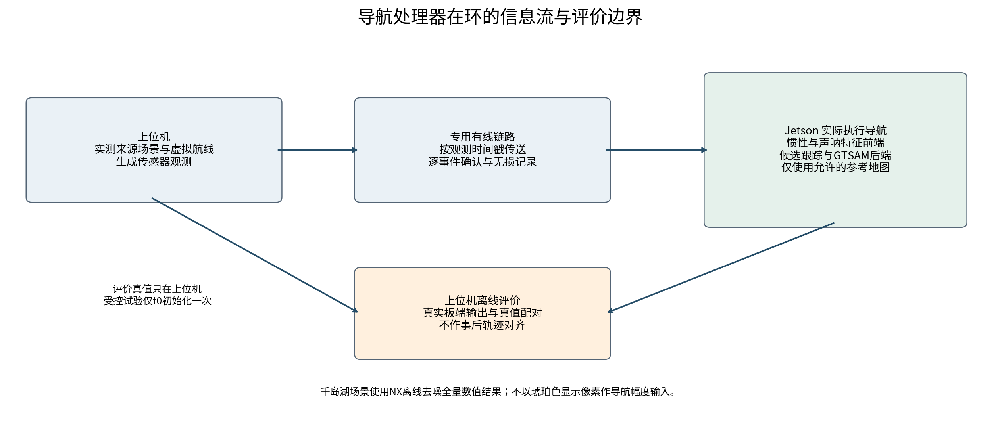

图1 导航处理器在环的信息流。评价真值不进入持续导航观测；受控试验只在初始时刻提供准确初始状态。千岛湖的NX去噪在场景生成前离线完成，不与导航在线处理耗时混合。

### 2. 两类Jetson数据的使用范围

| 场景 | 实际导航设备 | 数据范围 | 本报告的解释范围 |
|---|---|---|---|
| Monterey海底 | AGX Orin | 243569历元，73.070329 km | 完整归档可评价；原精度与资源检查未全部通过 |
| Chelan湖底 | AGX Orin | 157056历元，47.116489 km | 完整性及原相对精度检查通过；非硬实时验收 |
| 千岛湖实测来源场景 | Orin NX Super 16 GB | 62458历元，16.488644 km | 完整板端纯侧扫导航及全量数值核验 |

三组算法分支、地图和观测条件并不相同。这个组合用于评价已有部署技术在不同场景中的表现，不构成AGX与NX的同输入、同配置性能竞赛。千岛湖使用NX是本次报告更新的主体变化，不以旧PC或旧AGX结果重新贴标签。

### 3. 软件运行环境

AGX归档环境为aarch64、L4T 36.4.7、Python 3.10和CUDA 12.6，导航记录中的后端为原生GTSAM iSAM2固定滞后实现，特征计算使用CUDA。NX采用L4T 36.4.3、CUDA 12.6、TensorRT 10.3及PyTorch 2.5的板端环境，千岛湖运行记录显示OpenCV 4.10.0及GTSAM固定滞后后端。

运行环境信息与完整导航日志互相补充。一个早期环境检查文件中“正在编译”的阶段状态不能替代后来全程记录中的实际后端诊断；同样，仅能导入一个库也不能证明该库已经参与完整算法计算。本报告采用实际执行记录确认后端类别，并在附录保留环境检查与结果审查的时间范围。

### 4. 真值和参考地图的区别

已知参考地图属于地图辅助导航允许使用的先验，评价真值则只用于上位机计算误差。海湖分支使用测深及背散射参考图；千岛湖部署只包含允许的侧扫参考场、特征与算法依赖，不部署查询世界、评价真值或测深高度场。准确初始状态是受控试验条件，不是对未知位置全局初始化能力的证明。

## 四、实测来源数据与场景构建

### 1. Monterey海底场景

海底场景采用USGS Monterey Canyon测深与背散射产品[5]。仿真测深栅格为5 m，矩阵3534×5842，完整地理覆盖约29.21 km×17.67 km，保持无效区为空。背散射由不同测量系统和不同原生分辨率的图层配准融合，在有效测深区上的注册覆盖约98.66%。

这些背散射图层的原始单位并不统一，场景将各层作规定的线性归一化后作为空间纹理使用。它不是统一声学标定下的绝对目标强度。因此，该场景可以检验地形和纹理提供的导航约束，但不能证明模拟回波的绝对辐射量已经等价于每一种实物声呐。

### 2. Chelan湖底场景

湖底场景来自USGS Lake Chelan测深与背散射资料[6]。原生测量栅格为3 m，本次冻结仿真分支采用二维二倍降采样后的6 m验证栅格，矩阵8558×7974。场景包络约47.84 km×51.34 km，包络内只有实际有效测区可参与导航，不能把外包矩形都计为已测湖底。

背散射根据源产品记录的dB单位转换为相对线性功率后处理，分区中位功率用于表示未知的常数测量增益。背散射在有效测深区域上的注册覆盖约96.12%。相对增益处理有助于保持亮暗结构，却不能消除所有跨分区、跨视角辐射差异。

### 3. 千岛湖的完整实测来源场景

千岛湖场景使用声学所提供的两部分带噪声原始采集数据，共2020个有效物理记录，每侧8个沿航向通道、每通道12189个原生距离样点，完整数值阵列为2×8×2020×12189。系统参数中声速为1480 m/s，信号采样频率37650 Hz，安装角30°，沿航向通道间隔0.15 m。信号采样频率不是声呐声学载频，安装角也不是垂直开角，两者不能混写。

参考与查询场分别使用1010个不重合物理记录编号，没有共享同一记录ID，但它们仍来自同一航次及同一环境，并非独立复测航次。几何和强度经名义直航布局形成0.3 m网格，矩阵1635×4644。源平台布局采用假定速度和水平姿态，未读取GPS来恢复真实航迹。因此，这是一幅保留实测回波来源的名义坐标场，不是完成了高精度地理配准的千岛湖测绘成果。

场景确有来源于测量的非平坦底部几何，上位机可用它生成环境和观测；板端纯侧扫算法不消费该测深场。必须区分“场景构建使用测深帮助安排环境”与“导航估计器使用测深定位”。本次诊断中，MBES消费数、测深似然项、测深图因子和DVL离底高度观测均为零。

### 4. FIR与大模型去噪的部署结果

NX已完成全部16路FIR处理及random_adapted_56M模型推理。FIR为冻结的257抽头复数滤波方案，所选负频带为−15 kHz至−3 kHz；该频带针对本批干扰特征设置，不等于对所有设备和噪声都适用的固定参数。模型包含56083513个参数，使用本次实际NX构建的TensorRT FP32引擎，分块核心为192×768，不把整张琥珀色PNG作为网络输入。

模型输出为原生样本对应的对数增益g，场景幅度按A输出=A原始×exp(g)形成；本次没有再叠加FIR、边缘修复、亮度增强或生成式图像修补。全部16路与参考实现的最大增益数值差为2.5749×10⁻⁵，低于预定2×10⁻⁴容差。该结果证明板端计算的一致性，不是对无干净真值去噪质量的充分证明。

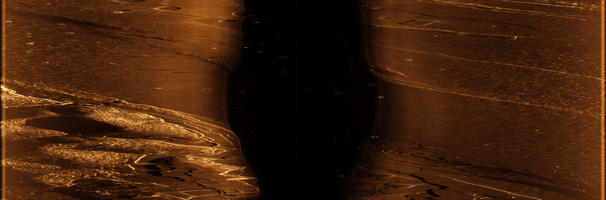

图2 FIR结果的原生全幅等比缩小预览，仅供报告查看。正式文件仍为24378×8084，没有拉伸、重复行或插值放大。

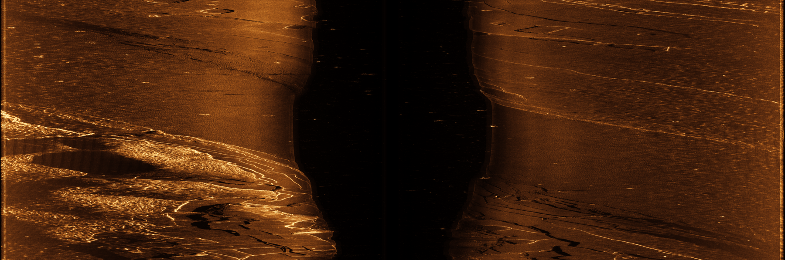

图3 NX纯模型结果的原生全幅等比缩小预览，仅供报告查看。两图不能用来替代原生幅度阵列、清洁参考数据或定位消融实验；琥珀色只是显示映射。

### 5. 数据分辨率与导航精度

原生距离采样、声呐物理分辨率、场景栅格间距和定位误差是四种不同量。将原生声呐数据保留为高清图，并不意味着得到了相同厘米量级的地理定位精度；把强度场栅格化为0.3 m，也不能创造0.3 m独立测绘真值。千岛湖本次误差评价针对名义仿真坐标系，真实地理误差还取决于源航迹、姿态、声速和外参标定。

## 五、声呐惯性前端与相对定位分析

### 1. 状态与基础量测

惯性前端采用15维误差状态，包含姿态误差、位置误差、速度误差、陀螺零偏和加速度计零偏。重力作为固定模型参数，不增加为待估计状态；本报告不把未启用的DVL比例因子、相机曝光状态或陆地系统特有量写入实际状态向量。姿态在惯性传播中保留滚转和俯仰，后端平面位姿图不意味着整个运动模型只有航向角。

以R、p、v分别表示体坐标到世界坐标的旋转、位置和速度，惯性传播的基本形式为Ṙ=R[ω测量−b陀螺]×、v̇=R(a测量−b加计)+g、ṗ=v。DVL量测与Rᵀv及安装关系对应，压力深度与垂向位置对应。DVL信息不能通过协方差交叉项被错误地解释成绝对水平位置或绝对航向观测，实际实现保留相应位姿规范自由度。

### 2. 同步波束与时间子帧

每个物理ping同时产生每侧8个沿航向通道，不能把8个同步波束称为8个连续时间ping。海湖冻结分支的声呐频率为5 Hz，特征因子还会按策略组织多个连续物理ping形成子帧；这属于时间积累，与一个ping中的同步多通道是两个维度。

时间积累可以增加局部空间覆盖和特征支持，但并不凭空增加相邻场景的独立重叠。子帧去畸变与拼接首先依赖短时惯性及DVL运动。如果运动估计有时变航向误差，拼接结构本身也会变形，后续声呐配准不能被视为完全独立于航位推算的新量测。

### 3. 声呐特征如何形成运动约束

局部前端从有支持的声呐观测中建立特征对应，结合条带几何进行稳健估计，再将可观方向的相对变化用于滤波更新。千岛湖板端记录中，前端采用GFTT与亚像素定位、SIFT描述及互相匹配和扫描行一致性；全局匹配器则为LoFTR，二者不是同一个处理层。

对一条局部近平面的测深条带，点到面残差对沿平面切向运动可能缺乏约束；重复、低对比或受视角改变影响的强度纹理也不能稳定约束全部平面自由度。可观性应从量测雅可比和信息方向分析，不能仅由匹配点数量或视觉上的亮度改善判断。特征多不必然代表独立信息多，密集相邻距离单元通常存在相关性。

### 4. Local误差与相对误差的关系

若Local与真值只相差固定世界变换C，则相对运动Tᵢ⁻¹Tⱼ中的C可以消去，绝对位置偏移不必直接破坏相对增量。若误差变换随时间改变，这种消去不再成立，航向、尺度和速度误差会污染短时位姿变化。由此，Local绝对误差大时不能直接断定每一段相对运动都差，但也不能未经相对误差检验就断言“相对量一直准确”。

本报告利用AGX海湖保存的完整位置及旋转，按10 s、30 s和60 s窗口计算SE3相对误差。窗口定义和统计在后文列出。千岛湖本次主要交付的完整评价数组以位置为主，不以差分位置反推的航向冒充实际板端姿态，因此不把它与AGX的SE3旋转误差混成一张同口径表。

## 六、全局地形地貌匹配与后端技术

### 1. 从环境候选到地图约束

海湖分支同时使用测深地形和实测来源背散射纹理。先验地形匹配和强度结构匹配提供候选，再结合运动连续性及多次观测管理候选，而不是把单帧最高相似度直接写成强位置先验。声呐测深与侧扫同源，有利于空间关联，但其误差可能共享声速、安装关系、姿态与视角影响，融合时需要控制重复信息。

千岛湖是纯侧扫分支，使用参考强度场上的特征关联，不使用测深地形高度残差。LoFTR通过图像对的条件特征建立对应[2]，本次使用未针对该批声呐微调的公开户外权重。匹配结果还要经过扫描平面几何、来源支持和时序一致性检查；图像外观变换不能直接冒充AUV真实位姿变换。

### 2. 多候选粒子跟踪的作用

重复纹理、平缓地形和覆盖边界可能使多个位置候选同时成立。候选组粒子跟踪保留这些解释，并设置无效或空假设，以避免把“所有候选都不可信”的情形强行压成一个位置。稳定候选与图优化之间仍需明确授权关系，粒子权重较高本身不自动等于可以加入一个强图因子。

[Global UTAN研究](https://pure.kaist.ac.kr/en/publications/terrain-based-global-tracking-without-prior-pose-information-usin/)将全局候选初始化与cohort particle filter跟踪结合，用于处理错误候选和全局追踪[3]。本项目借鉴其多候选管理思想，但当前海湖的搜索、配准验证以及千岛湖的强度特征前端以实际实现为准，不宣称完整复现其VLAD与TEASER++原论文链路。

### 3. GTSAM图优化与在线Global

后端采用原生GTSAM iSAM2固定滞后实现，融合相对里程计、已授权地图约束、历史回环以及启用的距离几何因子。iSAM2以增量重线性化和稀疏结构组织非线性估计[4]；本报告的定位数字仍取自实际在线发布值，不使用最后一次全历史重优化结果替代在线轨迹。

输出层通过map→odom变换把局部里程计坐标转换到地图坐标。形式上有T地图到机体=T地图到里程计×T里程计到机体。软校正可以缓和地图修正造成的输出突变，但不等于已经把全局结果完整反馈到IMU零偏和Local所有状态。因此，Global较好而Local继续漂移，在当前结构中并不矛盾。

### 4. 纯侧扫跨航线斜距变化约束

#### （1）量测关系

设同一已确认地物的名义平面坐标为L，其垂向位置Z未知；两次接收器的平面位置为oₐ、oᵦ，垂向位置为zₐ、zᵦ，对应实际接收斜距为rₐ、rᵦ。理想点散射几何满足：

rₐ²=‖L−oₐ‖²+(Z−zₐ)²；rᵦ²=‖L−oᵦ‖²+(Z−zᵦ)²。

两式相减，可以写为D=‖L−oᵦ‖²−‖L−oₐ‖²−(rᵦ²−rₐ²)=2(zᵦ−zₐ)[Z−(zₐ+zᵦ)/2]。

#### （2）未知高度与残差

当两次接收等深时，未知Z从差分中消去；不等深时，不能从仿真底部读取一个“真高度”代入，而应在压力和斜距支持的物理高度区间内保留兼容性。实现将该区间映射为D的允许区间[ℓ,u]，用归一化区间残差ε=[D−clip(D,ℓ,u)]/[(rₐ+rᵦ)σ]形成后端约束。区间内不提供额外残差，只有超出物理允许范围的分量才贡献约束；等深等式则保留对应导数。

#### （3）信息来源与约束边界

斜距来自实际收到的距离单元和已确认对应，不是从参考图亮度反推出距离。参考L仍是名义地图锚点，存在关联与地理编码不确定性。使用斜距符合侧扫设备提供距离单元的实际条件；若将未知高度、仿真真值或不真实的水平距离偷换进去，才会构成不合理信息输入。本次板端诊断明确记录known_landmark_height_used=false、DEM_or_altitude_used=false。

### 5. 回环与相关性控制

回环检测利用历史子图候选、几何一致性和分离观测窗口的确认来约束重复访问。千岛湖实际形成307条回环边，不是“未触发回环”的测试。与此同时，地图匹配与回环可能共同使用当前窗口，不能当作两份独立满权重观测；本次265个共享窗口沿用每份半信息的处理策略。

跨接收距离因子共331条、3988组特征对、7976个使用过的接收距离token，新增因子之间没有重复消费同一token。一次性使用和信息预算能够减少重复计数，但仍不等于对地图、回环和距离观测建立了完整联合协方差模型。preserve_legacy策略保留既有地图及回环信息，新增距离约束使用独立的保守预算，不通过统一减弱旧约束来制造表面改善。

## 七、验证设计与评价方法

### 1. 输入、输出与完整性

| 场景 | 声呐历元 | IMU事件 | DVL事件 | 深度事件 |
|---|---|---|---|---|
| Monterey AGX | 243569 | 2435683 | 243568 | 487136 |
| Chelan AGX | 157056 | 1570550 | 157055 | 314110 |
| 千岛湖 NX | 62458 | 1030546 | 103054 | 206109 |

海湖声呐采样频率为5 Hz；千岛湖虚拟航线声呐历元间隔约0.33 s，约3.03 Hz，IMU、DVL和深度按各自时间戳输入。千岛湖62458个历元是虚拟航线生成的导航观测，不是额外在湖中采集了62458个独立实测ping；实测来源仍为前述2020个有效记录。

评价覆盖全部规定采样时刻，检查时间戳、事件计数、来源校验值及板端原始输出与上位机回传的一致性。海湖数据来自原全程坐标归档再次重算，千岛湖从本次完整NX位置数组、CSV和板端位置日志交叉核验。未重新运行导航，不改变原始观测、滤波参数或轨迹坐标。

### 2. 三维绝对位置误差

在相同传感器时刻tₖ，定义eₖ=‖p估计(tₖ)−p真值(tₖ)‖₂；RMSE=sqrt[(1/N)Σeₖ²]。P95表示95%的保留样本误差不超过该值，不是95%置信区间；最大值保留全部异常峰；末点误差只评价最后一个共同采样点。各通道使用相同真值和相同时间轴，不用网络到达时间配对。

本报告不作事后SE3轨迹对齐、不平移轨迹、不缩放或旋转结果以适配真值，也不删除看起来异常的样本。声呐图显示的琥珀色、亮度及缩略图大小不参与位置误差计算。

### 3. 固定时间窗SE3相对误差

对窗口τ，先分别计算估计相对位姿ΔT估计=T估计(t)⁻¹T估计(t+τ)与真值相对位姿ΔT真值，再评价二者的平移及旋转差。窗口为10 s、30 s、60 s，海湖对应50、150、300个声呐间隔，保留所有重叠窗口。

相对误差用于识别短时运动约束的质量，绝对位置RMSE用于识别累计漂移，二者不能互相替代。Global还包含地图修正，Global的短时变化不等同于供后端使用的前端里程计。重叠窗口和同一长航迹上的大量ping高度相关，不能当作数十万次独立试验来给出虚假的显著性。

### 4. 误差尾部与航程分段

在完整误差序列上计算超过5 m、10 m、20 m的样本比例、最长连续超限样本跨度，以及全程最大误差所在航程位置。这些阈值只用于事后描述风险，不是用于接受匹配或筛选结果的导航门限。连续跨度定义为一段连续超限样本的末时刻减初时刻，不把样本数直接当秒数。

每组完整航程再等分为十段，分别统计Global RMSE、P95和最大值。分段帮助揭示非平稳性，但不是十次独立泛化实验。场景、硬件和算法分支均不同，跨场景表格用于描述各自表现，不把数值排序直接解释成设备优劣或同输入算法增益。

### 5. 本报告能验证与不能归因的内容

DR与Local是同一场景输入下的对照通道，Global相对于DR的改善可以说明完整环境辅助链路的净效果。由于当前NX完整试验没有同输入关闭回环、关闭距离约束和关闭去噪的板端消融，不能把全部改善分别归因于某个组件，也不能把本次NX的4.871 m直接与历史PC增强场的5.040 m比较来宣称硬件或模型单项提升。

未知初始位置全局恢复、独立航次地图匹配和真实外场精度需要另外设计验证；本报告不以准确初始化的单条路线代替这些命题。

## 八、完整硬件在环结果与算法有效性

### 1. 完整位置误差统计

下表由全部共同采样位置重新计算，单位均为米。海湖采用AGX板端在线输出，千岛湖采用实际NX输出；不是上位机参考值，也不是最终平滑后的最优轨迹。

| 场景与设备 | 通道 | RMSE / m | P95 / m | 最大 / m | 末点 / m |
|---|---|---|---|---|---|
| Monterey海底 AGX Orin | DR | 939.127 | 2047.901 | 2316.987 | 2192.007 |
| Monterey海底 AGX Orin | Local | 929.598 | 2041.597 | 2308.369 | 2184.607 |
| Monterey海底 AGX Orin | Global | 6.830 | 13.267 | 41.453 | 4.451 |
| Chelan湖底 AGX Orin | DR | 735.761 | 1766.942 | 2045.563 | 2024.939 |
| Chelan湖底 AGX Orin | Local | 734.390 | 1761.979 | 2038.062 | 2016.920 |
| Chelan湖底 AGX Orin | Global | 6.829 | 13.527 | 38.784 | 22.517 |
| 千岛湖 Orin NX Super | DR | 36.196 | 55.447 | 78.760 | 67.822 |
| 千岛湖 Orin NX Super | Local | 34.539 | 56.543 | 76.271 | 69.969 |
| 千岛湖 Orin NX Super | Global | 4.871 | 10.462 | 19.315 | 5.673 |

三组Global均显著小于各自DR和Local，但这一改善代表地图辅助完整链路的效果，不代表不依赖地图的声呐里程计已经达到相同精度。海底与Chelan的Global RMSE都约6.83 m只是各自统计结果接近，不能据此认为它们共享了同一轨迹或相同误差机制。

| 场景 | Local RMSE相对DR降低 | Global RMSE相对DR降低 |
|---|---|---|
| Monterey海底 AGX Orin | 1.01% | 99.27% |
| Chelan湖底 AGX Orin | 0.19% | 99.07% |
| 千岛湖 Orin NX Super | 4.58% | 86.54% |

表中百分比以同一场景的DR RMSE为基准，计算100×(1−目标RMSE/DR RMSE)。百分比不用于跨硬件排名。尤其在DR本身漂移很大时，Global相对降低比例会很高，应同时看绝对米制误差与尾部风险。

### 2. Monterey海底的全程表现

海底完整记录为243569个采样点，航程73.070329 km。板端DR和Local RMSE分别达到939.127 m和929.598 m，二者末点误差均超过2 km。Global RMSE为6.830 m，P95为13.267 m，末点为4.451 m，最大41.453 m。全局环境约束明显压低了累积漂移，但未消除全部瞬时风险。

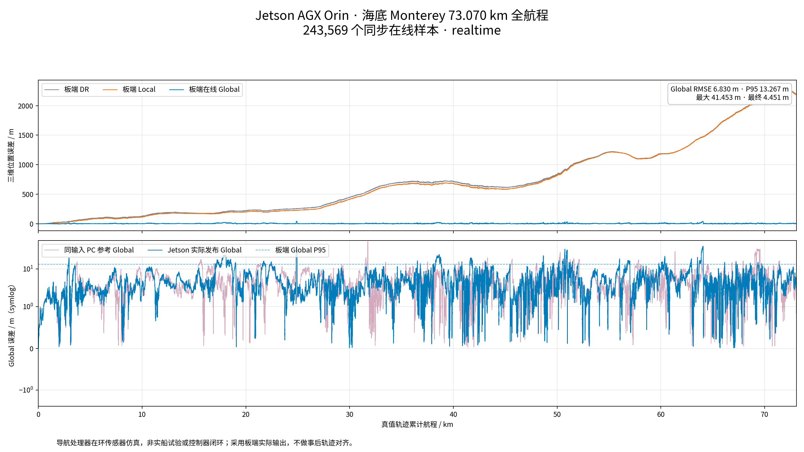

图4 Monterey海底AGX完整在线位置误差。保留DR、Local、Global和同输入上位机参考，不截去不利区段。

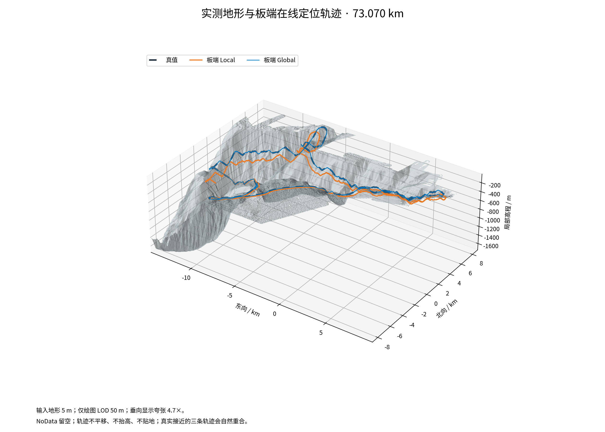

图5 Monterey实测地形上的实际AGX轨迹。图内仅显示地形LOD和标明的垂向夸张，轨迹没有平移、抬高或贴地。接近的轨迹可能自然重合。

原跨平台检查中，板端DR RMSE相对上位机增加约50.32%，Local RMSE增加约48.73%，Global P95增加约13.33%，超过原10%相对劣化检查范围。Global RMSE虽只增加约7.31%，仍不能单独据此宣布整个部署精度通过。完整回传位置与实际板端日志一致，说明这些差异不能简单归咎于结果回传损坏。

### 3. Chelan湖底的全程表现

湖底完整记录为157056个采样点，航程47.116489 km。Global RMSE为6.829 m，P95为13.527 m，最大38.784 m，末点22.517 m。末点显著高于平均水平，说明“全程平均较好”与“任务结束时始终贴近真值”不是同一个命题。

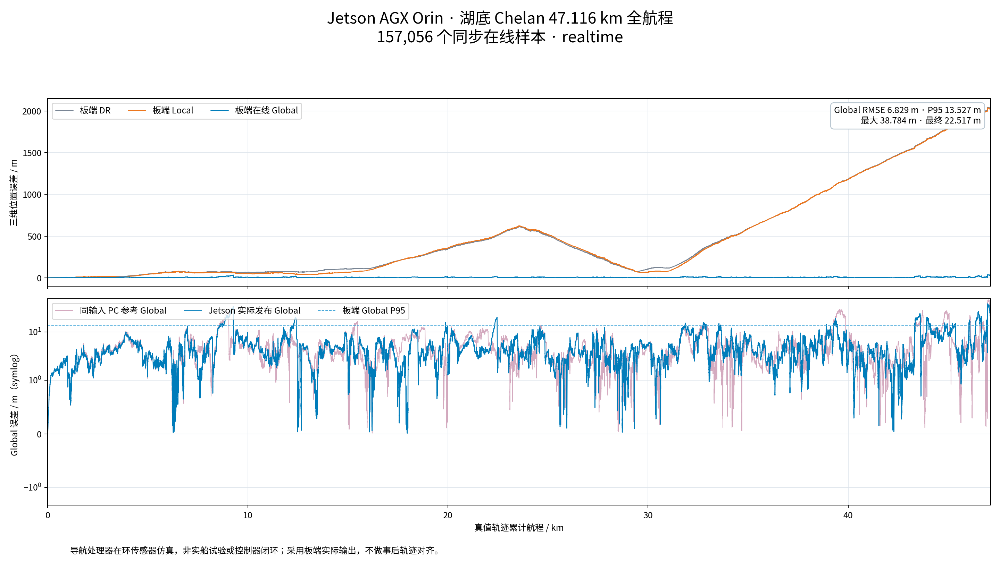

图6 Chelan湖底AGX完整在线误差。Local与DR的长程漂移几乎重合，不能把后端修正后的Global视为前端独立性能。

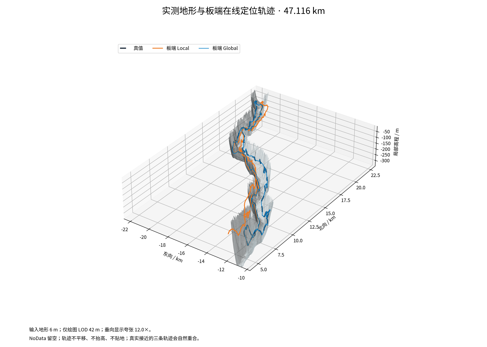

图7 Chelan实测湖底及实际AGX在线轨迹。无效地形区域保持为空，未为显示连贯而补齐未测区域。

湖底原完整性、相对精度与源进程资源检查均通过。其板端Global RMSE略低于同输入上位机参考，但这个差异不构成板卡能够提高算法本质精度的证据；非线性估计和跨体系结构数值路径存在差异，最终应按原一致性规则及不利指标共同评价。

### 4. 千岛湖NX完整结果

NX千岛湖完成62458个历元，最后采样航程16.488644 km。Global RMSE为4.871 m，P95为10.462 m，最大19.315 m，末点5.673 m。相比同一输入下DR的36.196 m和Local的34.539 m，Global长程误差受到明显控制；但前端相对于DR的净改善仍有限。

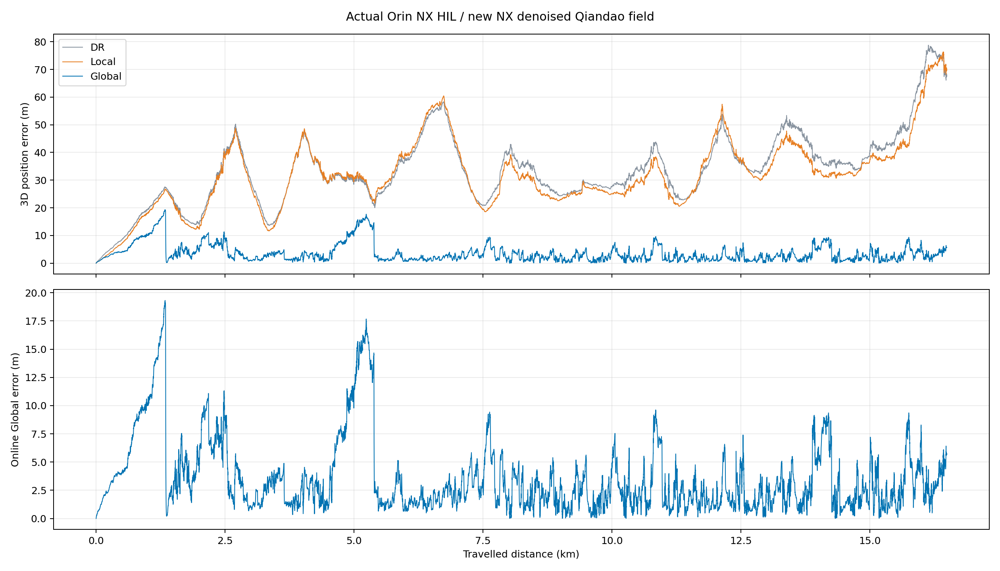

图8 实际NX千岛湖全程在线误差。下图保留Global完整细节，峰值和回落均来自真实记录，不用最终全历史平滑轨迹替换。

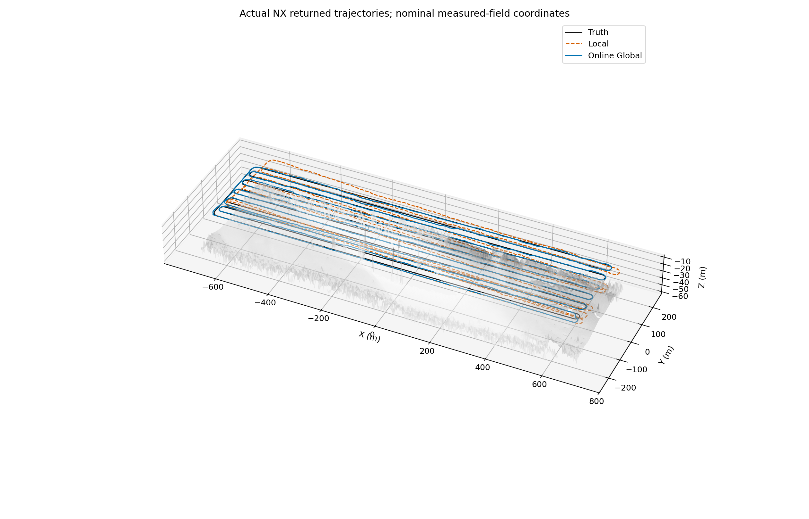

图9 本次NX模型强度场对应的名义实测来源底部与实际板端轨迹。垂向显示夸张为3倍、表面仅绘图抽取，不改变原位置和误差；导航器没有收到这幅底部高度场。

板端诊断显示前端有效对应62394次、拒绝63次，二者合计为首帧初始化之后的62457次尝试；形成20780次前端更新。地图特征尝试416次、接受381次、实际图先验352条；回环形成307条图边，距离兼容性形成331条新因子。这些计数说明环境匹配、回环和几何约束确实参与了运行，而不是只加载了名称相同的模块。

不过，模块参与并不等于已经证明其独立贡献。缺少同输入NX板端消融时，不能把4.871 m拆分成“模型去噪贡献多少、LoFTR贡献多少、回环贡献多少”。本次证明的是所部署完整方案在该名义场景条件下的表现。

## 九、数据分布、分段与误差机理

### 1. 均值之外的风险

Global轨迹包含平稳低误差段、误差缓慢增长段和地图修正引起的回落。单一RMSE会把这些行为压缩成一个数，无法直接说明超限持续时间。以下统计以各自全程数据计算，超过阈值的样本仍全部纳入RMSE。

| 场景 | 误差超过10m样本占比 | 超过20m占比 | 最长连续超10m样本跨度/s | 最大误差位置/km |
|---|---|---|---|---|
| Monterey海底 AGX Orin | 11.21% | 1.32% | 1063.00 | 24.924 |
| Chelan湖底 AGX Orin | 10.34% | 1.57% | 536.20 | 46.975 |
| 千岛湖 Orin NX Super | 5.69% | 0.00% | 487.74 | 1.338 |

三组超过10 m的样本比例分别约11.21%、10.34%和5.69%，最长连续超10 m的样本跨度分别为1063.0 s、536.2 s和487.74 s。由此可见，不利误差不全是一个采样点的尖峰，有些是持续数分钟的偏离。用于下游任务和控制参考时，应同时评价持续风险，而不能只看最后一点已回落到较小误差。

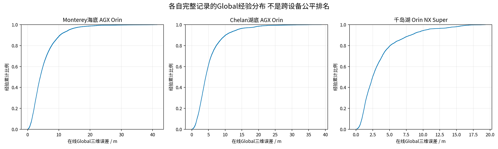

图10 三组各自完整记录的Global经验分布。每组单独归一化，不是独立样本置信分布，也不构成跨设备公平排名。

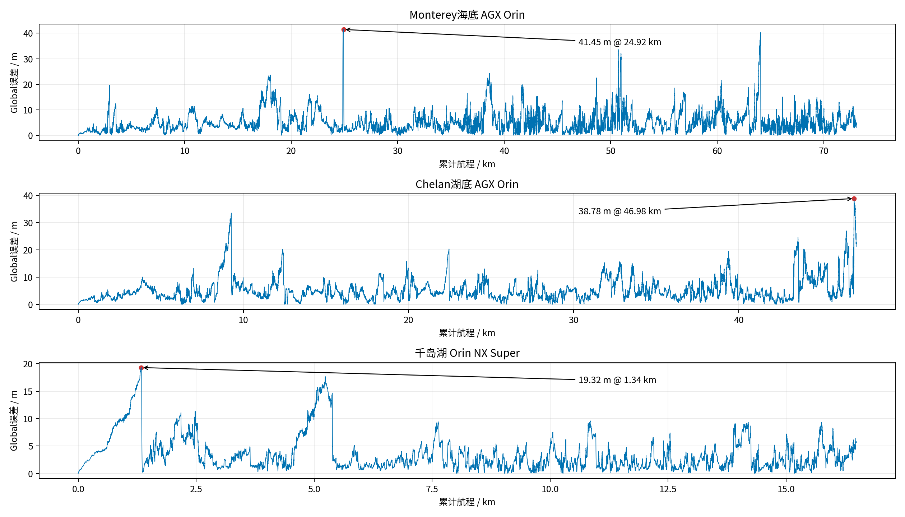

图11 全程Global峰值与对应航程位置。图中的异常没有按大小删去；峰值位置用于安排后续复核窗口，不按评价真值选择导航候选。

### 2. Monterey航程分段

| 航程区段/km | 样本数 | Global RMSE/m | P95/m | 最大/m |
|---|---|---|---|---|
| 0.00–7.31 | 24357 | 3.858 | 8.233 | 19.621 |
| 7.31–14.61 | 24357 | 5.173 | 9.664 | 11.376 |
| 14.61–21.92 | 24357 | 9.325 | 18.077 | 23.661 |
| 21.92–29.23 | 24357 | 6.738 | 11.523 | 41.453 |
| 29.23–36.54 | 24356 | 4.834 | 8.985 | 16.506 |
| 36.54–43.84 | 24357 | 8.296 | 18.437 | 24.270 |
| 43.84–51.15 | 24357 | 6.962 | 13.501 | 33.573 |
| 51.15–58.46 | 24357 | 6.503 | 12.466 | 18.537 |
| 58.46–65.76 | 24357 | 8.850 | 15.844 | 40.233 |
| 65.76–73.07 | 24357 | 5.587 | 10.530 | 15.697 |

各段误差不同，表明完整系统不是简单的“每走一米固定增长若干误差”。地图候选可观性、参考覆盖、前端增量质量和后端模式切换共同影响Global。若某段误差增大而后续回落，既可能对应积累后的有效纠偏，也可能涉及多候选转换，必须结合实际匹配和图边日志判别，不能仅凭曲线形状确认发生了正确重定位。

实际AGX海底最大Global误差发生在约24.924 km，为41.453 m；Chelan的最大值则接近任务末段，约46.975 km。最坏地点应以板端实际记录确定，不以同图中上位机参考的峰值位置替代。这也是跨平台一致性分析需要保留整条轨迹、而不能只比末点的原因。

海底Local和DR的大漂移提示航向、速度与偏置的长期一致性仍是主要薄弱环节。环境先验使Global保持相对较小，但这不免除对前端短时错误增量的审查：当前端坐标误差随时间改变时，后端传播和候选搜索也可能受到污染。

### 3. Chelan航程分段

| 航程区段/km | 样本数 | Global RMSE/m | P95/m | 最大/m |
|---|---|---|---|---|
| 0.00–4.71 | 15706 | 4.105 | 7.843 | 10.021 |
| 4.71–9.42 | 15706 | 9.071 | 21.545 | 33.464 |
| 9.42–14.13 | 15705 | 6.323 | 12.249 | 20.118 |
| 14.13–18.85 | 15706 | 4.932 | 9.491 | 11.541 |
| 18.85–23.56 | 15705 | 6.316 | 11.769 | 20.318 |
| 23.56–28.27 | 15705 | 4.896 | 9.099 | 13.009 |
| 28.27–32.98 | 15706 | 6.414 | 12.609 | 15.642 |
| 32.98–37.69 | 15705 | 5.190 | 9.410 | 15.070 |
| 37.69–42.40 | 15706 | 5.866 | 11.125 | 19.339 |
| 42.40–47.12 | 15706 | 11.685 | 22.416 | 38.784 |

Chelan存在狭长有效覆盖区与大量无效外包区域。参考覆盖或几何支持变化时，地图辅助纠偏不能等同于均匀连续观测。其末点22.517 m与最大38.784 m说明，平均精度之外还要关心任务收尾和短时风险。报告不把所有误差变化直接归因于“地形太平”，因为仅凭位置序列不足以排除视角、覆盖、关联和前端传播等因素。

### 4. 千岛湖航程分段

| 航程区段/km | 样本数 | Global RMSE/m | P95/m | 最大/m |
|---|---|---|---|---|
| 0.00–1.65 | 6246 | 8.172 | 16.506 | 19.315 |
| 1.65–3.30 | 6246 | 5.266 | 9.625 | 11.313 |
| 3.30–4.95 | 6246 | 4.439 | 9.622 | 11.506 |
| 4.95–6.60 | 6245 | 7.554 | 15.815 | 17.676 |
| 6.60–8.24 | 6246 | 3.714 | 6.862 | 9.430 |
| 8.24–9.89 | 6246 | 2.318 | 4.248 | 5.625 |
| 9.89–11.54 | 6245 | 3.547 | 7.372 | 9.621 |
| 11.54–13.19 | 6246 | 2.311 | 4.929 | 7.400 |
| 13.19–14.84 | 6246 | 3.969 | 8.478 | 9.358 |
| 14.84–16.49 | 6246 | 3.624 | 6.790 | 9.358 |

千岛湖全程在约1.35 km和约5 km附近可见较明显的误差增长与回落，之后多数区段保持较低误差，但仍有重复峰值。整体结构符合周期性环境纠偏与多约束后端工作的预期，却不能单凭这两次回落就精确归因于某一条回环或距离因子。图边存在性已由板端计数证明，单条约束的因果贡献仍需关闭相应模块的同输入对照。

千岛湖Local的RMSE比DR略低，而P95为56.543 m、高于DR的55.447 m；Local末点69.969 m，也高于DR的67.822 m。这说明前端修正存在收益不均匀的情形，后端控制了地图坐标误差，但前端仍有需要针对性改进的长时可观性和稳健性问题。

### 5. 地图质量与误差不能简单一一对应

海底5 m、湖底6 m和千岛湖0.3 m栅格反映不同来源和处理尺度。更细的格网并不自动带来同比例的定位提升，也不能把定位误差直接解释成格网分辨率的倍数上限。千岛湖场景还包含名义布设误差和同航次相关性，必须通过独立航迹、声速与外参标定才能评价真实地理精度。

因此，当前数据支持“多种实测来源环境中能够利用地图控制漂移”，不支持“已经证明任意海域都达到同样精度”。三组数据有助于发现共同机制与失效模式，但其传感器表征、参考条件和设备不同，不能作为严格统一基准上的泛化分数。

## 十、相对定位验证与前端局限

### 1. Monterey的SE3相对误差

| 时间窗 | 通道 | 相对平移RMSE/m | P95/m | 相对旋转RMSE/° |
|---|---|---|---|---|
| 10s | dr | 1.560 | 3.209 | 0.180 |
| 10s | local | 1.552 | 3.197 | 0.180 |
| 10s | global | 2.073 | 3.734 | 0.242 |
| 30s | dr | 2.718 | 5.696 | 0.277 |
| 30s | local | 2.699 | 5.671 | 0.277 |
| 30s | global | 3.934 | 7.308 | 0.432 |
| 60s | dr | 3.851 | 8.132 | 0.374 |
| 60s | local | 3.817 | 8.088 | 0.374 |
| 60s | global | 5.557 | 11.125 | 0.605 |

海底Local在10 s窗口的平移RMSE约1.552 m，略低于DR约1.560 m；30 s窗口约2.699 m，同样仅比DR略低。10 s通常对应约15 m航程，尾部误差却可能达到明显大于平均值的水平。这样的相对数据不支持“前端相对量始终很准”的绝对说法。

与上千米的绝对漂移相比，相对误差小得多，说明不能用绝对位置误差直接替代短时增量误差；但相对尾部仍可能对候选传播和图里程计形成不利输入。改进前端应关注偶发坏增量及其发生条件，而不只是压低全程平均误差。

### 2. Chelan的SE3相对误差

| 时间窗 | 通道 | 相对平移RMSE/m | P95/m | 相对旋转RMSE/° |
|---|---|---|---|---|
| 10s | dr | 1.403 | 2.500 | 0.192 |
| 10s | local | 1.395 | 2.484 | 0.192 |
| 10s | global | 1.705 | 2.915 | 0.247 |
| 30s | dr | 2.619 | 4.401 | 0.309 |
| 30s | local | 2.604 | 4.379 | 0.309 |
| 30s | global | 3.367 | 5.789 | 0.450 |
| 60s | dr | 3.815 | 6.660 | 0.429 |
| 60s | local | 3.781 | 6.604 | 0.429 |
| 60s | global | 4.966 | 9.195 | 0.641 |

相同时间窗定义使同一场景内DR、Local和Global可以直接对比。Local与DR的接近程度反映当前声呐前端在这些运动与环境条件下提供的额外信息有限。Global的相对误差则包含地图软校正造成的位姿变化，不能拿来直接评价前端里程计，也不能将其每一次跳变都解读成惯性航位推算错误。

### 3. 千岛湖的相对约束证据

千岛湖已证明特征前端进行了大量真实更新，后端采用实际Local增量，并通过地图、回环及距离兼容性修正形成在线Global。现有交付位置数据能计算绝对漂移和位移变化，但没有在本报告中用差分位置构造虚假姿态，故不附会一组与AGX完全同定义的旋转RPE。

后续应在相同输入上补齐板端完整姿态、相对观测信息矩阵和关联支持记录，再对转弯、直航、弱纹理和覆盖边界分别统计。这样才能区分“固定坐标偏移”“时变漂移”和“局部配准坏增量”，而不是笼统把所有Local误差归给DVL或某一传感器。

## 十一、板载实现与实时性分析

### 1. 完成部署不等于满足截止时间

实际板端原生后端、特征计算、事件消费和结果回传已经得到验证，但实时性还取决于最坏处理时间、传输和排队。模式名称中的realtime表示按照模拟时钟进行传感器注入，不自动意味着每个观测均在其周期内完成。

| 场景 | 传感器时间跨度/s | 记录墙钟/s | 时间比约值 | 主要实时性证据 |
|---|---|---|---|---|
| Monterey AGX | 48713.66 | 66535.67 | 0.732× | 最大结果到达滞后约17815.19 s |
| Chelan AGX | 31411.00 | 34374.49 | 0.914× | 最大结果到达滞后约2959.46 s |
| 千岛湖NX | 20610.81 | 20781.31 | 0.992× | 上位机源端到端墙钟，非单独板端基准 |

表中三类墙钟范围不完全相同，不能用这些比值对AGX与NX进行公平性能排名。它们共同说明：在完整任务上，仅宣称“有平均处理速度”不足以替代截止时间与队列稳定性验证。

### 2. 海底记录的处理长尾

海底全程归档中，声呐估计器调用平均约0.239 s、P95约0.267 s、最大约72.194 s；传输加处理往返平均约2.620 s、P95约4.556 s。这些统计有不同计时边界，不能把往返时间全部归为估计器计算，也不能把单次估计器均值当作含所有传感器回调的端到端耗时。

对5 Hz声呐，单周期为0.2 s；存在长时调用和持续排队时，即使最终所有样本都被处理，也不满足严格硬实时。GPU特征计算可以减少部分代价，但地图搜索、复杂候选验证、图更新、跨进程传送和观测调度都可能成为瓶颈，需要基于每个阶段的完整计时分布分析。

### 3. 千岛湖NX的时间解释

千岛湖端到端记录约20781.31 s，导航观测时间跨度20610.81 s，接近1倍速完成，但这不代表每一个时刻都满足0.33 s的观测周期。接收摘要中的estimator_wall_s约0.00653 s只是最后一个消息的处理时间，不能被写成全程平均、P95或“每ping仅6.5 ms”。

本次去噪发生在导航之前，不能把其时间排除后仍宣称完整的“采集—去噪—导航”已经在线实时运行。需要把离线模型处理和导航处理器在环明确分开。

### 4. 原生全量模型推理的约束

全部16路原生FP32模型前向累计约4018.34 s，范围不包括引擎构建、外部传输和最终成图。以2020个有效物理记录计，平均约0.503个全16路记录/s；这与本批原始约673.86 s的采集跨度并不等价，尚不能证明在3.03 Hz或5 Hz下对全部原生通道进行实时模型去噪。

模型参数的FP32静态权重约214 MiB，但推理还需要特征激活、工作区和输入输出缓存。通过分块完成原生全量处理证明16 GB设备上存在可运行的部署路径，不意味着可以把整张大幅图一次性送入网络。后续精度模式、块尺寸和流水调度的优化，都应在相同原生输入及明确数值或质量检查下独立验证。

## 十二、误差来源与技术风险

### 1. 声学建模误差

实测来源地图提供空间几何与纹理，但新航线观测仍由仿真生成。波束脚印、声速变化、阴影、遮挡、角度散射、混响和不同底质的反射机制不一定被完整建模。系统中关于水中可分离ping的调度条件不能替代真实波形级传播和干扰仿真，合成I/Q也不能写成恢复了实测相位。

### 2. 先验地图与同源相关性

同一测区生成观测并构成先验，会形成有利于匹配的条件；千岛湖参考与查询记录虽不重号，但仍共享航次与名义布局。这个条件适合验证链路和估计机制，却不能单独证明跨航次、不同设备、不同声速和环境变化下的性能。

同源测深与侧扫、重叠子帧、地图匹配、回环和距离约束之间也存在相关性。一次性token、鲁棒损失和半信息预算是工程管理措施，不是完整统计一致性的证明。过强地重复计入同一信息，可能导致协方差过度乐观，进而在错误峰值上形成不合理自信。

### 3. 跨体系结构数值差异

海底DR与Local的板端和上位机差异远大于通常希望接受的范围；由于完整回传数据与实际板端输出一致，问题不能只用通信字节错误解释。非线性估计、初始化、旋转运算及长时传播可能放大小的数值差异，但本报告没有新增因果对照，不能未经验证就把全部差异归因于某一库版本。

这一风险要求保留原精度判据和不利通道，而不是只展示Global接近的结果。跨平台部署应分别审查基础传播、局部前端和全局约束，避免Global把前端问题暂时遮住。

### 4. 系统资源与连续运行

AGX海底保留了完整交付数据，但源进程最终终止状态为OOM，原资源检查未通过。近期NX海底重跑也因上位机内存压力触发保护而中断，只有约17.4 km，不纳入本报告的73 km主结果。NX Chelan重跑没有形成新全程数据，本报告仍使用已有AGX记录。

资源保护停止能够避免把不完整任务误记为通过，但不能弥补被中断的验证。定位算法与运行稳定性应作为两类结论分别给出：数据已经显示某些区间定位有效，不等于系统已经具备长时无人值守部署能力。

## 十三、阶段成果与后续可检验问题

### 1. 已有数据能够支撑的成果

| 技术命题 | 当前证据 | 阶段判断 |
|---|---|---|
| 板载运行环境与算法部署链路 | 实际Jetson执行导航、原生后端与结果回传 | 支撑初步链路完成 |
| 相对定位匹配能够参与导航 | 特征前端更新、完整SE3相对误差 | 已形成验证，但长时漂移和尾部仍明显 |
| 绝对环境匹配能够控制漂移 | 三场景各自全程Global误差 | 在受控场景条件下有效 |
| 纯侧扫条件下板载运行 | NX千岛湖全事件、回环及距离因子 | 完整链路与定量结果成立 |
| 所有场景部署全面验收 | 海底一致性与资源检查不利记录 | 尚不能成立 |
| 实船地理精度与硬实时 | 无独立外场真值及完整截止时间证据 | 本报告不作此结论 |

这些成果可以支撑嵌入式部署和地形地貌匹配导航仿真验证的阶段材料。若用于按月份归档，应按实际记录形成时间区分当月完成与后续补充验证，不把11月新增NX证据倒签为更早月份已完成的实物成果。项目中的地形超分与重建研究还需要各自的独立数据和评价，不能由导航误差表自动证明。

### 2. 下一阶段的技术验证设计

| 待检验问题 | 应固定的条件 | 应改变或补充的因素 | 主要判据 |
|---|---|---|---|
| 各后端组件的独立贡献 | 相同NX输入、初始化、参考图 | 分别关闭回环、距离约束和特定匹配分支 | 完整误差、尾部和图因子变化 |
| 前端偶发坏增量的来源 | 原观测及原输出时间轴 | 记录信息方向、内点分布、转弯与覆盖支持 | 分场景RPE、失败窗口和传播误差 |
| 跨平台基础传播一致性 | 同一记录与初始化 | 控制数值路径和旋转运算 | DR与Local逐样本差异及长时误差 |
| 跨航次泛化 | 固定算法及预声明参数 | 独立航次、不同视角和环境条件 | 完整盲测，不在测试集反复调参 |
| 在线处理截止时间 | 固定精度与数据完整性 | 优化分块、传送和调度 | 每阶段P95/P99、最坏值和队列上界 |
| 真实地理定位精度 | 校准声速、时延、姿态与外参 | 引入独立外场参考 | 不依赖同一名义地图的误差评价 |

下一阶段不宜只追求一个更低的平均误差数字。应先定位影响后端的前端坏增量，建立同输入消融与跨平台基础传播对照，再检验地图与回环在未知初始偏差、弱纹理和独立航次中的行为。模型去噪的优化也应把结构保持、幅度偏差和导航效果一起评价，不能用更平滑的显示结果代替实测信息保真。

## 十四、结论

已有Jetson硬件在环数据表明，水下声学惯性导航可以通过实际板端的特征前端、多候选跟踪和GTSAM后端，利用地形地貌参考与重复观测约束显著降低长航程漂移。AGX海底、AGX湖底与NX千岛湖的在线Global RMSE分别为6.830 m、6.829 m和4.871 m，构成初步部署与受控算法验证的定量依据。

证据同时揭示了不能忽视的薄弱点：Local的长期改善有限，绝对漂移与相对误差尾部需要分别处理；海底跨平台精度与资源检查未全部通过；平均速度不能代替硬实时截止时间；千岛湖结果基于同航次名义场景和虚拟航线，尚不是独立外场地理精度。

因此，本阶段最有价值的成果不是“所有问题已经解决”，而是形成了清晰的信息边界、可运行的板载链路、可重算的完整结果和可检验的下一阶段问题。后续应以可观性、相关性、同输入对照和连续运行能力为主线，把当前受控场景中的有效性逐步转化为真实水下环境中的可靠性。

## 十五、参考文献与复现附录

### 1. 方法和数据来源

[1] Zheng等．FAST-LIVO2: Fast, Direct LiDAR-Inertial-Visual Odometry．官方实现：[FAST-LIVO2](https://github.com/hku-mars/FAST-LIVO2)。用于说明陆地融合框架与本项目水下改写的关系，不提供本报告定位数字。

[2] Sun J, Shen Z, Wang Y, Bao H, Zhou X．LoFTR: Detector-Free Local Feature Matching with Transformers．CVPR 2021．[作者预印本](https://arxiv.org/abs/2104.00680)。用于特征匹配方法归属，不能把视觉基准成绩移作声呐成绩。

[3] Zhang Q, Kim J．Terrain-Based Global Tracking Without Prior Pose Information Using Multibeam Echosounder Measurements．IEEE Transactions on Instrumentation and Measurement, 75, 7506113, 2026．[作者单位论文页面](https://pure.kaist.ac.kr/en/publications/terrain-based-global-tracking-without-prior-pose-information-usin/)。本项目借鉴多候选跟踪思想，不宣称其官方完整复现。

[4] Kaess M等．iSAM2: Incremental Smoothing and Mapping Using the Bayes Tree．International Journal of Robotics Research, 31(2):217–236, 2012．[作者机构论文页](https://publications.ri.cmu.edu/isam2-incremental-smoothing-and-mapping-using-the-bayes-tree)。

[5] USGS．Monterey Canyon测深与背散射数据产品．[数据DOI](https://doi.org/10.5066/F7XD0ZQ4)。本项目采用的栅格、归一化和覆盖处理以随附地图元数据为准。

[6] USGS．Lake Chelan多波束测深与背散射数据产品．[数据DOI](https://doi.org/10.5066/P1GE3YDR)。本报告区分原生3 m栅格和实际采用的6 m验证栅格。

[7] Song J等．OceanSim: A GPU-Accelerated Underwater Robot Perception Simulation Framework．IROS 2025．[作者预印本](https://arxiv.org/abs/2503.01074)。本项目扩展部分的传感器、估计器和验证边界以本报告及实际记录为准，不把原框架的全部结论自动归入新增模块。

### 2. 结果文件与证据索引

| 本报告目录内文件 | 用途 |
|---|---|
| data/verified_metrics.json | 全量重算指标、尾部、航程分段及NX诊断 |
| data/sea_complete_error_samples.csv | AGX海底全部误差样本 |
| data/lake_complete_error_samples.csv | AGX湖底全部误差样本 |
| data/qiandao_complete_error_samples.csv | NX千岛湖全部误差样本 |
| data/sea_hil_trajectories_full.csv.gz | AGX海底无损压缩评价坐标归档 |
| data/lake_hil_trajectories_full.csv.gz | AGX湖底无损压缩评价坐标归档 |
| data/qiandao_NX_navigation_states.npz | NX完整评价位置数组，不含原始声呐 |
| evidence/source_manifest.json | 本次读取来源、文件校验值及处理代码摘要 |
| evidence/sea_AGX及lake_AGX | 原完整性、精度、相对运动和资源审查 |
| evidence/qiandao_NX | 本次NX完整事件与位置审查、部署和场景摘要 |
| evidence/native_preview_audit.json | 原生声呐图与等比缩小预览的区分 |

原始MAT、原生复数信号、收到的声呐幅度缓存、模型权重和原始大体量传感器流不打包进本报告。表中的轨迹和误差属于仿真评价导出，不是声学原始观测；本报告仍只在项目本地保存，没有自动公开上传或发送。

### 3. 原报告与本报告的替换边界

本报告千岛湖主结果替换为实际NX完整16.49 km数据，不再沿用旧PC增强场的5.040 m、旧PC投影方案的10.800 m等结果作为“当前NX结果”。它们的输入场和验证目标不同，若需进行算法演变研究，应另设同输入对照，不混用数值。

近期NX海底中断数据和尚未执行的NX Chelan全程不进入本报告三组完整主结果；原AGX海底完整归档保留其未通过项。原报告、历史竖版声呐显示文件和原始实验目录均未覆盖。本报告中的两幅声呐小图只是明确标注的等比缩小预览，正式原生输出仍为24378×8084。

### 4. 重算与成文规则

数据处理程序只读取既有归档，重新计算位置误差并生成统计与图表，不启动仿真或运行导航算法。误差序列保留全部样本；分段统计不是下采样后的替代结果；渲染图允许等比缩放查看，不改变轨迹或测量几何。千岛湖航程沿用源程序记录的平滑航线弧长参数，不擅自改为转弯采样点之间的折线长度。

报告的Word和PDF由同一Markdown源稿生成，标题层级为题目、一、1.和（1）。正文中的主要数字均可回查完整数值摘要；对外使用任何实测来源图表或派生内容之前，仍需按数据提供方授权范围审查。
