# 海底地形地貌匹配导航算法仿真报告

项目名称：基于迁移学习的海底地形重建与高精度定位技术研究  
编制日期：2026年11月07日  
修订内容：加入跨航线斜距变化约束的纯侧扫导航算法及完整对照验证  
成果范围：PC完整梳形导航、新噪声种子补充试验及历史海湖板载部署证据  
数据管理：原始声学数据、逐ping输入及可还原缓存仅限本机，禁止上传

本报告评价一种在既有声呐特征前端和混合后端上增加跨航线斜距变化约束的水下匹配导航方法。方法利用同一已关联地物的两次实际侧扫接收斜距，在不提供海底高度、测深似然或DVL离底高度的条件下，剖面化未知地物高度的物理可行区间，向GTSAM加入连接两个可变位姿的非线性约束。前端、航位推算、底图和传感器输入均保持不变，使整体定位变化主要对应新增后端约束及其引起的后续估计、关联变化。

在16.48864 km、62458个物理ping的完整同输入试验中，实际在线Global的三维位置RMSE从11.733 m降为5.040 m，降低57.04%；P95从21.123 m降为11.158 m，最大误差从35.145 m降为21.743 m。全程终点误差则从7.928 m增加至9.940 m，说明整体改善不等于各项指标均改善。

参数冻结后，另以未用于本轮调参的噪声种子生成完整3.99986 km、15152个ping的补充记录，原版与改进版使用同一记录。Global RMSE从7.629 m降为5.951 m，降低21.99%；终点由12.658 m降为1.591 m。该组沿航向及短距离相对误差略增，旧开发种子也保留轻微退化记录，结果不支持所有场景和所有指标全面提升的结论。

当前证据表明，跨航线重复观测中的真实斜距变化能够补充原纯侧扫方案薄弱的横向约束，而不是通过换用更清晰底图或虚构测深信息降低误差。相关117项测试及原海湖核心161项回归均通过。本次改进属于PC受控场景仿真；同航次名义地理编码、新航线合成回波、准确初始状态及近似相关性管理仍限定其解释范围。历史板载结果单列，不作为新算法已经完成板载实时验收的证明。

关键词：水下导航；侧扫声呐；地貌特征匹配；斜距变化；未知地物高度；因子图；同输入对照

## 一、任务目标与试验范围

### 1. 研究背景与验证问题

水下航行器无法持续获得卫星导航定位，单靠惯性测量、DVL速度和压力深度计进行航位推算，会因航向误差、惯性零偏、速度误差及运动激励变化而产生累计漂移。已有海底地形图和声呐探测得到的地形地貌信息，可为航位推算提供与运动积分不同来源的约束。研究的关键不只是把两幅图像对齐，还包括量测几何、参考地图坐标、观测退化、错误关联、多候选管理和在线输出连续性。

本阶段总体验证三类问题：在模拟原始传感器输入下，板载算法是否接收完整数据并输出可追溯结果；多波束地形及侧扫地貌匹配是否改善长距离Global定位；没有可信测深约束时，侧扫图像特征能否独立提供可利用的导航信息。去噪研究服务于实测侧扫数据可用性，但不能以图像更平滑代替定位改善或地物保真证据。

### 2. 月度目标与实际时间

9月份任务的预期成果是初步完成嵌入式运行环境和算法部署链路；10月份任务的预期成果是建立仿真环境，验证绝对定位匹配与相对定位匹配，形成仿真报告。现存硬件在环完整实验的实际归档日期为2026年10月21日至23日。实测声呐去噪、千岛湖纯侧扫仿真及最终四组对照主要形成于11月3日至7日，作为后续补充验证列入本报告，不倒填为9月或10月已经完成的试验。

“部署链路初步打通”与“满足全部实时性和精度验收条件”是不同层级。前者可由板载运行、完整输入输出和版本一致性证明；后者还需要持续吞吐、跨平台数值差异、异常收尾、长时间资源稳定性及外场数据等证据。

### 3. 试验层级

| 试验层级 | 数据和算法运行位置 | 本报告中的含义 |
|---|---|---|
| PC地形匹配仿真 | PC生成传感器观测并运行定位 | 验证算法与场景、传感器模型之间的关系 |
| 处理器在环 | PC运行仿真、实际Jetson AGX Orin运行定位、网络返回结果 | 验证真实目标处理器上的部署和在线处理链路 |
| 实测声呐去噪 | 原始MAT复数数据进入固定信号处理与神经网络 | 验证完整实测记录能够处理和追溯，不预设具有干净真值 |
| 实测来源场景仿真 | 实测数据构建强度场，虚拟AUV产生新的声呐观测 | 验证纯侧扫匹配导航，不等同原航次位置精度评价 |

本阶段没有把实体声呐、推进器或控制器接入仿真闭环，因而处理器在环不应称为“实体声呐硬件在环”或“实船闭环湖试”。

### 4. 本次修订的核心验证问题

本次修订针对增强外观场上原方案Global RMSE仍为11.733 m的问题，验证新增后端物理约束是否能够有效利用重复侧扫观测，而非再次调整显示效果。对照保持底图、已记录的全部观测、初始化、局部前端和原地图及回环的既有信息强度不变；新增量测只使用确认特征、实际接收斜距及压力深度。评价覆盖完整路线、新噪声补充和已用于诊断的开发记录，分别考察平均误差、尾部、相对运动与不利结果。

## 二、仿真系统总体方案

### 1. 原项目基础与新增能力

OceanSim提供水下传感器仿真、场景组织、可视化及ROS 2集成基础。其公开工作面向水下感知仿真与声学成像，不能据原项目名称就推断本项目新增的全部定位算法已获得官方验证。公开方法与实现基础见[OceanSim论文](https://arxiv.org/abs/2503.01074)；本报告定位指标均来自本仓库具体归档实验。

本项目在该基础上增加真实测深及背散射数据适配、同步多波束与侧扫观测、IMU/DVL/压力深度输入、声呐惯性前端、多候选全局跟踪、GTSAM后端、map→odom软校正、板载数据传输与记录审计，并在后续增加实测复数侧扫去噪和纯侧扫特征导航适配器。仿真器、定位器和评价程序分离，防止将真值或仿真器内部海底高度直接传入不允许使用这些信息的定位分支。

### 2. 两条验证链路

硬件在环链路为：真实地形及背散射场景生成模拟IMU、DVL、压力和原始声呐事件；通过带序号和时间戳的数据接口发送至板卡；板卡运行冻结版本的完整前后端；定位及诊断结果返回PC；PC仅在评价端对齐共同时间戳并计算误差。模拟真值不作为持续导航观测发送。

纯侧扫链路为：固定去噪方案处理实测数据；按声明的原航速和姿态假设构建局部强度场；虚拟AUV沿梳形路线运动并产生含噪复数回波；由接收回波生成导航幅度；将当前和历史收到的物理ping按Local运动拼成子图；以特征对应和声呐几何约束进行地图匹配、历史回环和后端优化。

两条链路使用了不同的观测适配器。不能把海湖在环结果解释为新纯侧扫算法已经完成板载长程实验，也不能把纯侧扫方案的精度归因于未提供给该分支的多波束测深。

### 3. 坐标系与结果输出

DR表示仅依赖基础运动传感器传播和更新的航位推算；Local表示包含局部声呐约束的连续里程计；Global表示加入参考地图匹配和历史约束后实际在线发布的位置。评价使用每一时刻真实发布的Global，不以后处理得到的全历史平滑结果替换。

后端主要处理平面位置与航向，深度及完整局部姿态由前端状态维护。map→odom软校正用于调和全局参考与连续里程计坐标，避免把后端修正直接硬覆盖为前端运动增量。Global的差分可能包含地图校正，不应直接解释为航行器速度。

## 三、数据来源与场景构建

### 1. Monterey海区场景

海区场景使用USGS Monterey Canyon测深及背散射数据，来源标识为[10.5066/F7XD0ZQ4](https://doi.org/10.5066/F7XD0ZQ4)。归档测深网格为5 m，矩阵3534×5842，场景坐标跨度约29.205 km×17.665 km。处理保留完整源范围，不作地理裁剪或地形高度夸张，缺测区保留无效标记。

四套实测背散射层分别按其分布进行归一化，再配准到测深网格并仅在有效重叠区合成。因此，它们提供实测空间纹理，但不同设备、频率和编码之间并没有形成统一绝对目标强度标定。仿真回波也包含模型化传播、入射及噪声因素，不是重新播放原始海试声学波形。

### 2. Lake Chelan湖区场景

湖区场景使用USGS Lake Chelan测深和背散射产品，来源标识为[10.5066/P1GE3YDR](https://doi.org/10.5066/P1GE3YDR)。本次固定部署场景使用6 m准备网格，矩阵8558×7974，坐标跨度约47.838 km×51.342 km。数据集名称中的“3m”表示源产品组织信息，不应误写为全部实验都在3 m导航网格上运行。

背散射预处理将记录的dB量转换为相对线性功率，再进行插值和重叠平均，避免直接对dB作线性均值或用显示对比度拉伸替代物理量处理。湖区还使用了独立于海区冻结基线的候选合并和原始声呐恢复配置，不用湖区修复参数覆盖海区历史算法。

### 3. 千岛湖实测声呐数据

#### （1）原始记录

数据来自提供的下午返航Data01、Data02两部分，共2020个物理记录。完整复数数据组织为2舷×8个沿航向采样通道×2020记录×12189距离样点。声速参数1480 m/s，采样率37650 Hz，沿航向通道间距0.15 m。原始MAT、设备参数、测深及侧扫记录对应关系均保留来源哈希。

#### （2）去噪与成像

完整16通道处理覆盖393948480个原生复数样值。拼接显示图为24378×8084像素；该显示图的像素组织不应与复数数据数组一一等同。显示琥珀配色只是幅度可视化，不提供额外声学测量精度。

#### （3）场景栅格

按声明的标称原航速2.05778 m/s、平直姿态及平台深度假设构建名义局部坐标。场景网格1635×4644，采样间距0.3 m，约1.393 km×0.490 km。0.3 m是场景栅格间距，不是已通过外部标定的定位或测深精度。

#### （4）参考与查询

2020记录按物理记录拆分为1010条参考、1010条查询，无共同记录ID；完整2020记录的显示场仅用于展示。拆分避免直接使用同一个原始ping，但两部分仍来自同航次、同一名义地理编码，不构成跨航次独立泛化试验。

### 4. 梳形路线与覆盖范围

虚拟AUV以0.8 m/s沿12条1300 m测线运动，测线间距28 m，包含11次掉头以及闭合返航，总规划长度16488.743 m。末声呐采样距离16488.644 m，与规划终点相差约0.099 m，小于一个声呐采样间距。路线完整执行，不能把“全程结束”误写成只运行到最后一个打印点。

路线针对整幅强度场规划，并非从完整图中另截一小块开展往返。但尚未把每个实际ping的有效声呐足迹累积为全场逐像素覆盖率图，因此没有证明每个有效像素均达到100%覆盖。边缘、无效单元和声呐盲区不以插值填补方式计作已经观测。

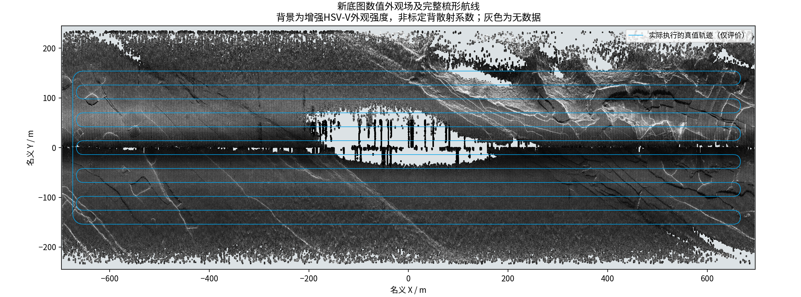

图1 本轮新数值外观场及实际执行的完整梳形轨迹。该空间场由全部原生样本投影构建，不是将竖版瀑布图像素直接当作米制坐标。

### 5. 本轮新底图的定义

本轮不从RGB竖版图提取高度，也不把其展示纵横比当作地图比例尺。以原始MAT已核对的逐束幅度、固定网络增益和`gain_and_commonmode`边缘补丁为来源，在真实原生距离采样对应的几何支持样本上应用固定增强外观映射，再进行0.3 m空间格点平均。与旧场逐项核对后，三套参考、查询和显示场的高程、有效掩膜、观测计数及路线文件全部逐字节一致；改变的是强度外观。

增强映射采用原Shotwell 0.30.14输出的256项RGB调色板，以最大RGB分量除以255定义HSV-V标量代理。逐原生样本使用与原PNG相同的0至1截断及256级索引量化，然后查询映射表。该场不是标定背散射功率或物理回波幅度，空间格点平均也不同于原瀑布图8/4重叠显示。因此本报告使用“增强外观场”而不声称数值海图与竖版图逐像素同构。

参考与查询分别来自偶数、奇数物理记录，仍无共同记录ID；新场同时用于参考匹配和模拟新航线回波生成。不能只增强参考图而继续用旧观测冒充同一次新场仿真。由于回波场的外观幅度尺度发生变化，固定合成噪声下的相对信号水平也随之改变，结果差异不能单独归因于条纹去除。

## 四、传感器模型与数据接口

### 1. 硬件在环输入

海湖在环分支的输入为IMU、DVL速度、压力深度及一体化多波束测深侧扫观测。名义频率分别为IMU 50 Hz、DVL 5 Hz、压力10 Hz、声呐5 Hz。所有传感器使用采样时间戳而不是网络到达时刻进行状态估计；网络序号、消息完整性和返回结果关联另行审计。

输入协议采用明确字段白名单。初始时刻可提供受控导航初值，后续真值保持在PC评价端。板载轨迹返回值与PC接收到的六组位姿通道逐条核对，防止把PC参考轨迹误当成板卡运行结果。

### 2. 纯侧扫仿真观测

纯侧扫分支不消费MBES XYZ、DOA测深量测、海底高度似然或DVL离底高度。它可使用IMU、DVL速度和压力深度，并利用已知传感器安装参数与收到的侧扫幅度。压力深度给出航行器在竖直方向的状态约束，不等同于航行器到海底的高度。

仿真复数回波参数包括450 kHz载频、451.8 kHz解调频率、37650 Hz采样率、5 ms脉冲长度、−6×10⁶ Hz/s调频率、250 m最大斜距和每舷8个同步沿航向采样通道。此处复数信号是仿真生成，不是从幅度图恢复了真实相位，也不是通过实物标定的完整波动声学或多途模型。

导航幅度每舷每通道使用512个距离单元，保留有效接收支持区域。原生复数与导航栅格承担不同用途：原生复数用于波形处理，导航栅格用于特征与子图组织。完整运行保存所有导航幅度及IMU/DVL/压力输入，原生复数仅保存首150个ping，不能声称已保存整个航程的全部原生I/Q。

### 3. 同步8通道与连续150个ping

8个通道属于同一物理ping的同步采样，不是8次连续发射。子图另外累计150次连续物理ping，二者不能相互替换。物理ping周期从实测记录时间戳确定，约0.33 s，对应约3.03 Hz；这与海湖在环分支的5 Hz配置属于不同试验条件。

150个ping之间实际首尾时间跨度约49.17 s，直航约39.34 m。连续运动将窄沿航向条带累积为具有二维纹理的子图，为局部特征及历史地貌对应提供支持。该窗口引入信息积累时延，不能把它写成150个ping瞬时同时发射。

### 4. 模型与实物的边界

数据中设备安装角、通道间距和采样率可用于约束仿真；声源指向性、介质声速变化、多途、姿态扰动、混响以及散射相位统计并未全部经过该设备实测标定。报告中的“真实数据”主要指场景纹理、部分测深来源和原始MAT记录，而不是所有传感器误差过程均真实复现。

### 5. 新斜距变化约束的数据来源

新增量测从导航实际收到的距离单元中取值，不从参考图的亮暗推断距离。直条带在原重叠平均之外附加主导实际接收来源标签，转弯来源投影继续使用原有标签；标签包含物理ping序号、同步沿航向通道、导航距离列和时间。附加标签不改变子图像素、描述子或Local更新。相同像素由多个回波贡献时，主导来源提供一个真实接收样本，而不是把平均图像对应的虚拟平均接收器当成实物声源。

距离列属于每舷512个导航单元，不应写为原生12189样点的全部独立距离精度。压力观测只用于航行器接收时刻的垂向状态；海底地物高度仍未知。当前后端采用平面位姿近似，传感器姿态、相位中心和外参误差的进一步标定仍会影响实物应用。

## 五、导航与地形地貌匹配算法

### 1. 局部状态估计

惯性传播和水下运动观测采用误差状态滤波思想。主要误差状态包括姿态、位置、速度、陀螺零偏和加速度计零偏，共15维；重力作为模型常量处理，不在当前纯侧扫适配器中另加待估重力状态，也未采用未经验证的DVL比例因子扩展。

海湖基线的声呐惯性链路受陆地激光惯性与视觉融合思想启发，但它使用了水下观测模型、DVL和压力约束，并非把官方FAST-LIVO2直接原样运行于声呐数据。官方FAST-LIVO2的激光几何与相机直接光度融合结构见[论文](https://ieeexplore.ieee.org/document/10757429/)；本项目的算法命名和效果应以实际实现为准。

纯侧扫前端采用GFTT角点、亚像素定位、SIFT描述子、互相匹配和鲁棒扫描行模型形成短时运动约束，主要更新有支持的沿航向量。它不是光流跟踪，也不是直接对原始强度做NCC相关。没有可信几何时不人为制造强横向或航向约束。

### 2. 海湖地形全局匹配

海湖版本结合候选检索、几何配准、多候选跟踪、无效候选和确认后发布。cohort粒子跟踪用于维护多个位置假设，避免立即将单次匹配高峰作为唯一正确解；GTSAM负责将确认的地图和相对运动约束组织为可优化的图。因而该后端是混合结构，不是“所有阶段都只使用粒子滤波”。

Global UTAN公开方案同样由外观检索、配准初始化和cohort粒子跟踪处理全局候选与伪峰，可作为该思路的参考。但论文中MBES地形描述、TEASER++和完整系统，与本项目具体模块并不完全相同，不能直接移用论文中的精度或恢复成功率。[Global UTAN论文信息](https://pure.kaist.ac.kr/en/publications/terrain-based-global-tracking-without-prior-pose-information-usin/)

### 3. 纯侧扫子图与特征地图匹配

#### （1）直航表示

按Local估计的位姿对收到的150个ping进行扫描行对齐与普通重叠平均，保留有效区域和观测时间。子图不是参考底图裁剪；无支持的像素不通过图像修补伪造。

#### （2）转弯表示

直条带不能同时容纳近乎垂直或反向的扫描方向。新方案在观测到足够航向变化时使用自适应来源投影，将实际回波组织成便于外观匹配的图，同时记录每个像素的主导实际来源、斜距、扫描平面、舷侧和时间戳。

#### （3）匹配与几何

LoFTR提供局部图像对应，随后使用声呐物理关系检验。该匹配器采用未经声呐专门训练的公开室外权重；它是图像对应工具，不因使用神经网络就自动具备水下几何正确性。[LoFTR原论文](https://openaccess.thecvf.com/content/CVPR2021/html/Sun_LoFTR_Detector-Free_Local_Feature_Matching_With_Transformers_CVPR_2021_paper.html)

#### （4）保持退化

投影横坐标和二维仿射变换只辅助外观组织及剔除错误对应，不把斜距投影当成已知水平地物坐标。参考强度场提供的是对应地物的名义平面坐标，地图匹配利用这些坐标与扫描平面的关系，不假定同时获得了海底高度。历史回环则以地物三维位置为未知量，通过斜距和扫描平面约束求解相对位姿；消元时保留真实零空间，避免用不存在的测深把问题人为变成强约束。

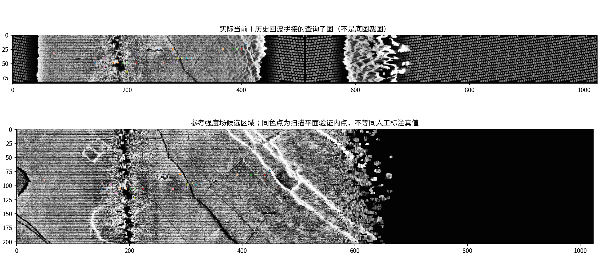

图2 同输入基线阶段实际接收回波形成的查询子图及参考候选，作为表示方法示例而非本轮新增斜距因子示例。点是几何检查后的对应示例，不是人工标注真值；查询图不是从底图直接裁剪。

### 4. 历史回环检测与图优化

回环检索要求当前与历史物理ping窗口不重叠，并满足至少180 s时间分离。首先根据估计覆盖范围及描述子检索候选，再进行LoFTR对应、几何检验和不同当前及历史窗口的时间一致性确认。两个来自同一个窗口的候选，不计作两次独立确认。

底图绝对匹配与回环不同：前者约束相对于已有地图的位置，后者约束不同时刻之间的相对位姿。轨迹相交并不自动形成回环，声呐必须实际扫到共同地物且匹配具有可靠几何支持。

当地图先验和回环使用同一个当前子图像素时，采用分摊信息的保守策略，避免把同一份观测重复作为完全独立证据。历史相关性仍属近似处理，尚不是所有地物都联合优化的严格相关性建模。GTSAM采用增量优化及固定滞后活动输出，保留长历史回环的作用；增量平滑的公开方法基础见[iSAM2](https://publications.ri.cmu.edu/isam2-incremental-smoothing-and-mapping-using-the-bayes-tree)。

### 5. 观测残差与信息退化

#### （1）运动与基础水下观测

用R表示机体到局部坐标的旋转、v为局部速度、p为位置。简化惯性传播为R随陀螺去偏后的角速度积分，速度由R(a测量−b加速度)+g积分，位置由v积分；g为固定重力常量。简化DVL速度观测为v_DVL≈Rᵀv，压力观测约束竖直位置。实际实现还需按照外参和坐标约定处理，不能把DVL速度误认为持续绝对位置或航向观测。

#### （2）参考地图的扫描平面约束

对特征i，参考强度图给出名义地物平面位置mᵢ；接收来源给出相位中心oᵢ和扫描平面法向nᵢ。平面位姿为(R₂,t₂)时，可构造r_plane,i = nᵢᵀ[R₂ᵀ(mᵢ−t₂)−oᵢ,xy]。特征对应决定“同一地物”，扫描平面决定它对位姿提供的约束方向；图像横坐标本身不作为另一个独立水平距离测量。

如果多个nᵢ几乎平行，残差对某个平移方向可能不敏感。即使匹配点很多，该方向的信息也可能仍接近零；不同扫描方向的可靠对应才可能提升平面位姿的可观性。

#### （3）历史回环的斜距与扫描平面约束

设未知地物P在两个局部子图坐标中的位置为Pₐ、Pᵦ，接收相位中心为oₐ、oᵦ，实际斜距为ρₐ、ρᵦ。每对对应包含两个距离残差‖Pₐ−oₐ‖−ρₐ、‖Pᵦ−oᵦ‖−ρᵦ，以及两个扫描平面残差nₐᵀ(Pₐ,xy−oₐ,xy)、nᵦᵀ(Pᵦ,xy−oᵦ,xy)。两个坐标间的竖直位移来自航行器压力状态差，不是已知海底高度。

联合线性化后，若位姿与地物变量的信息块为A、B、C，则消去地物后的数据位姿信息为A−BC†Bᵀ，C†表示退化情况下的广义逆。该操作只使用声呐观测及声明的不确定性；里程计初始化可以用于数值求解，但不能作为新增声呐量测精度混入输出信息。真实不可观方向不通过加很大对角项“修好”。

#### （4）后端目标与多候选处理

图优化组合里程计、确认后的地图先验及回环残差，按各自信息矩阵和鲁棒损失求解。多候选阶段避免把相互分离的地形模式简单取均值，确认状态和无效候选影响实际发布来源。上述融合仍采用近似历史相关性管理，实验中的实际信息、来源及发布跳变均保留，不能只凭优化器收敛就判断匹配正确。

### 6. 跨航线斜距变化约束

#### （1）从两次真实距离量测出发

设参考图上同一已确认地物的名义平面位置为L=(X,Y)，其真实垂向坐标Z未知。两次接收器的平面位置为oₐ、oᵦ，垂向位置为zₐ、zᵦ，实际接收斜距为rₐ、rᵦ。理想点散射几何满足rₐ²=‖L−oₐ‖²+(Z−zₐ)²，以及rᵦ²=‖L−oᵦ‖²+(Z−zᵦ)²。相减可得：

D = ‖L−oᵦ‖² − ‖L−oₐ‖² − (rᵦ²−rₐ²) = 2(zᵦ−zₐ)[Z−(zₐ+zᵦ)/2]。

该式来自同一地物两次球面距离的代数关系，不依赖图像横坐标被误认为水平距离。参考L提供名义平面锚定，但它本身仍有地理编码及关联误差。接收器偏移由Local运动和已知安装关系得到，两个端点的图位姿均作为优化变量，不把旧估计冻结成独立真值。

#### （2）等深消去与不等深区间

当zₐ=zᵦ时，未知Z在差分中精确消去，约束变为D=0；此时重复观察可能提供新的平面位姿信息。当接收深度不相同时，不能随意令Z为平底深度或从仿真地形读取高度。实现以最大斜距、下半空间和压力误差裕量构成保守的Z区间，再把该区间映射为D的允许区间[ℓ,u]。

残差写为ε=[D−clip(D,ℓ,u)]/[(rₐ+rᵦ)σ]。其中(rₐ+rᵦ)把平方距离差归一化为长度量纲，σ表示该归一化量的标准差。只要D落入允许区间，残差及相应雅可比均为零；未知高度允许的变化越大，得到的信息越弱。等深情况则保留真实等式在最优点的导数，不把它误作零信息死区。

本约束是保守区间兼容性模型，不等于完整联合地物最大似然解。它不能恢复所有地物高度，也不保证任意航线必然可观。两视角侧扫几何及平底假设的局限，可参见[两视角几何研究](https://arxiv.org/abs/2609.25271)；本报告的差分区间因子为本项目独立推导，未宣称完整复现该论文。

#### （3）可追溯的因果关联

只有已确认、可入图的地图特征对应能够进入历史关联库；候选基于参考平面坐标支持邻域检索，不使用真值误差选择。两次记录须来自不重叠物理窗口，并有至少180 s时间分离。每条因子至少6组特征、最多48组，超过上限时按距离支持分布抽取，不按真实定位误差排序。

每个距离样本用“物理ping、同步通道、导航距离列”唯一标识。一个样本在全部新增因子中最多使用一次；配对的旧端和新端均被消耗，不能在下一次回访时又当作新的独立观测。该限制只说明新增距离配对间不复用同一token，并不意味着它与旧地图、图像匹配或回环之间不存在相关性。

#### （4）噪声预算与鲁棒性

归一化噪声综合距离测量、地图平面位置及子图内部接收器偏移不确定性。当前工程配置的距离标准差为0.7 m、地图平面标准差2.5 m、接收器偏移标准差1 m、压力标准差0.03 m；这些是保守假设，不是该实物设备的外场标定结果。共享地图坐标在差分中的不确定性随两次接收基线传播，不把它计算为两份独立地图位置。

逐特征使用pseudo-Huber损失，参数为3；每条因子最多计24个独立等效特征，新增量测信息再乘0.5预算。鲁棒损失连续降低大残差影响，不以真实位置误差设定接受门限。窗口分离、特征数量及空间支持属于数据关联规则，不构成纯几何可观性的证明。

### 7. 图优化接入与策略选择

#### （1）真实两变量因子

新增因子使用GTSAM CustomFactor同时连接历史位姿和当前位姿，提供与Pose2局部增量约定一致的雅可比，并保留原固定滞后与长历史回环链路。存储格式中的零SE2占位矩阵仅用于兼容旧边容器；实际非线性距离数据另存，不能把占位矩阵误读为没有入图。

#### （2）保留既有信息的正式候选

最初试验把旧地图及回环的附加信息预算统一乘0.5，该策略在完整主场有改善，却在旧2 km开发记录上明显退化。退化早于首条新距离因子，说明统一减弱旧纠偏链路本身会改变结果。当前采用preserve_legacy：保留原地图及回环已经形成的信息矩阵，新增距离因子继续使用自身0.5预算，里程计不变。原本地图与回环共享当前窗口时的半信息分摊仍保留，没有取消后重复计入两份完整信息。

#### （3）输出与前端的边界

新约束只进入后端；DR和Local完整序列与基线逐值相同。后端通过既有map→odom软校正形成在线Global，不硬覆盖前端状态来隐藏漂移。新增因子引起优化状态变化后，后续检索、确认和地图先验数量也可能变化，因此实测改进反映整套闭环后端的效果，不能把所有收益机械分配给某一条距离因子。

#### （4）与公开方案的关系

[DIASSS公开实现](https://github.com/halajun/diasss)提供特征关联与侧扫几何优化的研究参考，但其演示接口包含离底高度和ground range等输入，本项目没有直接把这些量引入当前纯侧扫分支。[稠密子帧侧扫SLAM研究](https://arxiv.org/abs/2312.13802)说明可把对应子帧的相对约束组织为因子图；本项目使用的窗口、匹配器和未知高度兼容性模型仍以实际源码为准。

当前没有对所有共享地图、回环和距离关联建立严格联合协方差模型。一次性token、鲁棒损失和保守信息预算降低重复计数风险，但不等于已证明的协方差交集或统计一致性。未来应通过联合地物状态、相关性建模和独立外场验证进一步检验。

## 六、实测侧扫去噪方案与效果边界

### 1. 原始复数处理与固定模型

设备提供的原始MAT属于波束形成复数记录，不是阵元ADC射频信号。按原MATLAB规则先对ULA1与ULA2复数求和，再求幅度，保留双舷每舷8束、全部2020物理记录及12189距离样点。固定神经模型为“融合／宽带／前级”第400步检查点，SHA256为`faece15dfd9c9a4b028a409b6d8ee583c93287e1b6ec81afd0c274c4686073e0`，没有为本次导航结果重新训练或改选模型。

前级采用采样率37650 Hz、−15 kHz至−3 kHz参考子带及257抽头滤波器。该频带仍是采集处理链假设，不是双舷射频完整标定。网络使用固定参考相位增量、幅度局部对比、两级Haar表示及学习的局部和方向共识融合，输出实数对数幅度增益；不预测或补造真实干净相位。模拟加噪训练与实测真实同帧干净标签不是一回事。

### 2. 采用后来确认的边缘修复

本轮显式选用后来保留的`gain_and_commonmode`，不是此前产生黑边被否决的候选。以末端1024原生列为上下文，保存末端512列增益补丁，实际修改末端384个有效列，256列平滑过渡；慢变估计按Data01与Data02分别计算，sigma为8条物理记录，不把两段边界混为连续慢变序列。

算法延续内部慢变增益，并去除边缘相对内部参考的额外时间共模分量。零填充尾部不涂黑、不补回波；空间坐标和原始MAT不改。此为统计辐射修正，不是已辨识的设备纯噪声或新神经推理，结构先验不成立的真实目标也可能受到影响。

### 3. 采用本机同版本Shotwell增强

使用Shotwell 0.30.14未修改的原始增强引擎。按GUI路径生成最长边360像素的分析图，实际为360×119；黑点0、白点161、阴影参数4.5913043。原生图仅更换256项RGB调色板，完整压缩空间索引流IDAT保持不变，原来纯黑的区域仍纯黑；没有生成式修图、额外锐化或全图缩小后重画。

完整增强PNG仍为24378×8084原生像素，高清竖版PDF内嵌全部样点，竖版仅改变展示矩阵。增强可能截断高亮、放大残余条纹；图更亮不证明噪声真值更小，也不证明任何导航精度必然改善。

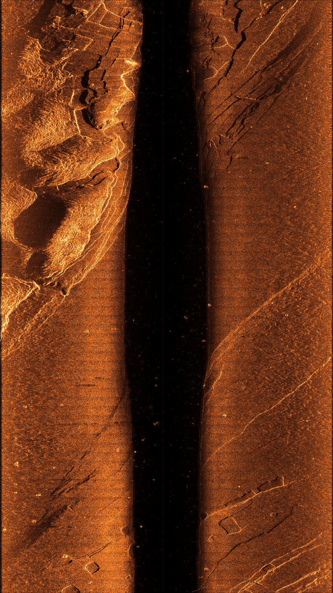

图3 本次确认的边缘修复与Shotwell增强全幅预览。预览不是原生分辨率文件；原生像素及来源哈希另有校验，私有数据仅本机保存。

### 4. 去噪与导航观测之间的边界

原生实测数据先处理形成新场；新的虚拟AUV观测再由该场和仿真器产生。导航收到的仍是含合成噪声的复数回波经脉冲压缩得到的幅度、IMU、DVL及压力深度，不是原瀑布图的直接裁剪，也不是重放真实原航次相位。历史ping只做普通重叠组织，不再次调用去噪网络。

新场的非标定HSV-V代理不应被解释为实物声呐绝对声压。参考图外观改变、边缘修复与合成信号水平改变同时存在，本轮对比评价的是这套组合方案，不是分别量化深度学习、小波、边缘修复和亮度增强的独立贡献。没有真实同帧干净真值，仍不报告真实PSNR或无损恢复率。

## 七、试验设计与评价指标

### 1. 主试验的同输入设计

主试验固定为增强外观场上已完成的完整16.49 km记录，噪声种子31。原版与改进版接收完全相同的62458个声呐ping、1030546个IMU、103054个DVL及206109个压力事件；不重新生成声呐。精确导航初始化沿用受控试验条件，参考图及核心依赖逐SHA核对。候选开启跨航线斜距变化约束，保持原地图和回环的既有信息强度。

此设计与旧报告的新旧底图对比不同：旧报告改变外观场并重新生成声呐，不能称为同声呐输入；本次把底图和收到的观测固定，主要考察后端对已有信息的利用。两种因果口径不混淆。

### 2. 开发记录与新噪声补充

旧场种子32的2 km记录用于诊断初版退化和选择保留既有信息的策略，属于开发验证，不再作为盲测。随后在新噪声记录生成前冻结参数和源码，使用种子33生成约4 km完整原版记录，再用候选重放并独立审查。两组运行串行，驱动核对91项预声明源哈希，防止看过新记录后再改参数。

新噪声只改变同一场景内的传感器随机实现，不构成独立航次、新海域或真实实船测试。新记录与主记录使用同一核心和同一参考图，均核对原始依赖哈希。补充样本数15152，不得替代主试验的62458样本全程结果。

### 3. 三维位置与方向误差

每个共同采样时刻计算eₖ=‖p估计(tₖ)−p真值(tₖ)‖₂，RMSE=sqrt[Σeₖ²/N]。P95为95%样本不超过的误差分位值，不是置信区间；最大误差保留全部异常峰；终点只评价最后一个时刻。数据按模拟采样时刻比较，不按网络到达时刻比较。

用评价真值航向ψ把水平误差投影为沿航向误差e∥=eₓcosψ+eᵧsinψ，以及横航向误差e⊥=−eₓsinψ+eᵧcosψ。真值航向只用于事后分解，不作为导航观测。该分解帮助辨认方向性薄弱环节，但不是单独证明因果归属或观测矩阵秩。

### 4. 相对运动与完整性评价

相对运动采用10 m和30 m航程窗口，将估计平面相对位移按各自起点航向转换后与真值相对位移比较。窗口内高度差不计入该平面RPE；它不能与历史板载按秒定义的SE3误差混表。所有时刻均保留，不作事后SE3对齐，不用最终全历史平滑轨迹替换实际在线Global。

完整性检查包括全部事件计数、归档输入哈希、CSV与NPZ逐值一致、实际图边、真实距离bin正支持、由Local重建的接收器偏移、压力位置及一次性token。改进版在首条新因子前的Global须与原版逐值相同，当前两组均有5549个前缀样本、坐标最大差0.0 m；该检查比较的是两份估计，不以真值误差筛选量测。

### 5. 运行时间与复现实验边界

本轮是PC离线加速的因果事件重放，观测频率来自原时间戳，声呐约3.03 Hz；海湖历史板载分支使用5 Hz。主候选重放墙钟约2325.8 s，补充候选约406.5 s；这两项不含原生回波重新生成，不能与含生成阶段的总墙钟直接比较，也不能作为板载实时性的验收结论。

## 八、海湖处理器在环历史试验结果

本章沿用旧底图报告已独立核验的历史板载数据。本轮在PC验证千岛湖纯侧扫后端改进，未重跑这些板载试验，也未更新其历史成功或失败状态。

### 1. 部署与接口结果

实际Jetson AGX Orin以aarch64环境运行冻结湖区及海区源代码，采用原生GTSAM后端。PC与板卡之间通过ROS 2 Humble可靠传输链路交换规定字段；湖区全程保留157056个声呐输出，海区保留243569个声呐输出，返回的六组位姿通道与板卡保存结果一致。

湖区输入计数为1570550 IMU、157055 DVL、314110压力和157056声呐事件，另含启动和结束消息。板载全程接收与输出链路已经实际工作，支持“板载算法部署链路初步完成”的阶段结论；并非只完成了依赖安装或空程序启动。

### 2. 湖区47.12 km完整结果

| 通道 | 板载RMSE/m | 板载P95/m | 板载最大/m | 板载终点/m | 原PC RMSE/m |
|---|---:|---:|---:|---:|---:|
| DR | 735.761 | 1766.942 | 2045.563 | 2024.939 | 944.143 |
| Local | 734.390 | 1761.979 | 2038.062 | 2016.920 | 942.325 |
| Global | 6.829 | 13.527 | 38.784 | 22.517 | 7.120 |

Global保持显著小于长程航位推算的误差，说明绝对地形约束在板载执行中持续发挥作用。Local与DR末段仍存在大漂移，不能因为Global较好就将前端称为长程绝对定位准确。板载与PC的DR、Local数值并不相同，不能仅用Global接近来证明全部数值链路一致。

湖区按原“不允许RMSE/P95退化超过10%”规则进行相对精度审查，没有触发退化项，但该规则是单侧退化限制，不意味着板载和PC所有通道误差差异均小于10%。湖区完整仿真时长31411 s，传感器阶段墙钟约34374.49 s，输出迟到P95约2529.47 s，持续5 Hz实时条件没有通过。

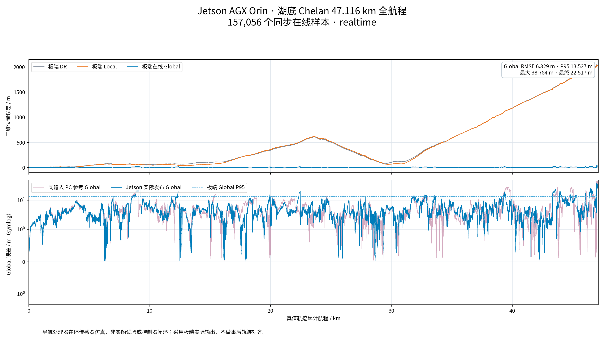

图4 湖区完整板载在线误差；全部157056个样本保留。

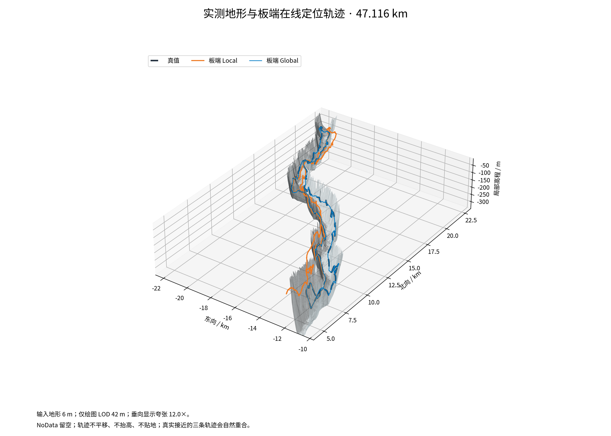

图5 湖区板载实际输出在地形上的轨迹展示，不以PC参考替代板载结果。

### 3. 海区73.07 km完整结果

| 通道 | 板载RMSE/m | 板载P95/m | 板载最大/m | 板载终点/m | 原PC RMSE/m |
|---|---:|---:|---:|---:|---:|
| DR | 939.127 | 2047.901 | 2316.987 | 2192.007 | 624.745 |
| Local | 929.598 | 2041.597 | 2308.369 | 2184.607 | 625.016 |
| Global | 6.830 | 13.267 | 41.453 | 4.451 | 6.365 |

海区Global总体仍明显优于板载DR和Local，但板载Global P95较原PC的11.706 m增加约13.33%，超过原10%退化限制；DR和Local RMSE分别增加约50.32%、48.73%。因此该组的“全通道相对精度审查”未通过。终点4.451 m较小，不能替代全程和跨平台判定。

完整海区归档约67.77 GB，保存的PC输入归档通过消息序号、字段、校验和及EOF审查；没有独立保存第二套板卡端原始字节输入归档，因此不扩大为“两端全部原始输入字节逐字节相同”。板载输出与返回结果的逐值一致性则有独立检查。

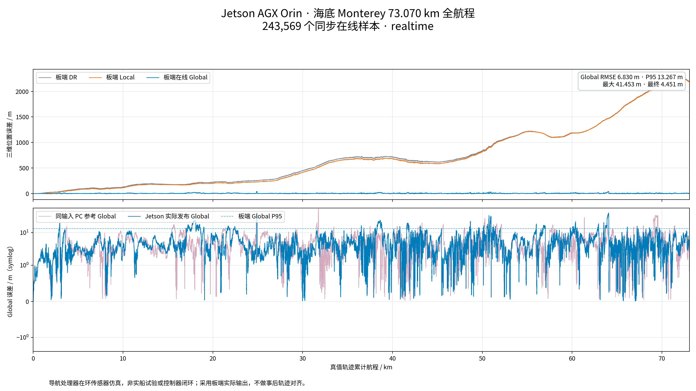

图6 海区完整板载在线误差；全部243569个样本保留。

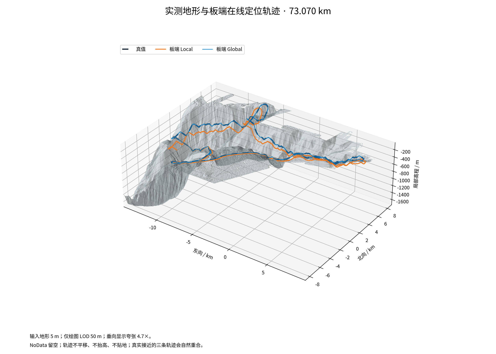

图7 海区板载实际轨迹。全程数据显示地图约束有效，但并不掩盖跨架构和实时性未达标项目。

### 4. 时序与资源问题

海区声呐估计调用平均0.2391 s、P95为0.2668 s，已高于5 Hz的0.2 s名义周期；网络与处理往返P95为4.5558 s，输出到达迟到量P95约16348.25 s、最大17815.19 s。因此数据完整运行不能解释成实时时间尺度已保持。

海区PC源进程在收尾阶段发生一次内存不足事件。后续修改将终端整份大JSON输出改为紧凑摘要，离线分配检查显示额外Python分配峰值由约27.85 MB降至3143字节，另有短程退出检查；但没有以修改后再次跑完整73 km的证据，因此原全程故障不被重新标记为成功收尾。

跨架构惯性差异已经在隔离声呐与图优化的对照中复现，尚未唯一定位全部根因。报告不将其简单归因于网络、DVL或一个确定浮点算子。后续应分别检查初始姿态、旋转处理、传播顺序和数值敏感性，保持原失败记录以便回归。

## 九、纯侧扫16.49 km完整仿真结果

### 1. 完整执行与主要结果

完整采样航程16488.644188 m，62458个在线输出及全部规定基础传感器事件齐全。原版、第一候选和当前保留既有信息的改进版使用相同收到的导航记录。DR和Local在三个后端方案中逐值相同，Global由各自实际在线发布值计算。

| 方案或通道 | RMSE / m | P95 / m | 最大 / m | 终点 / m |
|---|---:|---:|---:|---:|
| 共同DR | 37.817 | 56.959 | 85.923 | 72.613 |
| 共同Local | 34.553 | 50.460 | 83.943 | 74.428 |
| 原版Global | 11.733 | 21.123 | 35.145 | 7.928 |
| 第一候选Global | 5.301 | 11.553 | 23.188 | 8.232 |
| 当前改进Global | 5.040 | 11.158 | 21.743 | 9.940 |

当前改进版相对原版Global的RMSE降低57.04%，相对共同DR降低86.67%。第一候选在完整主试验中也有明显改善，但它统一减弱旧信息并在开发记录上退化，不能仅凭主试验结果就优先采用。当前策略的平均、P95和最大误差进一步降低，而终点增大2.013 m，需与长程平均收益一起解释。

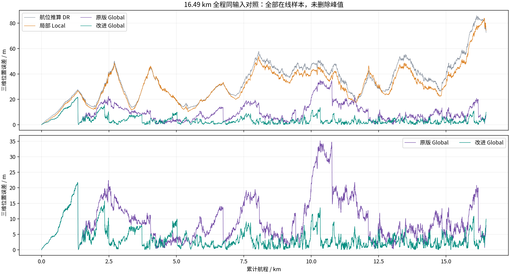

图8 同一62458样本输入的完整在线误差。上图同时保留DR、Local和两个Global；下图只比较原版与当前改进Global。所有异常峰均保留。

### 2. 方向性改善

| 方向RMSE | 原版 / m | 改进 / m |
|---|---:|---:|
| 沿航向 | 2.231 | 1.512 |
| 横航向 | 11.519 | 4.808 |
| 垂向 | 0.00975 | 0.00975 |

原误差主要集中在横航向。新增真实斜距变化约束后，横向RMSE下降至4.808 m，沿向也降低，垂向保持不变。这与新增约束用于平面后端而不是修改压力或前端的实现相符。该现象支持横向信息利用改善，但不能据此精确分配地图误差、匹配误差和融合误差各自占比。

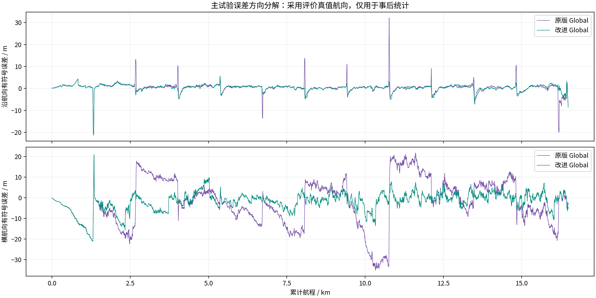

图9 采用评价真值航向分解的有符号误差。仅用于事后分析，不进入在线估计。

### 3. 首段与剩余峰值

首条新增斜距因子在模拟时刻1831.169577 s、累计1.465 km生效，此前5549个Global输出与原版完全相同。当前最大误差21.743 m发生在累计1.338 km，位于首次新增约束之前，因此本方法没有消除尚无独立回访的首段横向弱约束。

在首次新增约束后的全部样本中，原版Global RMSE为11.824 m，改进版为4.075 m。该分段仅解释作用时序，不代替全程5.040 m结果。原版最大峰位于10.331 km，其对应异常不通过删点或后处理掩盖。

### 4. 相对运动与发布代价

| 航程窗口 | 原Global平面RPE / m | 改进Global平面RPE / m |
|---|---:|---:|
| 10 m | 1.220 | 1.193 |
| 30 m | 2.284 | 2.212 |

主试验短距离Global相对误差略降，但仍须与Local连续里程计区分。map→odom发布修正可能使Global短时差分带有校正分量。用于控制或速度估计的短时运动应优先使用明确连续的里程计链路，而非把Global误差曲线的斜率当作航速。

### 5. 实际新增约束及回环

独立审查确认实际新增277条斜距变化因子、3119组配对、6238个不复用距离token；传统回环311条、地图先验350条。全部新增观测均可追溯到实际接收距离单元及Local接收器偏移，未读取海底高度或评价真值构造因子。

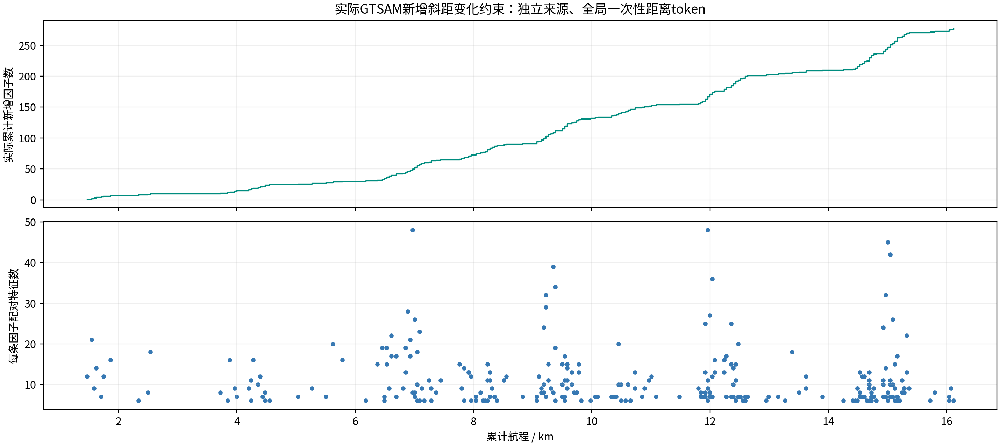

图10 上图为真实入图的累计新增因子数，下图为各因子的配对特征数。因子数不是独立观测维数；信息仍受几何退化和相关性约束。

### 6. 改进后实际三维轨迹

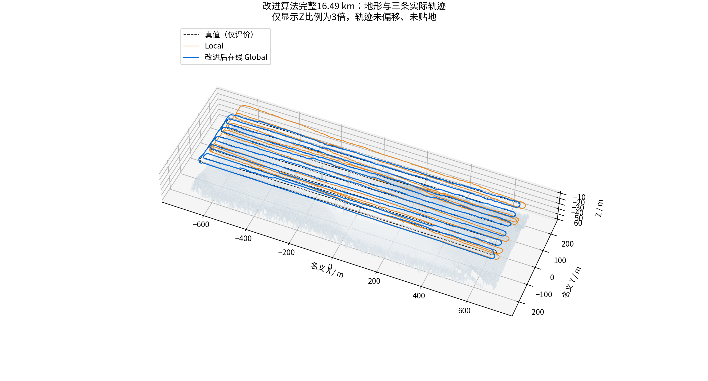

图11 同一新底图上的真值、Local和改进后在线Global，分别用黑虚线、橙线和蓝线表示。每条轨迹保留62458个原采样位置，未人为平移、贴地或平滑。地形为仿真器私有世界，Z显示比例3倍；该高度场未送入纯侧扫估计器。

## 十、新噪声种子与开发验证结果

### 1. 预先冻结的4 km新噪声检验

补充试验使用同一增强外观场、同一核心及参考图，但噪声种子改为33。原版完整生成并处理15152个ping后，候选直接重放其全部输入；没有根据中途误差继续调参。真实采样航程3999.863075 m，250000 IMU、25000 DVL、50000压力事件齐全。

| 方案或通道 | RMSE / m | P95 / m | 最大 / m | 终点 / m |
|---|---:|---:|---:|---:|
| 共同DR | 15.917 | 21.008 | 23.031 | 16.484 |
| 共同Local | 15.692 | 21.673 | 23.651 | 15.516 |
| 原版Global | 7.629 | 12.807 | 15.534 | 12.658 |
| 改进Global | 5.951 | 11.781 | 15.534 | 1.591 |

Global RMSE降低21.99%，P95降低，最大误差相同，终点明显降低。最大值仍由新约束前的共同首段决定，不应把最大不变解释为后续没有收益。该记录提供同场景新随机扰动下的补充证据，而不是完整16.49 km第二种子或跨海域泛化试验。

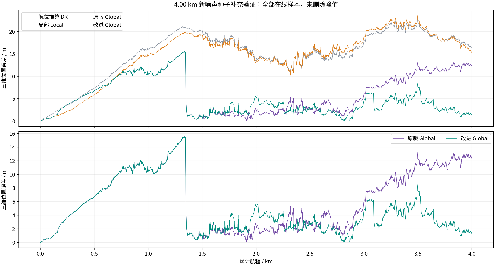

图12 新种子完整15152样本同输入对照。原版与改进版首段完全重叠；后段整体漂移降低，但局部仍有改进版较差的区间。

### 2. 补充试验中的代价

横向RMSE由7.454 m降为5.676 m，沿向由1.624 m增至1.787 m。Global 10 m平面RPE由0.845 m增至0.887 m，30 m由1.548 m增至1.607 m。绝对误差改善与短时连续性并不等价，不能只选有利指标。

独立审查确认19条新斜距因子、202组配对、404个一次性token、47条传统回环和88条地图先验。首新因子前5549个Global坐标逐值相同，地图与核心依赖和主试验一致；输入全部无损复用，DR与Local不变。

### 3. 旧场开发记录及负结果

旧场种子32约2 km记录已参与诊断，不属于未见测试集。三种方案的完整记录结果如下：

| 方案或通道 | RMSE / m | P95 / m | 最大 / m | 终点 / m |
|---|---:|---:|---:|---:|
| 旧场原版 | 7.797 | 15.136 | 16.184 | 2.083 |
| 统一减弱旧信息候选 | 9.540 | 15.303 | 16.013 | 4.669 |
| 保留旧信息候选 | 7.874 | 15.136 | 16.184 | 4.693 |

最初统一减弱旧信息的方案RMSE增加约22.35%，且退化先于首条新斜距因子；这一时序证据支持将旧信息减弱与新距离量测的作用分开。保留旧信息后，首新因子前轨迹恢复逐值一致，整体退化缩小到约0.98%，但终点仍差于原版。该记录不删除、不更名为成功结果，也不因为主试验改善就宣称已消除全部退化。

### 4. 能够支持的泛化范围

完整主试验与新噪声补充都支持当前场景下整体Global误差降低。它们不提供多地形统计显著性、独立航次绝对地图精度或任意失位恢复成功率。样本间存在强时间相关性，62458和15152个输出不等于同数量的独立实验；本报告不据逐帧样本量构造未经处理的置信区间或显著性检验。

## 十一、结果分析与阶段成果

### 1. 11 m不是已证实的底图精度下限

同一底图和同一传感器记录下，Global RMSE从11.733 m降为5.040 m，说明原误差不能完全归因于图像质量或地图分辨率。原横航向误差占主导，新约束后横向明显改善，表明几何可观方向与后端信息利用是重要环节。地图0.3 m栅格间距并不等于0.3 m坐标精度；缺少外部测绘基准时，也无法给出真实绝对误差下限。

### 2. 去噪与定位改进的因果区分

本轮新旧算法均使用相同的固定去噪、边缘修复和增强外观场，收到的全部导航输入也相同。因此本轮57.04%的全程收益不能归因于又换了去噪模型、底图变亮或增加测深。旧报告新旧外观场的对比属于另一个试验，二者不混合计算所谓独立AI去噪增益。

### 3. 尚未解决的约束与统计问题

在没有独立重复地物的首段，新增斜距变化因子尚不可用，横向弱约束仍可能累计；未知地物高度和压力变化也会扩大允许区间、降低信息。需要通过具有共同地物的测线布设、交叉或反向复访设计及传感器标定增强真实几何，而不是增加不存在的高度观测。具体航线的最佳交叉角不能从单次实验概括为普适规则。

地图关联误差、多个图因子共享纹理及历史位姿相关性仍采用近似管理。即使新增token不复用，旧图像量测和新距离量测也不自动统计独立。后续可研究联合地物变量、相关性传播与输出连续性，但不能把这些未来工作写成当前实现已有的性质。

### 4. 月度目标的支撑情况

| 阶段目标 | 当前可支撑成果 | 解释范围 |
|---|---|---|
| 9月运行环境与板载部署链路 | 历史海湖完整板载接收、算法执行、定位返回与记录审查 | 初步部署链路，不等于全部实时性与跨平台精度通过 |
| 10月建立仿真环境 | 实际地形、声呐与运动传感器、梳形航线、记录和评价链路 | 本轮11月后续补充应按实际日期标注 |
| 绝对匹配算法仿真 | 历史多波束地形匹配及当前纯侧扫参考地貌匹配 | 当前5.040 m为同场受控仿真，不是独立实船绝对精度 |
| 相对匹配算法仿真 | 局部声呐特征里程计、历史回环、真实重复斜距约束 | Local仍有漂移，部分Global短时相对指标有退化 |
| 报告与复现资料 | 完整在线曲线、三维轨迹、全样本导出、配置和独立审查 | 原数据保密，仅本地交付 |

### 5. 下一阶段工作

优先针对首段横向弱约束和Global发布连续性开展独立对照，保留准确初始化与未知初值恢复两种不同评价；随后补独立航次、真实航姿和外参、声速与设备频带标定，并引入可靠外部定位参考。若在板卡部署新纯侧扫配置，应重新运行对应完整任务，而不能借用历史海湖结果认定新版本已通过。

原海湖核心及入口未改动，161项相关核心回归通过；这不等于重新执行了原72 km全程。当前改进作为显式可选策略保存，原版和所有正负试验继续保留，后续迭代可按相同输入、同样本和同指标回归。

## 十二、软件与数据交付及复现方法

### 1. 本地交付与数据保密

本报告提供可编辑Word、PDF、源稿、全部主试验及补充误差CSV、无损压缩的完整仿真坐标、100 m分段统计、图表和来源摘要。原始MAT、实测I/Q、GPS、逐ping导航输入及可还原声学缓存不复制进报告包，也不上传。当前图表和仿真坐标仅作本地交付；任何对外分享仍应按数据授权范围单独审查。

### 2. 结果文件与数据字典

`data/main_errors_full.csv`保存62458行在线误差，`data/fresh_errors_full.csv`保存15152行。字段依次为模拟时间、累计航程、DR误差、Local误差、原版Global误差和改进Global误差，单位分别为秒、米、米。`main_trajectories_full.csv.gz`与`fresh_trajectories_full.csv.gz`保存相同采样时刻的真值及四组估计坐标，均为本地名义坐标，未丢弃样本。

`main_segments_100m.csv`与`fresh_segments_100m.csv`保留分段样本数、RMSE、中位数、P95、最大和末样本误差。分段用于定位异常区间，不是独立重复实验；跨段总体RMSE不能对分段RMSE不加权平均。`verified_report_results.json`保存当前重算结果、实际约束审查、开发负结果及回归范围。

### 3. 核心实现与版本绑定

核心新增模块分别负责未知高度区间残差、真实两变量GTSAM因子和一次性接收来源关联库。导航窗口只附加真实来源标签，前端保持原值。当前使用冻结42文件候选运行时，增强独立审查使用另存21文件分析运行时；4个原核心和3个参考图依赖逐SHA绑定，未用工作树中可能变化的文件替代已执行源码。

相关117项测试覆盖数学与雅可比、退化与物理区间、真实GTSAM接入、距离来源审计、默认关闭路径、完整性门禁、因子日志精度和报告依赖检查；原核心另161项回归通过。两份JUnit均0失败、0错误、0跳过。测试和清单只是验证的一部分，完整数值及实际图边仍需单独核对。

### 4. 同输入复现命令

以下命令使用本机已有私有场景和记录，不会下载、上传或覆盖原实验。输出必须选择从未存在的新目录。重放与分析须依次执行；这些命令用于复现已完成的同输入配置，本次编制报告没有重新启动仿真。

```bash
cd /home/cgz/OceanSim
TASK_BASE=output/real_sonar/qiandao_range_change_navigation_20261107_v1
TASK_SCENE=output/real_sonar/qiandao_edge_shotwell_navigation_20261107_v1
.venv-sonar-denoise/bin/python \
  "$TASK_BASE/runtime_candidate_v3/standalone/ReplayPureSideScanNavigation.py" \
  --experiment "$TASK_SCENE/enhanced_scene" \
  --run "$TASK_SCENE/full_enhanced_seed31" \
  --out "$TASK_BASE/manual_preserve_report_replay_NEW" \
  --runtime current --loop-closure \
  --submap-representation adaptive_projected \
  --mapped-range-changes --mapped-range-policy preserve_legacy
```

```bash
.venv-sonar-denoise/bin/python \
  "$TASK_BASE/analysis_runtime_v5/standalone/AnalyzeMappedRangeNavigation.py" \
  --source-run "$TASK_SCENE/full_enhanced_seed31" \
  --candidate "$TASK_BASE/manual_preserve_report_replay_NEW" \
  --out "$TASK_BASE/manual_preserve_report_review_NEW"
```

新增功能默认关闭；本报告采用显式的`--mapped-range-changes --mapped-range-policy preserve_legacy`。初版统一减弱旧信息策略只是保留的对照，不作为当前推荐命令。精确文件路径、源哈希和完整结果来源在evidence目录记录，正文不以工作目录标签代替算法定义。

### 5. 报告质量检查

报告数据再次从实际状态与在线CSV重算，检查样本总数、单调时间戳、所有坐标及误差逐值一致，并将标题、图、表、主要数值和PDF页面与源稿核对。Word标题遵循题目、一、1.、（1）的四级结构，图像保持宽高比。原版Word、PDF和源稿只读保留，新版单独存放。

## 十三、结论

当前纯侧扫改进利用同一地物两次真实接收的斜距变化，在未知地物高度下保持物理可行区间，通过两变量GTSAM因子补充原扫描平面与历史回环约束。完整16.49 km同输入试验的在线Global RMSE为5.040 m，较原版降低57.04%，P95和最大误差也降低；同场景新噪声4 km补充的RMSE为5.951 m，较其原版降低21.99%。全部规定事件及在线输出完整保留，DR、Local未变，实际距离来源和不复用条件通过独立审查。

改善具有明确边界：主全程终点误差从7.928 m增至9.940 m，补充测试沿向与短时相对误差略增，旧开发记录仍约0.98%轻微退化；首次独立回访前的弱方向尚未消除，历史相关性也未严格联合建模。因而结论是当前受控场景中的整体匹配导航性能改善，而不是任意场景或全部指标全面提升。

本报告可支撑现有仿真环境、绝对地形地貌匹配、相对匹配和部署链路阶段成果说明。历史海湖处理器在环结论保持原状；新纯侧扫算法本轮只在PC验证，仍需独立航次与外部基准、设备标定及对应板载全程复验，才能进一步形成真实高精度定位和实时时序验收结论。原始数据不上传，原算法与全部正负结果保留。

## 十四、参考文献与方法来源

### 1. 仿真与导航基础

（1）Song J, Ma H, Bagoren O, et al. OceanSim: A GPU-Accelerated Underwater Robot Perception Simulation Framework. IROS 2025; arXiv:2503.01074。[论文](https://arxiv.org/abs/2503.01074)

（2）Zheng C, Xu W, Zou Z, et al. FAST-LIVO2: Fast, Direct LiDAR–Inertial–Visual Odometry. IEEE Transactions on Robotics, 41:326–346. DOI:10.1109/TRO.2024.3502198。[出版页](https://ieeexplore.ieee.org/document/10757429/)；[官方代码](https://github.com/hku-mars/FAST-LIVO2)。本项目并非原样复现该激光视觉系统。

（3）Kaess M, Johannsson H, Roberts R, et al. iSAM2: Incremental Smoothing and Mapping Using the Bayes Tree. International Journal of Robotics Research, 2012,31(2):217–236. DOI:10.1177/0278364911430419。[作者机构页面](https://publications.ri.cmu.edu/isam2-incremental-smoothing-and-mapping-using-the-bayes-tree)

（4）Sun J, Shen Z, Wang Y, Bao H, Zhou X. LoFTR: Detector-Free Local Feature Matching With Transformers. CVPR 2021:8922–8931。[论文](https://arxiv.org/abs/2104.00680)

（5）Zhang Q, Kim J. Terrain-Based Global Tracking Without Prior Pose Information Using Multibeam Echosounder Measurements. IEEE Transactions on Instrumentation and Measurement, 2026,75:7506113. DOI:10.1109/TIM.2026.3716492。[作者机构页面](https://pure.kaist.ac.kr/en/publications/terrain-based-global-tracking-without-prior-pose-information-usin/)

### 2. 侧扫特征与多视角几何

（1）Zhang J, Xie Y, Ling L, Folkesson J. A fully-automatic side-scan sonar simultaneous localization and mapping framework. IET Radar, Sonar & Navigation, 2024,18(5):674–683。[作者公开实现DIASSS](https://github.com/halajun/diasss)

（2）Zhang J, Xie Y, Ling L, Folkesson J. A Dense Subframe-based SLAM Framework with Side-scan Sonar. arXiv:2312.13802v2，2024年11月15日修订，作者页面标注为IEEE Journal of Ocean Engineering接收稿。[论文](https://arxiv.org/abs/2312.13802)

（3）Norman K, Mangelson J G. Beyond the Flat Seafloor: A Closed-Form Two-View Constraint to Aid Sidescan Sonar Reconstruction. arXiv:2609.25271，2026年9月21日，作者页面标注OCEANS 2026 Monterey接收。[论文](https://arxiv.org/abs/2609.25271)

上述文献提供仿真、特征关联、增量平滑及侧扫多视角几何基础，不提供本报告新增区间因子的性能保证。本报告所有定位数值来自本项目实际试验，不引用外部论文的误差数值替代自身验证。

### 3. 场景与软件来源

历史海区USGS Monterey Canyon数据来源为[10.5066/F7XD0ZQ4](https://doi.org/10.5066/F7XD0ZQ4)，历史湖区Lake Chelan数据来源为[10.5066/P1GE3YDR](https://doi.org/10.5066/P1GE3YDR)。千岛湖原始记录、固定去噪及本轮全部输入输出仅本机保留，见本报告的数据字典和来源摘要。

增强外观映射沿用GNOME Shotwell 0.30.14原引擎，源码与许可见[已固定的软件版本](https://github.com/Guanzhen-C/DeepSea-Matching-navigation/tree/sonar-denoise-enhanced-20261107/third_party/shotwell_0_30_14)。辐射增强不等于增加新的物理测深或导航观测。

