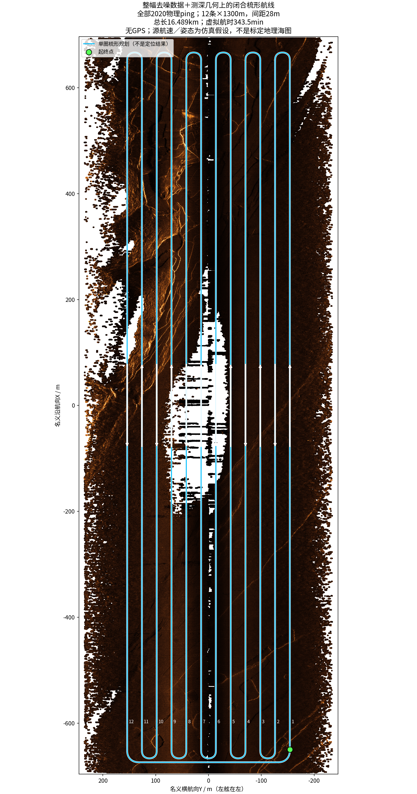
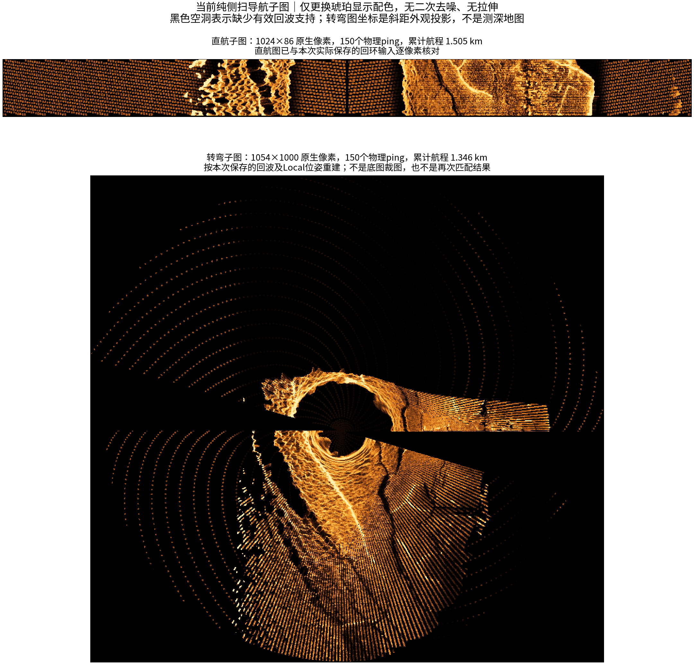
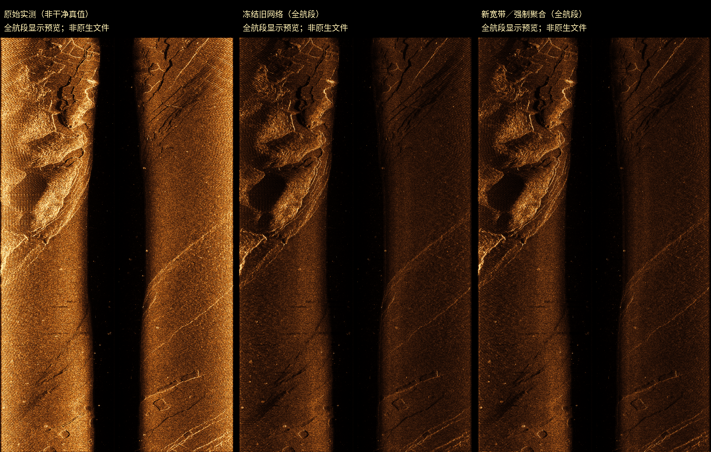
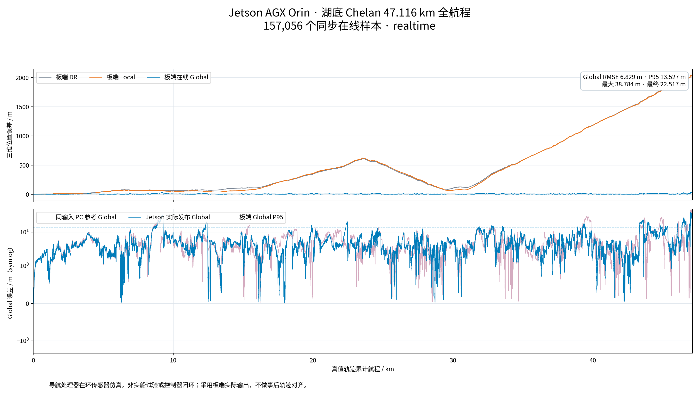
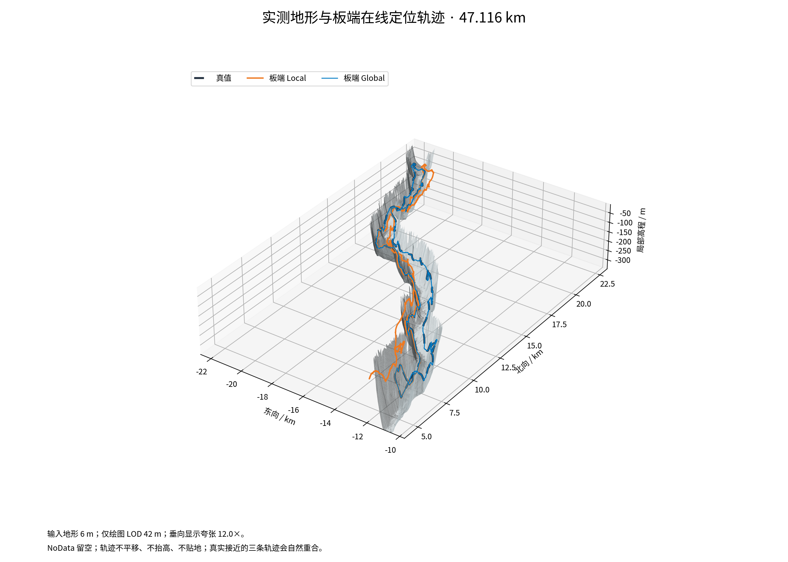
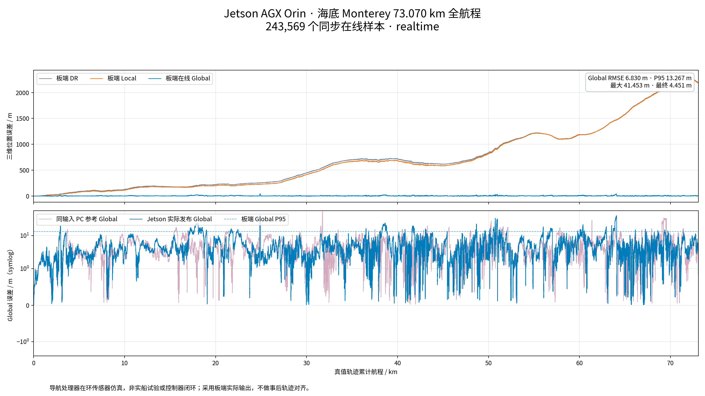
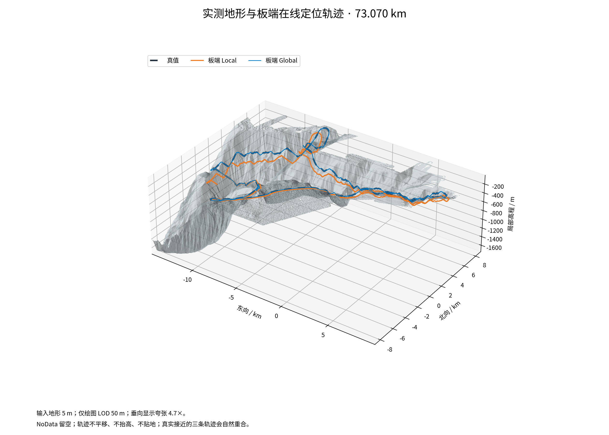
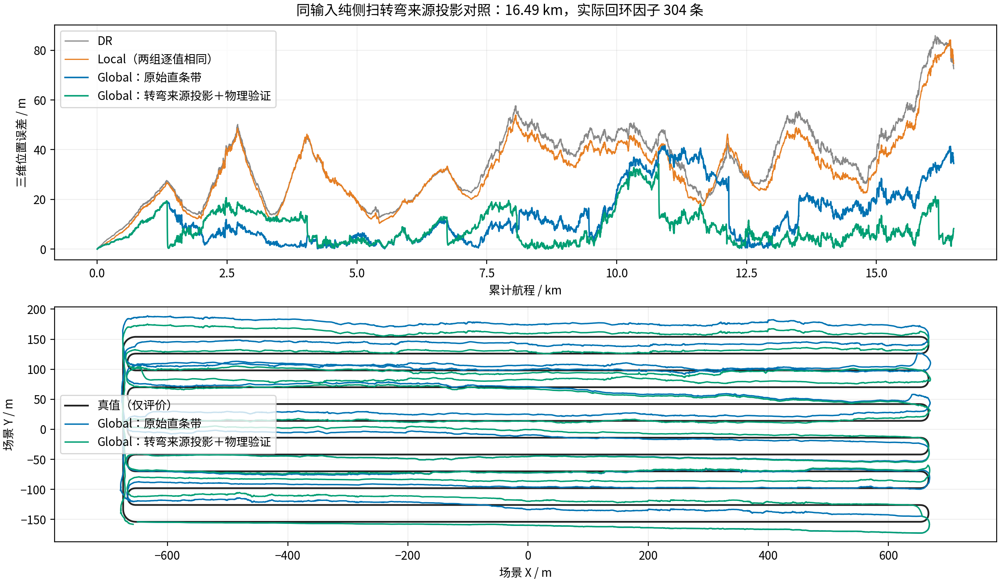
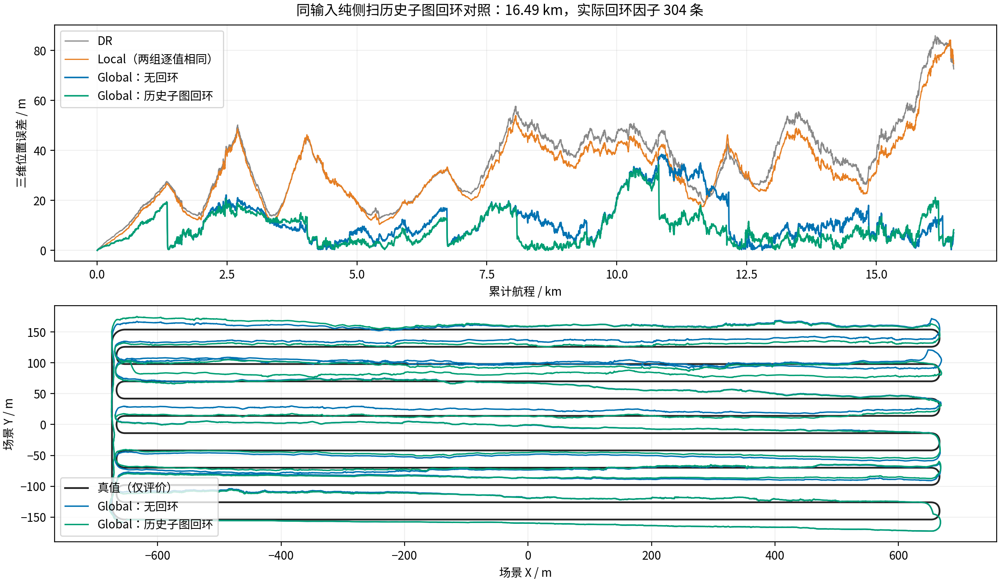
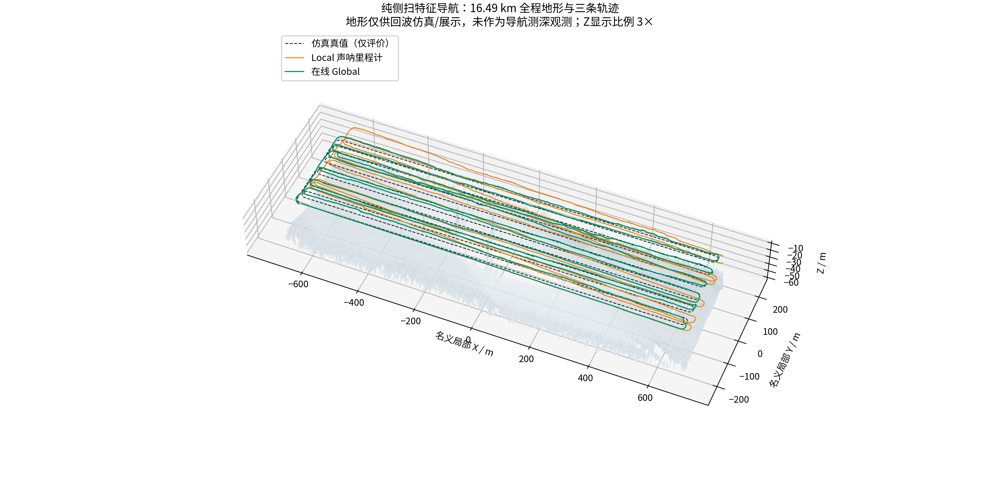

# 海底地形地貌匹配算法仿真报告

编制日期：2026年11月7日  
项目：基于迁移学习的海底地形重建与高精度定位技术研究  
成果范围：海湖地形匹配处理器在环验证、实测侧扫去噪及纯侧扫特征导航仿真  
软件主线：`Guanzhen-C/DeepSea-Matching-navigation` 仓库 `main`

本报告汇总两条已实际执行的技术路线：一是基于真实海底和湖底地形构建仿真观测，在嵌入式板卡上运行完整定位算法的处理器在环实验；二是对实测侧扫数据进行固定方案去噪，构建强度场，再开展纯侧扫特征辅助导航的完整梳形航线实验。二者分别回答“算法能否完成板载数据处理链路”和“侧扫地貌信息能否有效约束导航漂移”，不将不同传感器条件、不同地形和不同运行平台的数据混为一个精度结论。

湖区47.12 km、海区73.07 km处理器在环实验的板载在线Global三维位置RMSE分别为6.829 m、6.830 m。千岛湖实测数据构建场景中的纯侧扫16.49 km实验，最终组合Global RMSE为10.800 m，相同输入的DR为37.817 m，整体降低71.44%。海区在环实验仍存在跨架构精度规则未全部通过和持续实时性不足；纯侧扫实验仍有34.321 m峰值、横向退化和独立实测地理真值不足等限制。因此，现有成果能够支撑板载链路初步打通与地形地貌匹配算法仿真效果分析，不作为实船导航精度或全部工程验收条件均已通过的证明。

## 一、任务目标与试验范围

### 1. 研究背景与验证问题

水下航行器无法持续获得卫星导航定位，单靠惯性测量、DVL速度和压力深度计进行航位推算，会因航向误差、惯性零偏、速度误差及运动激励变化而产生累计漂移。已有海底地形图和声呐探测得到的地形地貌信息，可为航位推算提供与运动积分不同来源的约束。研究的关键不只是把两幅图像对齐，还包括量测几何、参考地图坐标、观测退化、错误关联、多候选管理和在线输出连续性。

本阶段重点验证三类问题：在模拟原始传感器输入下，板载算法是否接收完整数据并输出可追溯结果；多波束地形及侧扫地貌匹配是否改善长距离Global定位；没有可信测深约束时，侧扫图像特征能否独立提供可利用的导航信息。去噪研究服务于实测侧扫数据可用性，但不能以图像更平滑代替定位改善或地物保真证据。

### 2. 月度目标与实际时间

9月份任务的预期成果是初步完成嵌入式运行环境和算法部署链路；10月份任务的预期成果是建立仿真环境，验证绝对定位匹配与相对定位匹配，形成仿真报告。现存硬件在环完整实验的实际归档日期为2026年10月21日至23日。实测声呐去噪、千岛湖纯侧扫仿真及最终四组对照主要形成于11月3日至7日，作为后续补充验证列入本报告，不倒填为9月或10月已经完成的试验。

“部署链路初步打通”与“满足全部实时性和精度验收条件”是不同层级。前者可由板载运行、完整输入输出和版本一致性证明；后者还需要持续吞吐、跨平台数值差异、异常收尾、长时间资源稳定性及外场数据等证据。

### 3. 试验层级

| 试验层级 | 数据和算法运行位置 | 本报告中的含义 |
|---|---|---|
| PC地形匹配仿真 | PC生成传感器观测并运行定位 | 验证算法与场景、传感器模型之间的关系 |
| 处理器在环 | PC运行仿真、实际Jetson AGX Orin运行定位、网络返回结果 | 验证真实目标处理器上的部署和在线处理链路 |
| 实测声呐去噪 | 原始MAT复数数据进入固定信号处理与神经网络 | 验证完整实测记录能够处理和追溯，不预设具有干净真值 |
| 实测来源场景仿真 | 实测数据构建强度场，虚拟AUV产生新的声呐观测 | 验证纯侧扫匹配导航，不等同原航次位置精度评价 |

本阶段没有把实体声呐、推进器或控制器接入仿真闭环，因而处理器在环不应称为“实体声呐硬件在环”或“实船闭环湖试”。

## 二、仿真系统总体方案

### 1. 原项目基础与新增能力

OceanSim提供水下传感器仿真、场景组织、可视化及ROS 2集成基础。其公开工作面向水下感知仿真与声学成像，不能据原项目名称就推断本项目新增的全部定位算法已获得官方验证。公开方法与实现基础见[OceanSim论文](https://arxiv.org/abs/2503.01074)；本报告定位指标均来自本仓库具体归档实验。

本项目在该基础上增加真实测深及背散射数据适配、同步多波束与侧扫观测、IMU/DVL/压力深度输入、声呐惯性前端、多候选全局跟踪、GTSAM后端、map→odom软校正、板载数据传输与记录审计，并在后续增加实测复数侧扫去噪和纯侧扫特征导航适配器。仿真器、定位器和评价程序分离，防止将真值或仿真器内部海底高度直接传入不允许使用这些信息的定位分支。

### 2. 两条验证链路

硬件在环链路为：真实地形及背散射场景生成模拟IMU、DVL、压力和原始声呐事件；通过带序号和时间戳的数据接口发送至板卡；板卡运行冻结版本的完整前后端；定位及诊断结果返回PC；PC仅在评价端对齐共同时间戳并计算误差。模拟真值不作为持续导航观测发送。

纯侧扫链路为：固定去噪方案处理实测数据；按声明的原航速和姿态假设构建局部强度场；虚拟AUV沿梳形路线运动并产生含噪复数回波；由接收回波生成导航幅度；将当前和历史收到的物理ping按Local运动拼成子图；以特征对应和声呐几何约束进行地图匹配、历史回环和后端优化。

两条链路使用了不同的观测适配器。不能把海湖在环结果解释为新纯侧扫算法已经完成板载长程实验，也不能把纯侧扫方案的精度归因于未提供给该分支的多波束测深。

### 3. 坐标系与结果输出

DR表示仅依赖基础运动传感器传播和更新的航位推算；Local表示包含局部声呐约束的连续里程计；Global表示加入参考地图匹配和历史约束后实际在线发布的位置。评价使用每一时刻真实发布的Global，不以后处理得到的全历史平滑结果替换。

后端主要处理平面位置与航向，深度及完整局部姿态由前端状态维护。map→odom软校正用于调和全局参考与连续里程计坐标，避免把后端修正直接硬覆盖为前端运动增量。Global的差分可能包含地图校正，不应直接解释为航行器速度。

## 三、数据来源与场景构建

### 1. Monterey海区场景

海区场景使用USGS Monterey Canyon测深及背散射数据，来源标识为[10.5066/F7XD0ZQ4](https://doi.org/10.5066/F7XD0ZQ4)。归档测深网格为5 m，矩阵3534×5842，场景坐标跨度约29.205 km×17.665 km。处理保留完整源范围，不作地理裁剪或地形高度夸张，缺测区保留无效标记。

四套实测背散射层分别按其分布进行归一化，再配准到测深网格并仅在有效重叠区合成。因此，它们提供实测空间纹理，但不同设备、频率和编码之间并没有形成统一绝对目标强度标定。仿真回波也包含模型化传播、入射及噪声因素，不是重新播放原始海试声学波形。

### 2. Lake Chelan湖区场景

湖区场景使用USGS Lake Chelan测深和背散射产品，来源标识为[10.5066/P1GE3YDR](https://doi.org/10.5066/P1GE3YDR)。本次固定部署场景使用6 m准备网格，矩阵8558×7974，坐标跨度约47.838 km×51.342 km。数据集名称中的“3m”表示源产品组织信息，不应误写为全部实验都在3 m导航网格上运行。

背散射预处理将记录的dB量转换为相对线性功率，再进行插值和重叠平均，避免直接对dB作线性均值或用显示对比度拉伸替代物理量处理。湖区还使用了独立于海区冻结基线的候选合并和原始声呐恢复配置，不用湖区修复参数覆盖海区历史算法。

### 3. 千岛湖实测声呐数据

#### （1）原始记录

数据来自提供的下午返航Data01、Data02两部分，共2020个物理记录。完整复数数据组织为2舷×8个沿航向采样通道×2020记录×12189距离样点。声速参数1480 m/s，采样率37650 Hz，沿航向通道间距0.15 m。原始MAT、设备参数、测深及侧扫记录对应关系均保留来源哈希。

#### （2）去噪与成像

完整16通道处理覆盖393948480个原生复数样值。拼接显示图为24378×8084像素；该显示图的像素组织不应与复数数据数组一一等同。显示琥珀配色只是幅度可视化，不提供额外声学测量精度。

#### （3）场景栅格

按声明的标称原航速2.05778 m/s、平直姿态及平台深度假设构建名义局部坐标。场景网格1635×4644，采样间距0.3 m，约1.393 km×0.490 km。0.3 m是场景栅格间距，不是已通过外部标定的定位或测深精度。

#### （4）参考与查询

2020记录按物理记录拆分为1010条参考、1010条查询，无共同记录ID；完整2020记录的显示场仅用于展示。拆分避免直接使用同一个原始ping，但两部分仍来自同航次、同一名义地理编码，不构成跨航次独立泛化试验。

### 4. 梳形路线与覆盖范围

虚拟AUV以0.8 m/s沿12条1300 m测线运动，测线间距28 m，包含11次掉头以及闭合返航，总规划长度16488.743 m。末声呐采样距离16488.644 m，与规划终点相差约0.099 m，小于一个声呐采样间距。路线完整执行，不能把“全程结束”误写成只运行到最后一个打印点。

路线针对整幅强度场规划，并非从完整图中另截一小块开展往返。但尚未把每个实际ping的有效声呐足迹累积为全场逐像素覆盖率图，因此没有证明每个有效像素均达到100%覆盖。边缘、无效单元和声呐盲区不以插值填补方式计作已经观测。



图1 整幅实测数据构建场景与闭合梳形规划。底图坐标为名义局部坐标；图中历史标题中的测深几何属于场景构建，后续纯侧扫估计器没有读取测深似然。

## 四、传感器模型与数据接口

### 1. 硬件在环输入

海湖在环分支的输入为IMU、DVL速度、压力深度及一体化多波束测深侧扫观测。名义频率分别为IMU 50 Hz、DVL 5 Hz、压力10 Hz、声呐5 Hz。所有传感器使用采样时间戳而不是网络到达时刻进行状态估计；网络序号、消息完整性和返回结果关联另行审计。

输入协议采用明确字段白名单。初始时刻可提供受控导航初值，后续真值保持在PC评价端。板载轨迹返回值与PC接收到的六组位姿通道逐条核对，防止把PC参考轨迹误当成板卡运行结果。

### 2. 纯侧扫仿真观测

纯侧扫分支不消费MBES XYZ、DOA测深量测、海底高度似然或DVL离底高度。它可使用IMU、DVL速度和压力深度，并利用已知传感器安装参数与收到的侧扫幅度。压力深度给出航行器在竖直方向的状态约束，不等同于航行器到海底的高度。

仿真复数回波参数包括450 kHz载频、451.8 kHz解调频率、37650 Hz采样率、5 ms脉冲长度、−6×10⁶ Hz/s调频率、250 m最大斜距和每舷8个同步沿航向采样通道。此处复数信号是仿真生成，不是从幅度图恢复了真实相位，也不是通过实物标定的完整波动声学或多途模型。

导航幅度每舷每通道使用512个距离单元，保留有效接收支持区域。原生复数与导航栅格承担不同用途：原生复数用于波形处理，导航栅格用于特征与子图组织。完整运行保存所有导航幅度及IMU/DVL/压力输入，原生复数仅保存首150个ping，不能声称已保存整个航程的全部原生I/Q。

### 3. 同步8通道与连续150个ping

8个通道属于同一物理ping的同步采样，不是8次连续发射。子图另外累计150次连续物理ping，二者不能相互替换。物理ping周期从实测记录时间戳确定，约0.33 s，对应约3.03 Hz；这与海湖在环分支的5 Hz配置属于不同试验条件。

150个ping之间实际首尾时间跨度约49.17 s，直航约39.34 m。连续运动将窄沿航向条带累积为具有二维纹理的子图，为局部特征及历史地貌对应提供支持。该窗口引入信息积累时延，不能把它写成150个ping瞬时同时发射。

### 4. 模型与实物的边界

数据中设备安装角、通道间距和采样率可用于约束仿真；声源指向性、介质声速变化、多途、姿态扰动、混响以及散射相位统计并未全部经过该设备实测标定。报告中的“真实数据”主要指场景纹理、部分测深来源和原始MAT记录，而不是所有传感器误差过程均真实复现。

## 五、导航与地形地貌匹配算法

### 1. 局部状态估计

惯性传播和水下运动观测采用误差状态滤波思想。主要误差状态包括姿态、位置、速度、陀螺零偏和加速度计零偏，共15维；重力作为模型常量处理，不在当前纯侧扫适配器中另加待估重力状态，也未采用未经验证的DVL比例因子扩展。

海湖基线的声呐惯性链路受陆地激光惯性与视觉融合思想启发，但它使用了水下观测模型、DVL和压力约束，并非把官方FAST-LIVO2直接原样运行于声呐数据。官方FAST-LIVO2的激光几何与相机直接光度融合结构见[论文](https://ieeexplore.ieee.org/document/10757429/)；本项目的算法命名和效果应以实际实现为准。

纯侧扫前端采用GFTT角点、亚像素定位、SIFT描述子、互相匹配和鲁棒扫描行模型形成短时运动约束，主要更新有支持的沿航向量。它不是光流跟踪，也不是直接对原始强度做NCC相关。没有可信几何时不人为制造强横向或航向约束。

### 2. 海湖地形全局匹配

海湖版本结合候选检索、几何配准、多候选跟踪、无效候选和确认后发布。cohort粒子跟踪用于维护多个位置假设，避免立即将单次匹配高峰作为唯一正确解；GTSAM负责将确认的地图和相对运动约束组织为可优化的图。因而该后端是混合结构，不是“所有阶段都只使用粒子滤波”。

Global UTAN公开方案同样由外观检索、配准初始化和cohort粒子跟踪处理全局候选与伪峰，可作为该思路的参考。但论文中MBES地形描述、TEASER++和完整系统，与本项目具体模块并不完全相同，不能直接移用论文中的精度或恢复成功率。[Global UTAN论文信息](https://pure.kaist.ac.kr/en/publications/terrain-based-global-tracking-without-prior-pose-information-usin/)

### 3. 纯侧扫子图与特征地图匹配

#### （1）直航表示

按Local估计的位姿对收到的150个ping进行扫描行对齐与普通重叠平均，保留有效区域和观测时间。子图不是参考底图裁剪；无支持的像素不通过图像修补伪造。

#### （2）转弯表示

直条带不能同时容纳近乎垂直或反向的扫描方向。新方案在观测到足够航向变化时使用自适应来源投影，将实际回波组织成便于外观匹配的图，同时记录每个像素的主导实际来源、斜距、扫描平面、舷侧和时间戳。

#### （3）匹配与几何

LoFTR提供局部图像对应，随后使用声呐物理关系检验。该匹配器采用未经声呐专门训练的公开室外权重；它是图像对应工具，不因使用神经网络就自动具备水下几何正确性。[LoFTR原论文](https://openaccess.thecvf.com/content/CVPR2021/html/Sun_LoFTR_Detector-Free_Local_Feature_Matching_With_Transformers_CVPR_2021_paper.html)

#### （4）保持退化

投影横坐标和二维仿射变换只辅助外观组织及剔除错误对应，不把斜距投影当成已知水平地物坐标。参考强度场提供的是对应地物的名义平面坐标，地图匹配利用这些坐标与扫描平面的关系，不假定同时获得了海底高度。历史回环则以地物三维位置为未知量，通过斜距和扫描平面约束求解相对位姿；消元时保留真实零空间，避免用不存在的测深把问题人为变成强约束。



图2 当前方案的150 ping子图。上图为实际保存回环输入的逐像素核对结果；下图由同次记录回波和已执行Local位姿事后重建。琥珀色只用于显示，转弯图是斜距外观投影，不是正射海底地图。

### 4. 历史回环检测与图优化

回环检索要求当前与历史物理ping窗口不重叠，并满足至少180 s时间分离。首先根据估计覆盖范围及描述子检索候选，再进行LoFTR对应、几何检验和不同当前及历史窗口的时间一致性确认。两个来自同一个窗口的候选，不计作两次独立确认。

底图绝对匹配与回环不同：前者约束相对于已有地图的位置，后者约束不同时刻之间的相对位姿。轨迹相交并不自动形成回环，声呐必须实际扫到共同地物且匹配具有可靠几何支持。

当地图先验和回环使用同一个当前子图像素时，采用分摊信息的保守策略，避免把同一份观测重复作为完全独立证据。历史相关性仍属近似处理，尚不是所有地物都联合优化的严格相关性建模。GTSAM采用增量优化及固定滞后活动输出，保留长历史回环的作用；增量平滑的公开方法基础见[iSAM2](https://publications.ri.cmu.edu/isam2-incremental-smoothing-and-mapping-using-the-bayes-tree)。

### 5. 观测残差与信息退化

#### （1）运动与基础水下观测

用R表示机体到局部坐标的旋转、v为局部速度、p为位置。简化惯性传播为R随陀螺去偏后的角速度积分，速度由R(a测量−b加速度)+g积分，位置由v积分；g为固定重力常量。简化DVL速度观测为v_DVL≈Rᵀv，压力观测约束竖直位置。实际实现还需按照外参和坐标约定处理，不能把DVL速度误认为持续绝对位置或航向观测。

#### （2）参考地图的扫描平面约束

对特征i，参考强度图给出名义地物平面位置mᵢ；接收来源给出相位中心oᵢ和扫描平面法向nᵢ。平面位姿为(R₂,t₂)时，可构造r_plane,i = nᵢᵀ[R₂ᵀ(mᵢ−t₂)−oᵢ,xy]。特征对应决定“同一地物”，扫描平面决定它对位姿提供的约束方向；图像横坐标本身不作为另一个独立水平距离测量。

如果多个nᵢ几乎平行，残差对某个平移方向可能不敏感。即使匹配点很多，该方向的信息也可能仍接近零；不同扫描方向的可靠对应才可能提升平面位姿的可观性。

#### （3）历史回环的斜距与扫描平面约束

设未知地物P在两个局部子图坐标中的位置为Pₐ、Pᵦ，接收相位中心为oₐ、oᵦ，实际斜距为ρₐ、ρᵦ。每对对应包含两个距离残差‖Pₐ−oₐ‖−ρₐ、‖Pᵦ−oᵦ‖−ρᵦ，以及两个扫描平面残差nₐᵀ(Pₐ,xy−oₐ,xy)、nᵦᵀ(Pᵦ,xy−oᵦ,xy)。两个坐标间的竖直位移来自航行器压力状态差，不是已知海底高度。

联合线性化后，若位姿与地物变量的信息块为A、B、C，则消去地物后的数据位姿信息为A−BC†Bᵀ，C†表示退化情况下的广义逆。该操作只使用声呐观测及声明的不确定性；里程计初始化可以用于数值求解，但不能作为新增声呐量测精度混入输出信息。真实不可观方向不通过加很大对角项“修好”。

#### （4）后端目标与多候选处理

图优化组合里程计、确认后的地图先验及回环残差，按各自信息矩阵和鲁棒损失求解。多候选阶段避免把相互分离的地形模式简单取均值，确认状态和无效候选影响实际发布来源。上述融合仍采用近似历史相关性管理，实验中的实际信息、来源及发布跳变均保留，不能只凭优化器收敛就判断匹配正确。

## 六、实测侧扫去噪方案与效果边界

### 1. 问题与技术选择

第二批原始数据中出现的白色条带与设备采集信号干扰有关。第一批已滤波数据和第二批未滤波数据不是同一个时刻严格配准的干净—带噪对，不能直接以第一批图作为第二批的像素级监督真值。仅在PNG上平滑会混合显示配色、动态范围和信号问题，因而固定方案转向原始MAT复数数据处理。

纯小波、频域条带抑制和其他传统方案曾进行比较。最终保留的是“融合／宽带／前级”模型作为基准，“融合／限带／前级”作为对照；没有把图像生成模型输出用于导航测量。模型版本、两份权重与74份源码、19份测试组成95项哈希清单。

### 2. 固定处理链

前级在原始复数域采用257抽头滤波器，参考频带为−15 kHz至−3 kHz，采样率37650 Hz，并对完整距离记录边界作保护。该负频带是当前录制链路的处理假设，尚不是双舷射频频谱已严格标定的结论。

神经部分使用两级Haar小波残差结构及观测幅度、相位相关特征，将局部残差与多通道一致性残差作可学习融合。结果以正实增益形式作用于原观测，避免凭空替换复数相位。训练与实测推理采用一致的前级定义，分别记录前级贡献和神经残差，不能把滤波器作用全部归功于深度学习。

训练中的宽带、限带扰动是按采集干扰特征构造的已知噪声模型，对真实数据噪声的逼近仍不完整。模拟加噪能够提供可检验训练目标，但不能替代真实同帧干净观测和独立航次测试。

### 3. 原生分辨率与完整处理

完整16通道、2020记录及12189距离样点参与原生处理；滑窗保留足够上下文，输出网格不依靠缩小整图获得。竖向瀑布图与横向版本主要是展示布局不同，旋转本身不增加信息；只有保留原生样点和明确对应关系，才能讨论最高分辨率。

报告中的全航段比较图是屏幕预览，原始与固定基准的全尺寸PNG约167 MB、155 MB，保留在原实验目录。预览不是原生图的替代品，也不能用于宣称细节全部保真。Git数据包提供完整处理记录和原尺寸文件哈希，而不是把超限大图悄悄缩小后声称“原图已上传”。



图3 同一完整航段的原始、旧版及固定模型对照预览。显示色限与琥珀色表按原成像协议固定，图中“未验收”表示没有真实干净真值，不影响完整数据处理记录已完成的事实。

### 4. 可报告结果与不能作出的结论

固定“融合／宽带／前级”模型在预先指定的左右舷条带观察窗口中，对应对数条纹分量的中位幅值变化约为−29.66 dB、−28.17 dB。该量只描述特定频率分量的衰减，不能写成真实噪声抑制比、信噪比提升或PSNR提升。窗口频率曾用于噪声形态设计，亦不是独立盲测区域。

原先选取的亮回波区域幅度也发生下降，说明条纹抑制与地物亮度保持之间存在取舍。残余边缘条带没有被证明全部去除；边缘修复候选包含统计辐射校正，不能隐含替换原固定基准。去噪结果的选择是当前工程基准，不是自动保真验收。

千岛湖导航试验使用固定处理后的场景，但本次四组导航消融改变的是子图表示和回环，不是去噪开关。因此71.44%的导航RMSE降低不能直接归因为“AI去噪带来71.44%提升”。要量化去噪的独立贡献，仍需同一场景、同一输入及相同匹配配置下进行原始与去噪场的配对对照。

## 七、试验设计与评价指标

### 1. 可比较性设计

硬件在环评价比较相同时间戳下板载实际在线输出与原PC参考。板卡返回通道与收到的实际板卡输出核对一致，不要求其与PC算法数值逐值相同；后者是跨架构可移植性问题，需要另外量化。

纯侧扫最终评价使用完整无损记录输入的2×2设计：旧直条带与新来源投影两种表示，分别关闭、开启历史回环。所有组均处理同一份声呐幅度和IMU/DVL/压力事件，不重新抽取噪声；四组DR、Local全程逐值一致，旧表示回环控制还需与原执行位置、航向、时间和航程逐值复现。

### 2. 三维绝对位置误差

在共同采样时刻计算 eₖ = ‖p估计(tₖ) − p真值(tₖ)‖₂，单位为米。全程RMSE为 sqrt[Σ(eₖ²)/N]；P95为95%样本误差不超过的分位值；最大误差反映最坏时刻；终点误差只反映最后一个样本。

三维误差不进行事后刚体对齐，不删除高误差段，也不以最终图优化轨迹替换在线发布轨迹。图中某一时刻的误差、全程RMSE和终点误差不是同一个指标。P95也不是95%置信区间或95%实验成功率。

### 3. 相对运动与方向退化

相对运动评价比较两个时刻之间的真实相对变换与估计相对变换，分离固定坐标偏移与持续运动漂移。海湖在环审计提供10 s、30 s、60 s窗口的SE3相对运动；纯侧扫对照提供10 m、30 m航程窗口的航向对齐平面相对误差。两类窗口单位不同，不能直接混表作同一种RPE。

对信息矩阵的秩和方向曲率进行检查，用于判断当前观测约束哪些方向。曲率比不是边缘协方差或精度比；低加权残差也不能证明一个弱约束方向已经准确。GT只用于离线诊断，不以真实误差筛选在线因子。

### 4. 完整性与实时性

完整性包括事件数量、序号、时间戳、输出数量、文件哈希、压缩文件EOF及实际图因子。完整数据收集通过，不自动意味着任务所有工程条件通过。

实时性包括声呐估计调用时间、网络与处理往返时间、输出到达迟到量及其随航程的增长。5 Hz名义周期为0.2 s；平均或P95处理时长超过该周期，或队列迟到持续累积，都不能仅凭启动参数名为“realtime”就判为实时达标。

## 八、海湖处理器在环试验结果

### 1. 部署与接口结果

实际Jetson AGX Orin以aarch64环境运行冻结湖区及海区源代码，采用原生GTSAM后端。PC与板卡之间通过ROS 2 Humble可靠传输链路交换规定字段；湖区全程保留157056个声呐输出，海区保留243569个声呐输出，返回的六组位姿通道与板卡保存结果一致。

湖区输入计数为1570550 IMU、157055 DVL、314110压力和157056声呐事件，另含启动和结束消息。板载全程接收与输出链路已经实际工作，支持“板载算法部署链路初步完成”的阶段结论；并非只完成了依赖安装或空程序启动。

### 2. 湖区47.12 km完整结果

| 通道 | 板载RMSE/m | 板载P95/m | 板载最大/m | 板载终点/m | 原PC RMSE/m |
|---|---:|---:|---:|---:|---:|
| DR | 735.761 | 1766.942 | 2045.563 | 2024.939 | 944.143 |
| Local | 734.390 | 1761.979 | 2038.062 | 2016.920 | 942.325 |
| Global | 6.829 | 13.527 | 38.784 | 22.517 | 7.120 |

Global保持显著小于长程航位推算的误差，说明绝对地形约束在板载执行中持续发挥作用。Local与DR末段仍存在大漂移，不能因为Global较好就将前端称为长程绝对定位准确。板载与PC的DR、Local数值并不相同，不能仅用Global接近来证明全部数值链路一致。

湖区按原“不允许RMSE/P95退化超过10%”规则进行相对精度审查，没有触发退化项，但该规则是单侧退化限制，不意味着板载和PC所有通道误差差异均小于10%。湖区完整仿真时长31411 s，传感器阶段墙钟约34374.49 s，输出迟到P95约2529.47 s，持续5 Hz实时条件没有通过。



图4 湖区完整板载在线误差；全部157056个样本保留。



图5 湖区板载实际输出在地形上的轨迹展示，不以PC参考替代板载结果。

### 3. 海区73.07 km完整结果

| 通道 | 板载RMSE/m | 板载P95/m | 板载最大/m | 板载终点/m | 原PC RMSE/m |
|---|---:|---:|---:|---:|---:|
| DR | 939.127 | 2047.901 | 2316.987 | 2192.007 | 624.745 |
| Local | 929.598 | 2041.597 | 2308.369 | 2184.607 | 625.016 |
| Global | 6.830 | 13.267 | 41.453 | 4.451 | 6.365 |

海区Global总体仍明显优于板载DR和Local，但板载Global P95较原PC的11.706 m增加约13.33%，超过原10%退化限制；DR和Local RMSE分别增加约50.32%、48.73%。因此该组的“全通道相对精度审查”未通过。终点4.451 m较小，不能替代全程和跨平台判定。

完整海区归档约67.77 GB，保存的PC输入归档通过消息序号、字段、校验和及EOF审查；没有独立保存第二套板卡端原始字节输入归档，因此不扩大为“两端全部原始输入字节逐字节相同”。板载输出与返回结果的逐值一致性则有独立检查。



图6 海区完整板载在线误差；全部243569个样本保留。



图7 海区板载实际轨迹。全程数据显示地图约束有效，但并不掩盖跨架构和实时性未达标项目。

### 4. 时序与资源问题

海区声呐估计调用平均0.2391 s、P95为0.2668 s，已高于5 Hz的0.2 s名义周期；网络与处理往返P95为4.5558 s，输出到达迟到量P95约16348.25 s、最大17815.19 s。因此数据完整运行不能解释成实时时间尺度已保持。

海区PC源进程在收尾阶段发生一次内存不足事件。后续修改将终端整份大JSON输出改为紧凑摘要，离线分配检查显示额外Python分配峰值由约27.85 MB降至3143字节，另有短程退出检查；但没有以修改后再次跑完整73 km的证据，因此原全程故障不被重新标记为成功收尾。

跨架构惯性差异已经在隔离声呐与图优化的对照中复现，尚未唯一定位全部根因。报告不将其简单归因于网络、DVL或一个确定浮点算子。后续应分别检查初始姿态、旋转处理、传播顺序和数值敏感性，保持原失败记录以便回归。

## 九、纯侧扫16.49 km完整仿真结果

### 1. 完整输入与运行条件

完整单圈包含62458个物理声呐ping、1030546 IMU、103054 DVL及206109压力事件。采用准确初始状态，在同一名义强度场上比较四种配置；原始导航观测按float64无损保存。四组使用同一份输入，源快照、外部滤波及后端核心、强度参考与实际输出都核验SHA256。

四组真正执行的是完整因果估计过程，不是在最终真值轨迹上重新配准来替代在线定位。旧表示回环组的控制复现与原执行源的全部位置、航向、时间和距离逐值一致；其余组允许Global因算法改变而不同，但不允许DR和Local输入或轨迹随意改变。

### 2. 全程四组对照

| 方法 | RMSE/m | P95/m | 最大/m | 终点/m | 实际回环边 |
|---|---:|---:|---:|---:|---:|
| DR | 37.817 | 56.959 | 85.923 | 72.613 | — |
| Local | 34.657 | 50.638 | 84.209 | 74.680 | — |
| 旧条带Global，无回环 | 15.834 | 35.351 | 44.016 | 29.636 | 0 |
| 旧条带Global，有回环 | 17.050 | 36.309 | 41.598 | 34.463 | 294 |
| 新来源投影Global，无回环 | 14.223 | 30.938 | 38.445 | 7.010 | 0 |
| 新来源投影Global，有回环 | 10.800 | 20.009 | 34.321 | 8.241 | 304 |

新来源投影加回环组合相对于DR的全程RMSE降低71.44%，相对于旧条带加回环降低36.66%。仅改变表示、双方均关闭回环时，RMSE仍降低10.17%，说明改进并非完全依赖回环数量增长。

新表示内部开启回环使RMSE由14.223 m降至10.800 m，降低24.07%；旧表示内部开启回环却由15.834 m增至17.050 m，增加7.68%。新表示的终点误差略差于其无回环版本，说明终点最好、约束最多和全程RMSE最好不是同一件事。



图8 保持回环开启，仅改变子图表示的完整对照。DR和Local逐值相同，绿色Global为新组合。



图9 同一新表示下关闭与开启回环的完整对照。曲线中的校正变化按实际发布保留。

### 3. 实际匹配与回环

新组合处理416个历史子图，检索1146次历史候选，575次通过几何候选检查，最终304条回环约束真实加入图优化。候选数量、几何通过数量和实际图边数量分别记录，不能把候选检索成功当成回环已经生效。

第一条实际回环约在累计1.505 km出现。304条边不等于304次完整绕圈，而是不同时段具有共同声呐覆盖的子图间约束。其中11条涉及新来源投影表示，首次接受约在5.385 km；已经与图中的端点、量测和信息矩阵逐条对齐。早期两公里实验中该类型候选曾全部被拒绝，原负面记录保留。

实际绝对侧扫特征先验350条，其中343条为秩2、7条为秩3。秩2并不总指向同一世界方向，也不能仅凭秩3数量推断整张图可观性。来源投影共尝试17个地图窗口、接受15个，并非15个窗口全部产生了满秩约束。

### 4. 误差方向与残余问题

原旧条带加回环Global的X/Y/Z分量RMSE约1.309/17.000/0.010 m，Y方向占三维均方误差约99.41%。新组合对应约1.240/10.728/0.010 m，主要改善来自Y方向，但该方向仍主导总体误差。世界Y只在对应直航方向下可称为横航向，不能将转弯时世界轴与机体系混淆。

最坏点约在10.806 km，新组合误差34.321 m。10—12 km区段的Global RMSE由旧组合约34.177 m降至19.989 m，尾段也改善，但不能因整体降低而忽略局部高误差。Local全程RMSE比DR低约8.36%，终点却略差，说明局部声呐约束没有解决全部航向和横向漂移。

新组合Global的10 m/30 m平面RPE约1.224/2.270 m，旧组合约1.073/1.905 m。Global绝对精度改善伴随一定发布校正变化，不能只挑选有利指标。两组Local未改变，其短时运动不应被Global位置差分替代。

### 5. 独立噪声种子的短程补充

| 2000 m试验 | 旧无回环RMSE/m | 旧有回环RMSE/m | 新无回环RMSE/m | 新有回环RMSE/m |
|---|---:|---:|---:|---:|
| seed31 | 10.317 | 10.416 | 8.564 | 8.570 |
| seed32 | 10.418 | 10.275 | 7.785 | 7.797 |

两种噪声种子都支持新表示改善转弯后的匹配；短程新表示下回环单项略差，没有被包装为“始终正增益”。短程不是完整路线的替代，第二种噪声种子也不是新海域或独立实测航次。它补充重复性证据，而不证明广泛场景泛化。



图10 新组合完整62458帧真值、Local及在线Global轨迹。轨迹不人为偏移或贴地；地形显示采用网格抽样和3倍Z比例，仅用于图形展示，不改变轨迹数据，也不向估计器提供海底高度。

## 十、结果分析与工程适用性

### 1. 绝对地形地貌匹配的作用

海湖长程在环结果中，DR和Local可达到数百米至千米级误差，而Global仍维持个位数米全程RMSE，表明已有地图约束对长距离运动积分漂移具有持续限制作用。该结论依赖当前场景、参考地图和模拟观测条件，不能直接推断真实设备在任意地形或声速条件下具有相同精度。

纯侧扫结果说明，在缺少可信测深量测时，地貌特征及符合声呐几何的观测仍可发挥作用。它不是“图像能替代所有深度信息”，而是保留可观方向、利用转弯和重复覆盖增加观测多样性，并通过参考地图与历史约束逐步校正。

### 2. 相对定位与全局校正的关系

Local主要提供短时相对运动，Global主要提供地图参考下的位置。Local存在较大的固定坐标偏移，不必然意味着每个短时增量都不准确；但航向误差随运动变化时，会污染短时增量及后端传播。需联合分析RPE、航向和局部匹配状态，不能只看绝对误差曲线。

后端结果不宜不加区分地覆盖前端所有状态。把错误地形匹配的航向或位置硬灌回Local可能造成自我强化；反之完全忽略确认全局信息也可能错失长期校准机会。当前保留软输出变换，未来若估计陀螺零偏或长期航向，需要建立明确的观测及相关性模型后单独对照验证。

### 3. 地形和地貌可观性

平坦或重复地形中，多波束高度残差可能对水平位置不敏感；侧扫相似纹理也可能产生伪峰。平行条带常存在沿扫描面法向、地物高度和相对位姿之间的耦合。增加重复采样数量不一定等于增加独立信息，关键在于视角、扫描方向、地物结构和噪声相关性。

转弯来源投影的收益，主要在于不再把不同方向观测强行压入失真的直条带，同时在几何阶段恢复真实来源。它不是靠把地图图像拉得更清晰就获得物理位姿，也不能保证所有转弯都是良好几何；黑色孔洞和稀疏采样应如实保留。

### 4. 去噪与匹配的联合评价

去噪目标不仅是条纹消失，还应保持定位特征的可重复性、地物边界、阴影关系及幅度统计。更暗或更光滑的图像可能降低显著纹理，对特征匹配不一定有利。应将去噪分量衰减、幅度变化、对应一致性、几何残差和导航误差作为互补量，而不是选择单一视觉评分。

现有固定模型适合后续一致条件下的导航实验基准。其真实干净标签、设备频带标定和边缘残余尚不充分，应维持基准不变开展有明确变量的实验，避免每次改去噪、地图、前端、回环和随机噪声后无法解释收益来源。

## 十一、阶段完成情况与后续工作

### 1. 已有成果能够支撑的结论

| 阶段事项 | 结果 | 可支持的结论 |
|---|---|---|
| 嵌入式运行环境与完整算法运行 | 两套冻结基线实际板载执行并返回全程结果 | 初步打通板载部署及记录链路 |
| 海湖地图绝对匹配仿真 | 47.12 km与73.07 km全程Global结果齐全 | 可开展绝对地形匹配效果分析 |
| 相对声呐里程计及图后端 | Local、相对运动审计、回环与实际因子记录齐全 | 可分析相对匹配与全局校正的作用和退化 |
| 实测侧扫去噪 | 全16通道原生处理、固定模型及来源哈希 | 可建立实测地貌处理与仿真数据基准 |
| 纯侧扫导航 | 16.49 km同输入四组、第二种子短程、真实回环 | 本场景中侧扫辅助导航获得整体正收益 |
| 报告可复核性 | 全程结果数据、100 m分段统计、图表和源码索引 | 可由仓库main重新分析并重写报告 |

### 2. 不能提前认定通过的事项

当前海区跨架构全通道退化规则未通过；两组完整在环均未达到持续名义实时；海区源进程历史收尾内存不足没有用新完整长程重新验收。新纯侧扫尚未开展相同完整配置的板载长程实验。

现有准确初值试验不证明任意未知初始位姿的全地图重定位能力；相关模块具备候选维护与恢复机制，也不等同每种失位工况都已系统验收。真实海图坐标的独立绝对精度、跨航次地貌变化、声速失配、DVL失锁、时间同步偏差及充分六自由度激励仍需要专门试验矩阵。

项目名称中的“迁移学习”描述整体研究方向，不意味着本报告所有导航结果均来自已完成训练的迁移模型。去噪存在训练与真实数据推理迁移，但LoFTR仍是公开室外权重；没有新增地形超分网络的试验结果，也没有证据称超分提高了这些导航指标。

### 3. 后续实施优先级

（1）先固定基线，修复板载数值可移植性并进行同一输入的短程、转弯及全程递进验证，保留原跨架构差异。同步完成长时资源和收尾检查，再重新审查实时性。

（2）建立声呐实际有效足迹覆盖图，以有效地貌单元为分母统计一次、重复及多视角覆盖，区分无数据区域与未观测区域，不以轨迹范围替代覆盖率。

（3）按设备标定采样链路、安装外参、声速和相位中心，收集同区域独立复测及可配准参考。先澄清地图和传感器误差，再评价更复杂匹配模型。

（4）对去噪设置原始／固定去噪／边缘候选的配对变量，保持观测、航线和导航算法不变；联合检查特征保留、错误关联及定位收益。

（5）增强扫描方向多样性和可观性处理，研究声呐域特征适配与更严格的历史相关性建模。每次迭代继续完整同输入四组及独立种子验证，保留最大误差、失败段和发布连续性代价。

## 十二、软件与数据交付及复现方法

### 1. main分支与版本追溯

报告编写前已将原各分支中全部已提交代码快进整合到main。本地及项目GitHub远端仅保留main，删除的是旧分支引用，不是算法文件或提交历史；35个原引用分别保存在归档标签中，并有本地完整Git bundle备份。官方上游仓库未修改。

湖区、海区、固定去噪和纯侧扫四类基线仍用各自标签或固定提交精确追溯。版本索引在[`config/validated_algorithm_profiles.json`](../../../config/validated_algorithm_profiles.json)，分支整理及恢复说明在[`docs/repository/README.md`](../../repository/README.md)。不要从main任取参数组合后声称与旧冻结实验完全相同。

### 2. 报告数据包

[`data/verified_metrics.json`](data/verified_metrics.json)保存从完整轨迹重新计算的指标；三个`*_errors_full.csv`保留全部误差样本，未按终端打印间隔抽样；三个`*_trajectories_full.csv.gz`无损保存完整轨迹数据；`*_segments_100m.csv`提供适合网页阅读的分段统计。

`evidence/`包括完整四组比较、实际图与回环记录、在环完整性和时序审查、去噪固定协议与原尺寸图哈希。`figures/`包含本报告实际引用图像。[导出清单](evidence/export_manifest.json)逐项给出来源和产物SHA256，明确本数据包没有包含大体积私有原始声呐采集包。

Git普通仓库对单文件有大小限制，原始海区输入归档和超限原生PNG保留在原实验存储位置；报告提供数据来源、字节数和校验值，不虚构这些文件已进入main。可在[GitHub官方大文件说明](https://docs.github.com/en/repositories/working-with-files/managing-large-files/about-large-files-on-github)核对托管限制。

### 3. 结果重算与仿真重新执行

从main获取报告数据包即可重新计算本文位置误差和分段指标，不需要重新运行完整传感器仿真。完整重新生成声呐则还需要本机对应场景、观测归档、冻结运行时和特征权重；不能把只有报告CSV的下载包称为包含所有原始声学资源的完整仿真镜像。

本机已验证的纯侧扫完整重放命令如下，输出目录必须不存在：

```bash
.venv-sonar-denoise/bin/python standalone/RunValidatedSideScanNavigation.py \
  --validation output/real_sonar/qiandao_fullframe_joint_comb_20261106_v2/validation_projected_full_comb_seed31_v3 \
  --mode replay \
  --out output/real_sonar/qiandao_fullframe_joint_comb_20261106_v2/user_verified_replay_01
```

将`--mode replay`换为`--mode simulate`会按当前位置重新生成声呐并默认运行完整路线。入口在启动前核验实际完整四组、全部记录输入、53个原bundle文件、39份冻结源码、外部依赖和特征权重。该离线审核不将评价真值传入新的在线估计器，不是在线误差阈值。

已通过该入口实际执行10 m启动检查，并独立核对38个ping、625 IMU、62 DVL和125压力事件。此长度尚未形成150 ping后端子图，只验证启动、生成和记录链路；完整后端有效性依据是16.49 km四组，而不是这次短检查。

### 4. 测试口径

硬件在环归档保留当时591项主机回归全部通过的记录；纯侧扫仿真交付时119项相关特征、几何、回放、回环、门禁和绘图测试通过；固定去噪19个指定测试文件在两个独立环境中合计110项通过，95项源码／测试／权重哈希复核通过。这些测试集合和时间不同，不相加成一个“全部测试数量”，也不以单元测试替代定位精度和实时时间验收。

## 十三、结论

现有系统已具备真实海湖地形场景、模拟水下传感器、完整定位前后端、实际嵌入式处理器运行、网络数据交换和独立结果审查链路。长程处理器在环数据表明，绝对地形约束能够持续限制航位推算累计漂移，能够支撑板载算法部署链路初步完成及地形匹配导航仿真分析。

固定实测侧扫去噪方案完成完整原生数据处理，为地貌场景构建提供了可追溯输入。纯侧扫新方案在整幅场景的完整梳形路线中，通过来源投影、物理特征验证和历史回环取得Global RMSE10.800 m，相对同输入DR降低71.44%，证明侧扫地貌约束在该场景中具有导航价值。

当前成果仍属于有明确条件的仿真与处理器在环阶段。海区跨架构退化、持续实时性、去噪真实保真、未知初值重定位、全有效像素覆盖和独立外场精度应继续分别验证。后续迭代以main中的固定基线、完整数据和可重复对照为基础，而不是以单条好看的曲线或单个终点误差作为成熟度判断。

## 十四、参考文献与方法来源

### 1. 公开方法

（1）Song J, Ma H, Bagoren O, et al. OceanSim: A GPU-Accelerated Underwater Robot Perception Simulation Framework. IROS 2025；arXiv:2503.01074。[论文](https://arxiv.org/abs/2503.01074)

（2）Zheng C, Xu W, Zou Z, et al. FAST-LIVO2: Fast, Direct LiDAR–Inertial–Visual Odometry. IEEE Transactions on Robotics, 41:326–346. DOI:10.1109/TRO.2024.3502198。在线发表日期2024年11月19日。[出版页](https://ieeexplore.ieee.org/document/10757429/)；[官方代码](https://github.com/hku-mars/FAST-LIVO2)

（3）Kaess M, Johannsson H, Roberts R, et al. iSAM2: Incremental Smoothing and Mapping Using the Bayes Tree. International Journal of Robotics Research, 2012,31(2):217–236. DOI:10.1177/0278364911430419。[作者机构页面](https://publications.ri.cmu.edu/isam2-incremental-smoothing-and-mapping-using-the-bayes-tree)

（4）Sun J, Shen Z, Wang Y, Bao H, Zhou X. LoFTR: Detector-Free Local Feature Matching With Transformers. CVPR 2021:8922–8931。[CVF正式论文页](https://openaccess.thecvf.com/content/CVPR2021/html/Sun_LoFTR_Detector-Free_Local_Feature_Matching_With_Transformers_CVPR_2021_paper.html)

（5）Zhang Q, Kim J. Terrain-Based Global Tracking Without Prior Pose Information Using Multibeam Echosounder Measurements. IEEE Transactions on Instrumentation and Measurement, 2026,75:7506113. DOI:10.1109/TIM.2026.3716492。[作者机构页面](https://pure.kaist.ac.kr/en/publications/terrain-based-global-tracking-without-prior-pose-information-usin/)

### 2. 数据与本项目结果

（1）USGS Monterey数据产品，DOI:10.5066/F7XD0ZQ4；USGS Lake Chelan数据产品，DOI:10.5066/P1GE3YDR。具体处理、坐标和强度单位以本仓库地图元数据为准。

（2）海湖处理器在环完整归档、共同真值指标和相对运动审查，见本报告`evidence/lake_hil/`、`evidence/sea_hil/`及`evidence/hil_cross_scene_scope.json`。

（3）固定实测侧扫去噪发布清单，见`releases/sonar_denoise_20261106/`；本报告`evidence/denoising/`保存处理、成像及描述性质量记录。

（4）千岛湖完整2×2同输入比较和真实图因子，见本报告`evidence/qiandao/`。纯侧扫单窗、两公里、第二种子和完整航程实验过程，见`docs/experiments/千岛湖转弯侧扫来源投影_单窗与两公里对照_20261107.txt`。
