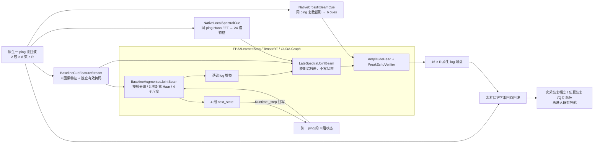
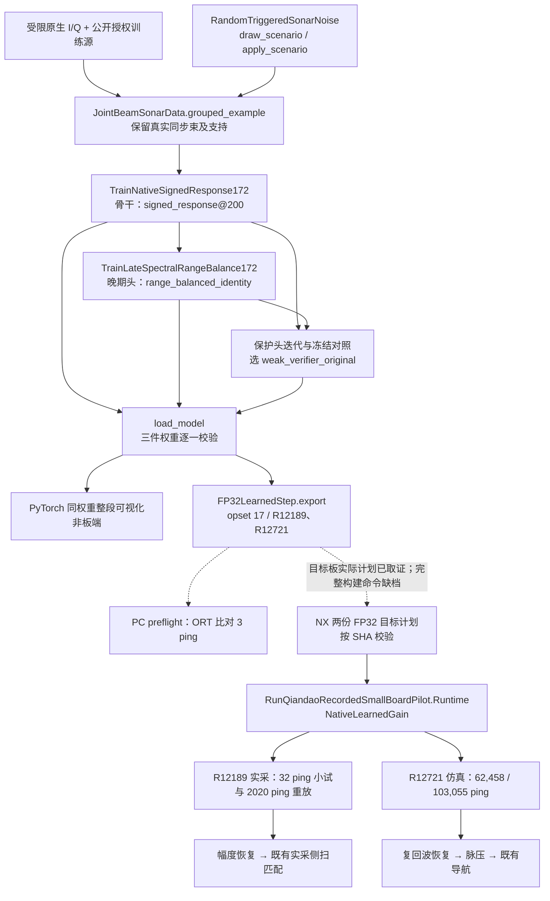

# Mermaid 技术图

左舷和右舷各 8 束，总共 16 路。实线代表代码调用/数组流；虚线代表制品构建或同版验证，不表示原始数据上传。来源和冻结哈希见 [证据索引](../README.md)。

## 1. 板端推理结构（实际）

[可导入的 Mermaid 源](architecture.mmd)

## 2. 训练、转换与两类板端实验

[可导入的 Mermaid 源](pipeline.mmd)

