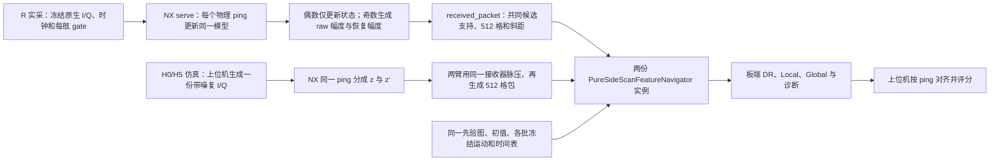

# 实际板端端到端调用与运行证据

## 1. 运行中真正接起来的链

模型既不直接提供 DVL/IMU，也不直接给 GTSAM 加因子；影响通过幅度、有效支持、特征与几何选择传递。两臂每个阶段调用详见[去噪接口](DENOISING_INTERFACE.md)、[导航接口](NAVIGATION_INTERFACE.md)。

### R：实采完整重放（已运行、连接已验证）

源码链：`RunQiandaoRecordedTrackAB.host:101–188` → `RunQiandaoRecordedSmallBoardPilot.serve:214–279` → `RecordedTrack.add_received:49–78` → `RunQiandaoRecordedLegacyNavAB.received_packet:44–59` → `F/.../PureSideScanFeatureNavigation.side_scan:205–315`。板端 `ready.engine_sha256` 对应 R12189 计划（[第一阶段制品指纹](../sonar_denoising_model_audit/README.md#制品指纹本机重新计算-sha-256)）；`ready.code_SHA256` 校验冻结导航、地图和 LoFTR 摘要。逐 ping 回执记录 `seq/t/body_sha256/native_values`；奇编号的 `query.raw/student.positions` 是两个实际导航实例返回，既有网络时序也有实际位置输出。

实采保留 2,020 个物理 ping，模型看到全部接收；偶数用于先验建图并只参与模型历史，1,010 个奇数 ping 作定位查询。真实 GNSS 航向/速度产生运动代理，水平位置除共享启动状态外留作上位机评分及事先构建偶数先验；无实拍完整 IMU/DVL/压力链和独立水下真值。该次 `run_summary.json` 为校正速度单位后的版本，不能使用标有 `INVALID_speed_unit.json` 的早期运行。两臂都运行了 GTSAM，确认侧扫先验各 4 条，**0 历史回环、0 mapped-range 因子**；实采收益不能归因这两类因子。

### H0：原时钟带噪完整梳形（已运行、连接已验证）

源码链：`RunQiandaoHistoricalClockAB.host:216–307,331–350` 将仿真同一含背景噪声并额外注入弧形条纹的复 I/Q、原时钟和原运动事件发给 NX。板端 `board:75–127,130–174` 固定 R12721 计划摘要，计算 $z'=z\exp(wg)$，在同一个 `for key,v` 循环内分别调用 `receiver.pulse_compress(v)` → `packet_from_compressed_IQ` → `nav[key].side_scan`。因此输入不是 PC 去噪 PNG、传感器真值或预填 pose。板端回执的 `model_ms/corrected/positions/map_epoch` 是同一物理 ping 的证据。宿主真值只用于仿真数据生成、结果核对/评分；初始化读取历史相同清单，不写成未知起点重定位。统计 `archived_amplitude_reproduced_at_every_ping=62458`、`historical_dr_bitwise_equal_at_every_ping=62458`、`used_archived_motion_events=1339709`、`nonzero_denoise_pings=62458`。

原无附加条纹的接收幅度对齐属于复核历史输入，不是把不同噪声的对照当成去噪效果。修复后的 H0 给两臂同样的历史回环候选校验，未改模型/几何方程；此次只审查已存版本。

### H5：5 Hz 仿真时钟补充梳形（已运行，非墙钟实时）

`RunQiandaoNoisyCombBoardAB.host:159–190,197–245` 生成该批相同运动事件、接收序列、噪声与初始化；两臂起始状态取共同仿真启动值，逐 ping 真值不作为匹配输入。板端 `board:40–74,76–118` 共享相同 R12721 引擎/底图/LoFTR，分别对 $z,z'$ 脉压后构造包。累计 103,055 ping 都注入非零额外条纹，也都发生非零去噪修改。`sustained_wall_5Hz_certified=false`，模型前向与完整接口时间见[风险](POTENTIAL_ISSUES.md)。

## 2. 哪些功能实际触发

以下从三组 `run_summary.json` 的 `diagnostics.{raw,student}` 取值；方向均为旁路→去噪，地图成功/尝试是几何匹配，图先验另需确认。不要把开关设为 true 等同于因子实际插入。

| 运行 | 地图接受/尝试 | 绝对侧扫先验 | 投影地图接受/尝试 | 历史回环边 | 重复斜距因子 |
|---|---|---|---|---|---|
| R | 6/6→6/6 | 4→4 | 0/0→0/0 | 0→0 | 0→0 |
| H0 | 384/416→374/416 | 356→349 | 17/17→16/17 | 322→314 | 312→265 |
| H5 | 314/687→398/687 | 280→366 | 19/21→20/21 | 257→249 | 56→100 |

P32 只做 RootSIFT 图像比对（`RunQiandaoRecordedSmallBoardPilot.feature_report:169–211`），没有导航和绝对位姿真值。历史 `SideScanIQHistory.FrozenComplexWindowDenoiser:17–66` 是另一套旧离线模型；H0/H5 调用该文件的**包适配函数**而不调用旧模型类。其文件名不能证明现用小模型走了历史去噪方法。

## 3. “完整、可复现”具体到哪一层

| 层级 | 结论 |
|---|---|
| 真运行链存在且完整 | **已运行、已验证**：本机记录有真正 NX 引擎、raw/denoise 调用、相同时间戳对应、结束回执和结果。不是方案图。 |
| 内部证据可追溯 | **已验证**：两次梳形脚本与锁定摘要对齐，三批可校验冻结导航模块，已重算数据计数。R/H0/H5 主结果均有逐 ping（R 为奇编号导航）归档；未在本次新跑一遍。 |
| 按原环境准备复跑 | 本机有 R12189/R12721 plan、冻结导航 manifest 和代码、主要实验入口、时序/场景/回执。复跑须复完原接收数据、运动归档、地图、LoFTR、NX 软件、守护脚本及原处理顺序。H0 入口还校验历史中断前缀和既有输入归档，不是只有引擎就能直接起。 |
| GitHub 公开独立复现 / 传感器整链实时验收 | **待实验**：GitHub 尚缺完整部署依赖闭包、权重/目标引擎、授权数据或公开等效夹具与精确构建记录。没有从干净环境重建并复跑的证据，也没有单臂持续实采 5 Hz 的验收。 |
