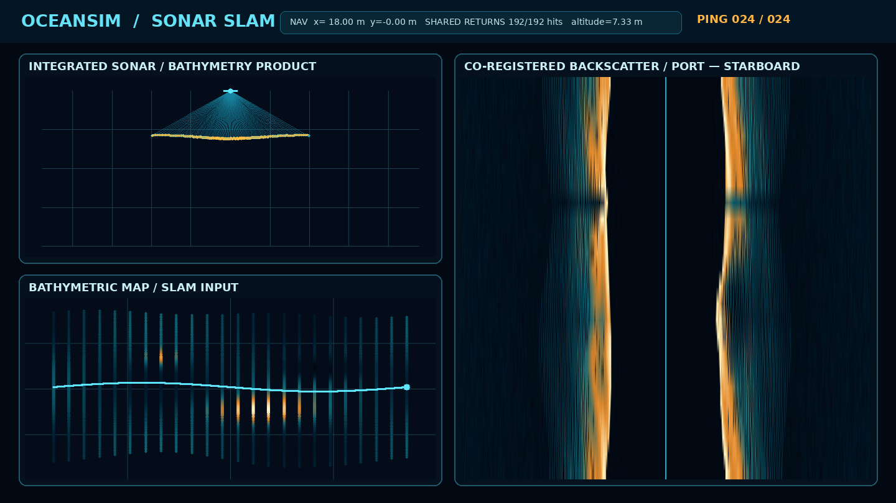

# Multibeam Echosounder and Side-scan Sonar

OceanSim includes geometric first-return models for standalone bathymetric
multibeam echosounders (MBES), standalone dual-channel side-scan sonars (SSS),
and an integrated bathymetric side-scan sonar. The integrated model is used by
the SLAM demonstrations: one timestamped backend call produces one raw
per-echo range/XYZ/backscatter grid. A bandwidth-limited bathymetry cloud and
the side-scan image are both views of that same grid. The standalone models
remain for systems that really contain separate instruments.

The models provide two closest-hit backends. The general PhysX backend follows
the active Isaac Sim collision scene. The Warp backend uploads one static
triangle mesh, builds a BVH once, and evaluates ray intersection, surface
normal, reflectivity interpolation, and first-order return power on CUDA.
Range parameters assume the stage is authored in metres, as in the provided
OceanSim assets.

## Coordinate convention

Both sensors use a local `+X` forward, `+Y` port/left, `+Z` up frame.

- The MBES boresight is `-Z`; its fan lies in the local Y-Z plane.
- MBES across-track steering angles are negative to port and positive to
  starboard, following the raw-angle convention in `marine_acoustic_msgs`.
- The side-scan transducers look toward `+Y/-Z` (port) and `-Y/-Z`
  (starboard).

## Integrated bathymetric side-scan

### V2 document-derived operating profiles

OceanSim includes two profiles transcribed from the user-supplied
`多波束测深侧扫作业及成像V2.docx`. The source describes image formation and
resolution, but does not identify a manufacturer or model. The profile values
therefore record only what the document states; missing hardware values remain
unknown instead of being filled with a nominal data sheet.

| Quantity | Standard resolution | High resolution | Provenance |
|---|---:|---:|---|
| Along-track rows (called beams in V2), per side and ping | 8 | 8 | stated |
| Along-track sample spacing | 0.15 m | 0.075 m | stated |
| Along-track coverage per ping | 1.2 m | 0.6 m | stated |
| Near-range along-track resolution | 0.15 m through 60 m | 0.075 m through 30 m | stated |
| Far-range along-track resolution | `R * sin(0.14 deg)` | `R * sin(0.14 deg)` | stated; range convention is ambiguous |
| Horizontal beam opening, beta | 0.14 deg | 0.14 deg | stated |
| Across-track/range sample spacing | 0.02 m | 0.02 m | stated |
| Across-track/range resolution | 0.025 m | 0.025 m | stated |
| Maximum reported range | 250 m | 250 m | stated; side and range convention are ambiguous |
| Samples per beam under the current 0--250 m interpretation | 12,500 | 12,500 | derived |

The V2 text does not consistently distinguish slant range from ground range,
does not explicitly say whether 250 m is per side or the full swath, and does
not say whether the 2 cm samples are before or after slant-to-ground
correction. OceanSim's live V2 demonstration currently interprets 250 m as a
per-side slant-range interval. The far-range equation uses degrees, not 0.14
radians; this agrees with the document's approximately 0.36 m result at 150 m.

The following quantities are **not supplied by V2**: manufacturer and model,
acoustic centre frequency, vertical opening angle alpha, ping rate, pulse
duration and receiver bandwidth, source level and receiver calibration,
bathymetric accuracy, calibrated intensity units, sound-speed profile,
vehicle speed and operating altitude, survey-line spacing, the exact 8-beam
steering/phase-centre table, and the six-degree-of-freedom installation
calibration. They must be obtained from the actual instrument and installation
survey before a sim-to-real accuracy claim is made.

The profiles live in
`isaacsim/oceansim/sensors/bathymetric_sidescan_profiles.py`. They deliberately
store unknown fields as `None`. With an assumed sound speed of 1500 m/s, the
2 cm range interval implies a 37.5 kHz two-way sample rate. That is a derived
message rate, not a frequency or bandwidth stated by V2.

### Current V2 ray-model interpretation

The large live demonstration selects `v2-standard` by default. It uses the
following explicit simulation assumptions: 1500 m/s sound speed, 10 Hz ping
rate with four distinguishable pings in water, 1.5 m/s survey speed, 40 m
minimum altitude, a 170 deg vertical fan, 96 published bathymetry samples, and
256 raw quadrature returns per side for each of the eight rows. The 170 deg fan
is chosen to make the interpreted 250 m interval
reachable at the nominal altitude; it is not V2's unspecified alpha. The eight
row centres are represented by parallel virtual footprint rays whose local-X
origins are cell-centred at the documented 0.15 m (standard) or 0.075 m (high)
spacing. Thus the standard centres run from -0.525 m to +0.525 m, with pixel
boundaries at +/-0.6 m; the high-resolution centres run from -0.2625 m to
+0.2625 m, with boundaries at +/-0.3 m. The stated 0.14 deg is retained as the
individual horizontal beam opening and is not misused as row steering.
Because V2 does not provide the physical phase-centre/steering table, these
origins are an image-domain sampling model, not a recovered transducer layout.

At the whole-map launcher settings one ping contains 4,096 common raw return
directions. The 96-sample bathymetry output is selected from these returns; it
does not add 96 independent rays or a second noise draw. The
native `port_beams` and `starboard_beams` matrices each have shape
`(8, 12500)`. `SideScanPing.as_raw_sonar_image_dict()` serializes all eight
port beams followed by all eight starboard beams, for 16 beams with 12,500
samples each. The legacy one-dimensional `port` and `starboard` fields remain
as strongest-row aggregate views for existing consumers. The live waterfall
max-pools every ten range samples for responsive display; that display
decimation does not alter the raw matrix contract.

The 250 m two-way travel time is about 0.333 s at the assumed sound speed, so a
conventional uncoded ping rate must not exceed 3 Hz. At 1.5 m/s, gap-free
coverage requires at least 1.25 Hz in standard mode and 2.5 Hz in high mode.
The launcher validates both constraints. A coded/interleaved schedule must
explicitly configure the number of distinguishable pings in water; this records
the acquisition assumption but does not pretend that the geometric ray model
synthesizes waveform separation or interference.

The whole-map interactive launcher currently schedules the single integrated
bathymetry/side-scan acquisition at 10 Hz. At 250 m it explicitly assumes four
distinguishable pings in water. At 1.5 m/s each ping advances 0.15 m, so adjacent
standard-mode footprints overlap by 1.05 m (87.5%). Each ping already contains
the complete eight-row, 1.2 m strip and therefore produces one 10 Hz local
FAST-LIVO2-style geometry/intensity update. The direct intensity residual uses
an eight-ping causal reference separation: 0.8 s and about 1.2 m at the
configured speed, exactly one standard-mode strip, so a repeated physical row
is not counted as an independent reference. All pings still enter the filter at
10 Hz and every converged strip enters the causal local map. Correlated samples are
limited to 32 independent-equivalent observations, and the intensity map keeps
one local anchor for 120 s instead of changing at each global keyframe. These
are temporal-baseline, covariance-weight, and local-map parameters rather than
additional match-acceptance gates. Longer-range references remain the
responsibility of loop/relocalization factors.

The Python API for the current V2-standard approximation is:

```python
from isaacsim.oceansim.sensors.BathymetricSideScanSonarSensor import (
    BathymetricSideScanSonarSensor,
)
from isaacsim.oceansim.sensors.bathymetric_sidescan_profiles import (
    STANDARD_V2_PROFILE,
)

profile = STANDARD_V2_PROFILE

sonar = BathymetricSideScanSonarSensor(
    prim_path="/World/rob/bathymetric_sidescan",
    num_beams=96,
    swath_width_deg=170.0,  # simulation assumption; V2 alpha is unknown
    range_bins=profile.range_bins_per_side,
    imaging_rays_per_side=1024,
    along_track_beams_per_side=profile.rows_per_side_per_ping,
    along_track_origin_spacing_m=profile.along_track_sample_spacing_m,
    waterfall_decimation=10,
    min_range=0.0,
    max_range=profile.maximum_range_m,
    sound_speed=1500.0,  # environmental assumption
    center_frequency_hz=0.0,  # message sentinel: V2 frequency is unknown
    viewport=True,
)
sonar.initialize()
ping = sonar.scan(timestamp=t)

published_xyz, published_backscatter, beam_index = (
    ping.valid_registered_samples(frame="sensor")
)
xyz, backscatter, raw_return_index = (
    ping.valid_acoustic_samples(frame="sensor")
)
port = ping.side_scan.port
starboard = ping.side_scan.starboard
port_rows = ping.side_scan.port_beams
starboard_rows = ping.side_scan.starboard_beams
raw_image = ping.side_scan.as_raw_sonar_image_dict()
```

The bathymetry and imaging products share one timestamp, frame, angular swath,
first-hit launch, dropout decision, noisy range, XYZ point, and intensity.
Per-ray sensor/world origins preserve the eight virtual footprint centres. The
published bathymetry product is an exact subset of the raw grid, enforced at
ping construction. Every populated aggregate display cell retains its source
raw return and also its published bathymetry source when that return was
selected; other cells correctly use `-1` for the legacy sparse-output lineage.
A finite display footprint may spread one detection into adjacent range cells,
but it does not create a second seabed observation or establish the documented
2.5 cm physical resolution.

The estimator consumes the point-wise `XYZ + backscatter` samples from
`valid_acoustic_samples()`. One common stride is applied to XYZ and intensity,
so they cannot become misregistered. It never infers a side-scan elevation angle from a
slant-range bin or uses the simulator's world-frame hit points. The rolling
port/starboard waterfall is a visualization and place descriptor, not the
source of direct 3-D intensity residuals.

Here, "the same ping" is stronger than equal timestamps: bathymetry and image
must be derived from the same measured echoes. A real combined system may
publish fewer bathymetric soundings than image samples, but each published
sounding must still identify its source return. The simulator enforces this
subset relationship, and the SLAM direct residual accepts only backscatter
values carrying the corresponding measured XYZ source.

This represents the observable outputs needed from an integrated MBES seabed
image or bathymetric side-scan. It does not claim to simulate coherent phase
interferometry, refraction, multipath, or a calibrated transducer impulse
response.

Mount the sensor origin just outside the vehicle collider when using PhysX.
That backend keeps the closest hit and cannot skip the vehicle and continue
through it. The Warp backend currently contains only its supplied static mesh,
so moving objects are intentionally not represented by it.

## CUDA static-mesh backend

The large Monterey Canyon example selects the Warp CUDA backend automatically
when CUDA is available. It loads the complete 5,842 x 3,534 measured grid,
not a local crop. The default acoustic level of detail is stride 2 (about
5.63 million valid triangles); the separate UI display level of detail is
stride 8. Its integrated sonar submits the single raw return grid as one BVH
query per ping. Force or disable it with:

```bash
standalone/run_large_scale_slam_isaac.sh --sonar-backend warp-cuda
standalone/run_large_scale_slam_isaac.sh --sonar-backend physx
```

For another static bathymetry mesh, pass the backend to the integrated sensor:

```python
from isaacsim.oceansim.sensors.warp_raycast_backend import (
    WarpMeshRaycastBackend,
)

backend = WarpMeshRaycastBackend(
    vertices_xyz,
    flattened_triangle_indices,
    vertex_reflectivities=reflectivity,
    prim_path="/World/Seabed",
    device="cuda:0",
)
sonar = BathymetricSideScanSonarSensor(..., raycast_backend=backend)
```

The arrays are stored as `float32`, matching Warp mesh queries, in a local
scene frame centred on the measured grid. The final compact ping is copied to
NumPy for the current estimator and ROS adapters. Published bathymetry,
point-wise XYZ/backscatter, and the two range-binned display channels are all
reduced from that single returned array; no second ray set or backend launch is
created.
Systems with genuinely separate MBES and SSS hardware may still share the
backend between the two standalone sensor classes.

Use `--verify-sonar-backend` with a finite headless run to compare CUDA ranges
against the corresponding PhysX collision mesh. Treat the timings and
agreement values emitted by that current run as diagnostics; measurements
from the former cropped, sparse-imaging scene are not performance claims for
the complete-map configuration.

## Multibeam echosounder

```python
import numpy as np

from isaacsim.oceansim.sensors.MultibeamEchosounderSensor import (
    MultibeamEchosounderSensor,
)

mbes = MultibeamEchosounderSensor(
    prim_path="/World/rob/mbes",
    translation=np.array([0.0, 0.0, -0.25]),
    num_beams=256,
    swath_width_deg=120.0,
    min_range=0.5,
    max_range=75.0,
    sound_speed=1500.0,
    range_noise_std=0.02,
    random_seed=7,
    viewport=True,
    draw_in_scene=True,
)
mbes.initialize()

# Call once per desired ping while the physics timeline is playing.
ping = mbes.scan()
points_sensor = ping.valid_points(frame="sensor")
points_world = ping.valid_points(frame="world")

# Per-beam fields include ranges, directions, validity, intensity, and TWTT.
ranges = ping.ranges
travel_times = ping.two_way_travel_times

# Dictionary with marine_acoustic_msgs/SonarRanges field semantics.
sonar_ranges = ping.as_sonar_ranges_dict()
# Or retain raw two-way travel time using SonarDetections semantics.
sonar_detections = ping.as_sonar_detections_dict()
```

The MBES uses one first-return ray per beam.  Gaussian range error and random
dropout can be configured.  Return intensity combines surface incidence,
reflectivity, spherical spreading, and two-way attenuation. Like the existing
imaging sonar, the PhysX path reads the nearest hit prim's `reflectivity`
semantic (or an ancestor's value); unlabelled geometry uses
`default_reflectivity`. The Warp path instead interpolates the optional
per-vertex reflectivity supplied with its static mesh.

## Side-scan sonar

```python
from isaacsim.oceansim.sensors.SideScanSonarSensor import SideScanSonarSensor

sidescan = SideScanSonarSensor(
    prim_path="/World/rob/sidescan",
    translation=np.array([0.0, 0.0, -0.20]),
    range_bins=512,
    waterfall_lines=400,
    rays_per_side=512,
    tilt_deg=45.0,
    vertical_beam_width_deg=50.0,
    along_track_beam_width_deg=2.0,
    min_range=0.5,
    max_range=75.0,
    multiplicative_noise_std=0.02,
    additive_noise_std=0.01,
    random_seed=7,
    viewport=True,
    draw_in_scene=True,
)
sidescan.initialize()

ping = sidescan.scan()
port_line = ping.port
starboard_line = ping.starboard
waterfall_mono8 = sidescan.get_waterfall()

# Dictionary with marine_acoustic_msgs/RawSonarImage field semantics.
raw_image = ping.as_raw_sonar_image_dict()
```

Each transducer casts a vertical ray fan with a narrow configurable
along-track aperture.  First hits are binned by slant range.  The port bins are
reversed and concatenated with the starboard bins, producing the conventional
`far port -> nadir -> far starboard` display row.  Subsequent rows form the
waterfall.  Closest-hit visibility creates first-order acoustic shadows.

The noise model provides multiplicative Gaussian speckle, range-scaled
additive Rayleigh noise, Gaussian range error, and optional outward-only
exponential range diffusion.

## Live visualization

Both sensors can display data without RViz:

- `viewport=True` opens a Kit window. MBES shows a live cross-track beam and
  bottom-return view; side-scan shows a colorized port/starboard waterfall.
- `draw_in_scene=True` adds isolated USD curves and points to the main Isaac
  Sim viewport. They follow the current scan and do not clear DVL or other
  debug drawings.
- `viewport_resolution=(width, height)` controls the live window resolution.
- Call `sensor.close()` during teardown to remove its window and guide
  geometry.

The `OceanSim > Examples > Sensor Example` panel exposes **Multibeam
Echosounder (live view)** and **Side-scan Sonar (live view)** checkboxes. They
are enabled by default. After pressing `LOAD` and `RUN`, two live data windows
open and the acoustic rays and returns are visible in the 3D viewport. The
example limits acoustic pings to 10 Hz so its general-scene PhysX queries
remain responsive. The large measured-terrain example is the reference CUDA
path because its seabed is static and can be represented by one Warp mesh.
Its production Local estimator uses CUDA-batched feature consensus on the
co-registered MBES/side-scan observations; the retired point-to-surfel state
update is not a selectable frontend. See the
[FastSonar-LIVO2 guide](underwater_fast_sonar_slam.md).

For a self-contained live test that does not require the separate
`OceanSim_assets` download, run:

```bash
standalone/run_acoustic_slam_isaac_demo.sh
```

This starts Isaac Sim with a lightweight procedural seabed, moving AUV,
collidable acoustic targets, the main 3D beam/return view, an MBES swath
window, and a side-scan waterfall window. It uses the local Isaac Sim 6.0.1
environment at `/home/cgz/.conda/envs/isaacsim-6.0`; use
`--duration 10` for a finite smoke test.

For the actual SLAM estimator and a larger measured-terrain validation range,
start the validated V2 large-area route with:

```bash
standalone/run_v2_full_map_slam_isaac.sh
```

It opens the Isaac Sim UI by default, uses the V2 standard profile, and runs a
closed approximately 72.35 km route through the largest connected Monterey
Canyon region with both measured bathymetry and backscatter. The launcher
starts at the difficult 30 km section with exact evaluation initialization;
truth is not fused after startup. Sensor data
remain scheduled on exact application-clock events at 50 Hz IMU, 5 Hz DVL,
10 Hz pressure depth, and 5 Hz integrated sonar; measured wall-clock speed may be lower
than the requested display scale. The AUV follows a kinematic route, so the
Isaac physics timeline is not used as the navigation timestamp source.
Close the window to stop. A finite non-UI smoke run is:

```bash
standalone/run_v2_full_map_slam_isaac.sh --headless --duration 10
```

Select the high-resolution V2 profile explicitly when needed:

```bash
standalone/run_v2_full_map_slam_isaac.sh \
    --sonar-profile v2-high-resolution --ping-hz 2.5
```

The lower-level `standalone/run_large_scale_slam_isaac.sh` is an internal
environment runner; use the full-map launcher so the production estimator
topology cannot be omitted. It fuses the integrated sonar with only IMU, DVL,
and pressure depth and displays Local and Global trajectories. Details are in the
[FastSonar-LIVO2 guide](underwater_fast_sonar_slam.md).

## Preview without Isaac Sim

For a presentation machine without Isaac Sim, generate the deterministic
acoustic SLAM dashboard with:

```bash
python3 standalone/acoustic_slam_demo.py
```

The script only needs NumPy and Pillow. It writes a full-resolution PNG and an
animated GIF to `demo/acoustic_slam_preview/`. The dashboard uses the same beam
geometry, return intensity, side-scan binning, noise, and rasterizers as the
live sensors, but intersects them with an analytic seabed instead of PhysX.



## ROS 2

The built-in ROS adapters avoid an additional message dependency:

- MBES publishes valid XYZ returns as `sensor_msgs/PointCloud2`.
- Side-scan publishes its waterfall as a `mono8` `sensor_msgs/Image`.

```python
from isaacsim.oceansim.sensors import ros2_helpers
from isaacsim.oceansim.sensors.MultibeamEchosounderSensor_ROS import (
    MultibeamEchosounderSensor_ROS,
)
from isaacsim.oceansim.sensors.SideScanSonarSensor_ROS import (
    SideScanSonarSensor_ROS,
)

ros = ros2_helpers.OmniHandler(
    name="slam",
    use_multibeam=True,
    use_sidescan=True,
)
mbes = MultibeamEchosounderSensor_ROS(
    prim_path="/World/rob/mbes",
    translation=np.array([0.0, 0.0, -0.25]),
    og_node=ros._mbes_node,
)
sidescan = SideScanSonarSensor_ROS(
    prim_path="/World/rob/sidescan",
    translation=np.array([0.0, 0.0, -0.20]),
    og_node=ros._sidescan_node,
)
mbes.initialize()
sidescan.initialize()
ros2_helpers.publish_sensor_tf(mbes)
ros2_helpers.publish_sensor_tf(sidescan)

# In the scenario update callback:
mbes_ping = mbes.scan()
sidescan_ping = sidescan.scan()
```

The default topics created by `OmniHandler(name="slam", ...)` are:

| Topic | Message | Contents |
|---|---|---|
| `slam/mbes/points` | `sensor_msgs/PointCloud2` | Valid XYZ bottom returns in the MBES frame |
| `slam/sidescan/waterfall` | `sensor_msgs/Image` (`mono8`) | Fixed-size side-scan waterfall |

For applications already using
[`marine_acoustic_msgs`](https://github.com/apl-ocean-engineering/marine_msgs),
use `MultibeamPing.as_sonar_ranges_dict()` and
`MultibeamPing.as_sonar_detections_dict()` or
`SideScanPing.as_raw_sonar_image_dict()` as the field mapping for a custom ROS
publisher.  `SonarRanges` separates discrete multibeam detections from sonar
images and retains one direction, range, intensity, and validity flag per beam;
`SonarDetections` preserves two-way travel times and steering angles.

## Model scope and references

This implementation is based on public sensor geometry and data conventions:

- [EdgeTech 6205 manual](https://www.edgetech.com/wp-content/uploads/2019/07/0014877_REV_F.pdf)
  describes simultaneous, co-registered bathymetry and dual-frequency
  side-scan products from one fully integrated sonar head.
- [NOAA hydrographic survey equipment](https://nauticalcharts.noaa.gov/learn/hydrographic-survey-equipment.html)
  describes multibeam backscatter as co-registered with bathymetry.
- [HoloOcean: Realistic Sonar Simulation](https://www.cs.cmu.edu/~kaess/pub/Potokar22iros.pdf)
  describes profiling-sonar geometry, side-scan row construction, shadowing,
  material-dependent returns, and probabilistic noise.
- [Stonefish sensor documentation](https://stonefish.readthedocs.io/en/latest/sensors.html)
  documents practical MBES and side-scan parameters and a single-ray-per-beam
  geometric MBES model.
- [`marine_acoustic_msgs`](https://github.com/apl-ocean-engineering/marine_msgs)
  defines reusable ROS messages for profiling and imaging sonar data.
- [Isaac Sim scene-query documentation](https://docs.isaacsim.omniverse.nvidia.com/5.0.0/python_scripting/environment_setup.html#do-raycast-test)
  documents the PhysX closest-hit ray query used by the backend.

The current implementation does **not** model sound-speed-profile refraction,
beamforming and water-column samples, coherent phase, detailed sediment
scattering, or multipath reverberation.  Treat it as a geometry-faithful SLAM
sensor model, not a hydrographic-grade acoustic system simulator.  Compare and
tune noise, beam geometry, latency, and material reflectivity against the real
instrument before drawing sim-to-real conclusions.

The complete Monterey example contains 11,296,546 measured bathymetry cells
and 11,145,229 registered measured backscatter cells (98.6605% of valid
bathymetry) over a 5,842 x 3,534, 5 m grid spanning 29.205 x 17.665 km between
sample centres. NoData and the remaining
backscatter gaps stay `NaN`. Backscatter products A/B/C/D are independently
1st-to-99th-percentile normalized before mosaicking because their encodings,
frequencies, and instruments differ. Thus the spatial texture is measured but
not absolute-calibrated target strength. The simulator uses that texture as a
reflectivity input to its stated incidence, attenuation, beam, and noise
model; the generated line is not a replay of the source raster's native
radiometry.

The final simulation raster is 5 m even where an original backscatter layer
was published at 2 m. The default acoustic mesh uses stride 2, so its vertices
are approximately 10 m apart; stride 1 restores the 5 m simulation grid but
does not recover centimetre-scale detail. Consequently, 2 cm output sampling
and the documented 2.5 cm sensor resolution do **not** create independent
centimetre-scale seabed information in this scene. Monterey is appropriate for
large-area trajectory, mapping, revisit, and measured-texture matching tests;
it is not evidence that the V2 radiometry or 2.5 cm resolving power has been
reproduced. That validation requires a suitably resolved local target scene and
calibration data from the actual instrument.

The PhysX backend issues one Python scene query per ray; use the Warp backend
only when a static mesh is an accurate representation of the surfaces that
should return echoes.
