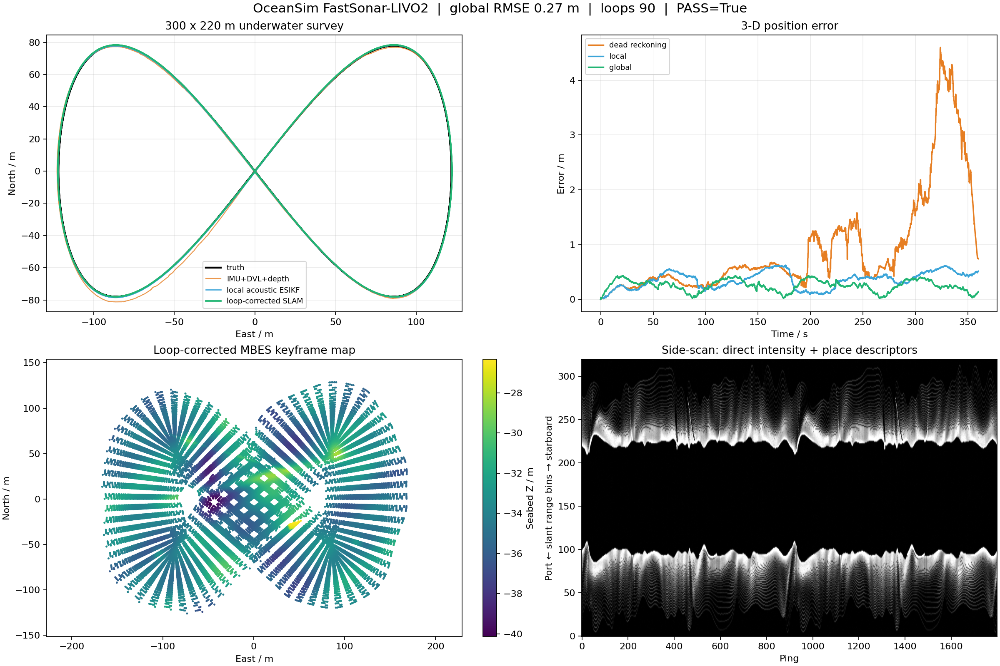

# FastSonar-LIVO2 underwater SLAM

OceanSim now includes a runnable acoustic-inertial SLAM stack for an AUV with
only an IMU, bottom-track DVL, pressure depth, multibeam echosounder (MBES),
and co-registered side-scan backscatter from one integrated sonar. Its
high-rate error-state filter and sequential geometry/appearance structure are
inspired by FAST-LIVO2, but the implementation is original OceanSim acoustic
SLAM code: it is neither the FAST-LIVO2 source code nor its camera photometric
model. It is also not FAST-LIO2 and does not require a camera, LiDAR,
compass, AHRS heading, GNSS, or simulated ground-truth pose measurements.

The implementation is original BSD-3-Clause OceanSim code.  Public GPL
projects were studied as architectural references; their source code was not
copied into this repository.

## Architecture

The local front end in `isaacsim/oceansim/slam/` contains:

1. A 15-state error-state iterated Kalman filter with rotation, position,
   velocity, gyroscope bias, and accelerometer bias.
2. High-rate IMU propagation plus robust bottom-track DVL velocity and
   positive-down pressure-depth updates.
3. A sensor-only startup window: gravity aligns roll/pitch, DVL initializes
   velocity, and pressure initializes depth. Absolute yaw and horizontal
   translation are explicitly fixed as local-frame gauge freedoms, not
   treated as measurements.
4. One geometry update per integrated V2 ping. Its eight simultaneous
   along-track rows already form a 1.2 m (standard) or 0.6 m (high-resolution)
   surface patch. Optional multi-ping motion compensation remains available
   for genuinely single-row instruments, but is not applied a second time to
   V2 data.
5. An incremental voxel-surfel bathymetry map and iterated point-to-plane
   update.  Each return uses polar range/angular uncertainty, surfel normal
   variance, Huber weighting, and eigenvalue-based degeneracy attenuation.
   The complete historical voxel map is retained for revisits, while a
   coarse spatial block index packs only the current sensor-reach window for
   the exact Warp 27-neighbour association. The small double-precision
   15-state solve remains on the CPU.
6. A direct acoustic-intensity update using dense samples with an explicit
   sensor-frame XYZ coordinate for every backscatter value. No elevation angle
   is guessed from a side-scan slant-range bin. The eight co-registered rows in
   one physical ping are processed as the real 2-D strip; consecutive pings are
   not bundled merely to manufacture that aperture. Because every simulated
   acquisition is normalized independently, it gets one gain and offset
   nuisance pair that is projected out of the pose information. Raw returns from one acoustic
   footprint are correlated, so their aggregate local-filter weight is capped
   at 96 independent-equivalent samples. A configurable causal separation
   (one ping in the V2 live launcher), 45% map coverage, normalized-correlation, inlier-ratio,
   planar-rank, view-direction, and two-sided support gates must all pass
   before the strip can update x/y/world-yaw in the ESIKF. The reference map is
   partitioned by pose-graph anchor so one local intensity surface never mixes
   samples expressed under different global corrections. Without old spatial
   overlap, side-scan contributes to mapping and place recognition but not
   pose. This is an acoustic map-matching residual, not a camera photometric
   residual.
7. Conservative innovation/correction limits and recoverable DVL weighting so
   an acoustic correction cannot permanently lock out velocity observations.

The global back end adds:

1. Fixed-interval acoustic keyframes.
2. Combined MBES bathymetry/backscatter and robust rolling side-scan
   waterfall descriptors for repeat-place candidates. A strict descriptor
   search over all historical keyframes can propose a place even outside the
   drifting odometric search radius.
3. Ordered-beam registration followed by trimmed ICP geometric verification.
4. Consecutive-match confirmation, uncertainty-weighted loop edges, global
   relocalization branch seeding, robust x/y/yaw pose-graph optimization, and
   a separately corrected global map and trajectory. An accepted direct
   intensity match that also passes graph-export validation adds a separate
   anchor-to-current pose factor
   from its measurement-only normal equation; it is not folded into or counted
   again as an odometry edge. Factor uncertainty is floored at 1 m and 2 deg
   for the 5 m source raster/3 m online voxels, partly covering correlation
   with the self-built reference submap, and a rank-aware 99% pre-fit
   normalized-residual gate rejects a graph-inconsistent factor before it can
   create or modify any node. This is a compatibility test, not a claim that
   the compact graph computes full endpoint-marginal NIS. Roll, pitch, and
   depth remain owned by the ESIKF.
   After a geometrically verified loop has corrected the global branch, that
   graph pose may seed a non-committing intensity re-alignment in an old anchor
   frame. A passing match refines the global graph only; it never jumps the
   live local inertial state and still has to pass every radiometric gate.

This split is intentional: loop corrections do not jump the live inertial
state or invalidate its local map.

## Deterministic large-area validation

Run the complete two-lap validation:

```bash
standalone/run_large_scale_underwater_slam.sh --assert-quality
```

The test range is 300 x 220 m.  The AUV covers a 244 x 156 m figure-eight and
travels approximately 1.70 km in 360 simulated seconds.  It includes rolling
bathymetry, a ridge, trench, pipeline, wreck, and isolated rocks.  The command
writes:

- `demo/large_scale_slam/metrics.json`
- `demo/large_scale_slam/trajectory.csv`
- `demo/large_scale_slam/map_and_trajectory.npz`
- `demo/large_scale_slam/overview.png`

The command records dead-reckoning, local-filter, and optimized global errors,
accepted/rejected geometry and intensity updates, loop and intensity graph
edges, and the sensor sample counts in `metrics.json`. Use an equal-seed run
with `--disable-intensity-updates` for an intensity ablation. Historical
numbers from the former sparse-intensity implementation are intentionally not
presented as results for the current dense, anchored factor pipeline. The
fresh three-seed controlled run recorded below shows no large or robust direct-
intensity gain, so no stronger localization claim is made.

`rejected_intensity_updates` counts strips that actually invoked the direct
matcher. `skipped_intensity_strips` is a separate pre-matcher count; its reason
may also appear in `intensity_rejection_reasons`, so the reason histogram is
not defined to sum to the matcher-rejection count.



For a short pipeline smoke test:

```bash
standalone/run_large_scale_underwater_slam.sh \
  --duration 12 --no-plot --output /tmp/oceansim-slam-smoke
```

## Live Isaac Sim UI

Isaac Sim 6.0.1 is installed in
`/home/cgz/.conda/envs/isaacsim-6.0`.  Start the live scene with:

```bash
standalone/run_large_scale_slam_isaac.sh
```

The default live UI loads the **complete, geographically un-cropped** USGS
Monterey Canyon 5 m raster mosaic. Its 5,842 x 3,534 grid spans 29.205 x
17.665 km between sample centres. It contains 11,296,546 measured bathymetry
cells; source NoData remains `NaN`, so preprocessing does not bridge or invent
seafloor in unmapped areas. The display mesh uses the complete footprint at
stride 8 by default, while the static Warp acoustic mesh uses stride 2. These
are level-of-detail choices, not geographic crops. Strict mesh construction
also preserves native NoData holes instead of spanning them with coarse
triangles.

The paired texture is a mosaic of the public USGS backscatter products A, B,
C, and D. It provides 11,145,229 measured cells, or 98.6605% of the valid
bathymetry; the remaining 151,317 bathymetry cells have `NaN` backscatter.
Because the four products use heterogeneous native encodings, instruments,
and frequencies, each layer is independently clipped and linearly normalized
between its 1st and 99th percentiles before equal-weight averaging in overlap
cells. The result retains measured spatial texture and per-cell A/B/C/D source
lineage, but it is **not absolute-calibrated target strength**. Complete bounds,
source URLs, archive and array checksums, normalization details, and masks are
recorded in `data/monterey_canyon_full_5m/metadata.json`.

The vehicle is the full-scale 1.08 m Light Autonomous Underwater Vehicle
(LAUV) developed by LSTS at the University of Porto and OceanScan-MST.  Its
upstream Apache-2.0 Collada body, control fins, propeller, texture, and license
are stored under `assets/vehicles/lauv/`. The live trajectory maintains a
28 m terrain clearance over a low-pass navigation copy of the DEM. By default,
one integrated V2 ping casts one common grid of eight simultaneous rows per
side and 256 quadrature returns per row: 4,096 raw returns in one backend call.
Each raw return contains measured range/XYZ and backscatter. The 96-sample
published bathymetry cloud is selected from this grid rather than cast as an
independent fan, while the identically decimated raw `XYZ + intensity` array
feeds both local geometry and direct acoustic matching. The port/starboard range-bin
waterfall is retained for display and place descriptors only; it is not
back-projected into invented 3-D points. `--sonar-backend physx` retains the
general collision-scene fallback.

An accepted local intensity match updates the gated ESIKF. Only when its
freshly re-associated measurement-only optimum also passes the graph-export
checks does it produce an explicitly anchored x/y/yaw pose-graph factor with
its own conservative information matrix; otherwise the local posterior enters
the odometry chain once. The exported factor is derived after projecting out
gain/offset, rather than from the filter's posterior covariance, and remains
separate from the same interval's pre-image inertial/DVL/depth edge. A
non-committing graph-seeded match is counted as
accepted only after that graph factor also passes the transactional
compatibility gate. This architecture is implemented and its component gates
are unit-tested, but
it is not evidence by itself that measured backscatter improves localization.
Use `--disable-intensity-updates` and identical seeds for a controlled A/B run;
rolling descriptors and geometrically verified loop closure remain active in
that mode.

### Archived pre-correction direct-intensity ablation (2026-09-04)

The following results predate the one-raw-grid/per-ping correction and must not
be used as validation of the current acquisition model. A fresh matched-seed
ablation is required before making a localization-accuracy claim.

The current dense, anchored implementation was run for the complete 360 s
two-lap numerical survey with three fixed random seeds. `ON` enables the
direct intensity ESIKF update and anchored graph factors; `OFF` disables those
updates but deliberately retains rolling side-scan descriptors, so this table
isolates direct fusion rather than the total value of side-scan for proposing
loop candidates.

| Seed | Local RMSE ON/OFF (m) | Global RMSE ON/OFF (m) | Accepted updates | Intensity factors |
| --- | ---: | ---: | ---: | ---: |
| 21 | 0.260258 / 0.276660 | 0.223512 / 0.236169 | 107 | 25 |
| 31 | 0.386127 / 0.386298 | 0.287776 / 0.272710 | 106 | 33 |
| 41 | 0.353901 / 0.341703 | 0.292648 / 0.287315 | 106 | 29 |
| Mean | 0.333429 / 0.334887 | 0.267979 / 0.265398 | 106.3 | 29.0 |

Across these three seeds, direct intensity improves mean local RMSE by only
0.44% and worsens mean optimized global RMSE by 0.97%. The signs also vary by
seed. With only three deterministic trials this is not a confidence interval,
but it is sufficient to reject a claim of a large or robust gain. The result
is expected when geometry and loop closure are already strong, adjacent dense
rays share the same low-resolution texture, and most accepted image updates
apply only centimetre-scale corrections to a self-built map.

The measured mosaic itself is not featureless: over 11,145,229 valid cells its
normalized standard deviation is 0.1925 and the median 5 m neighbour
difference is 0.0512. The limitation is independence and scale. Valid-cell
correlation remains approximately 0.76--0.77 at a 10 m lag, while the default
stride-2 acoustic mesh samples the native 5 m raster at 10 m vertices. Thus a
512-ray-per-side fan heavily oversamples interpolated, correlated texture; it
does not create hundreds of independent sub-metre localization features.

The complete-map 1.1-lap run provides a second, harder paired ablation. Both
runs use the same seed, 8,561 pings, complete 29.205 x 17.665 km scene, and 54
MBES-verified loop edges; `OFF` again retains side-scan descriptors.

| Complete-map metric | Direct intensity ON | Direct intensity OFF | ON change |
| --- | ---: | ---: | ---: |
| Dead-reckoning RMSE (m) | 28.223693 | 28.223693 | identical |
| Local acoustic ESIKF RMSE (m) | 7.552456 | 7.637383 | -1.11% |
| Local final error (m) | 2.098617 | 3.823041 | -45.11% |
| Final optimized global RMSE (m) | 3.994212 | 3.969828 | +0.61% |
| Final optimized global final error (m) | 5.449938 | 4.530961 | +20.28% |

The ON run attempted 1,060 strips, accepted 77 (74 local and 3 graph-seeded),
and exported only 6 explicit graph factors; 962 attempts lacked enough old-map
correspondences. Of the 74 local acceptances, only 3 passed the stricter fresh
association needed for graph export, while 71 entered the odometry chain as a
local posterior. This supports a narrow conclusion: direct intensity helps the
revisited local tail in this run, but it does not yet improve the optimized
global trajectory. High mean accepted correlation (0.994) is internal
photometric consistency, not proof of geographic accuracy.

The live navigation model keeps simulated gyro bias within the
LSTS-published 1 degree/hour INS maximum. That data-sheet envelope is used as
a configurable bias bound; no AHRS/compass heading is generated or fused.

The UI shows a chase-camera 3-D scene, live MBES beams/returns, a live
MBES swath, a side-scan waterfall, truth/local/global tracks, optimized MBES
points, and a status panel.  The 360-second route repeats for loop closure.
Close Isaac Sim to stop it.  Use `--camera-mode overview` for a fixed view of
the complete survey instead of the default vehicle-following view.

The complete V2 full-map launcher uses a 20x render time scale and limits only
the operator sonar-window upload to 2 simulated Hz.  Every 10 Hz integrated
sonar ping still updates the raw waterfall and enters the unchanged sensor and
SLAM event clocks. The local direct-intensity update uses an eight-ping causal
reference separation, 32 independent-equivalent samples, and a 120 s stable
local intensity-map anchor. No additional acceptance threshold is introduced.
This keeps the UI responsive without decimating estimator measurements:

```bash
standalone/run_v2_full_map_slam_isaac.sh
```

The status panel and shutdown metrics report the ray-casting and SLAM
association providers separately. The full-map V2 launcher uses at most 384
co-registered returns from each physical ping in its ESIKF update. Its Warp
kernel performs the same lexicographically ordered 27-voxel search, distance
gates, and score as the reference Python implementation. Only compact match
indices cross back to NumPy. The residual/Jacobian construction, 15-state
double-precision ESIKF solve, incremental map statistics, loop detection, and
pose-graph optimization remain CPU code. Use
`--slam-association-backend cpu` for the complete reference path.

`auto` selects the association implementation according to workload size.
Backend timings are emitted by each current run; timings from the former
cropped, sparse-imaging scene are not used as performance claims for the
complete-map pipeline.

Useful finite checks are:

```bash
standalone/run_large_scale_slam_isaac.sh \
  --headless --sonar-backend warp-cuda --verify-sonar-backend \
  --max-frames 40 --time-scale 4

standalone/run_large_scale_slam_isaac.sh \
  --headless --slam-association-backend cpu \
  --max-frames 600 --time-scale 8

standalone/run_large_scale_slam_isaac.sh \
  --duration 30 --time-scale 8
```

To recreate the complete bathymetry/backscatter mosaic from the official USGS
archives (the default paths are under `downloads/`):

```bash
PYTHONPATH=. python standalone/prepare_real_bathymetry.py --download
```

The source catalog and direct data download are published by the USGS at
<https://doi.org/10.5066/F7XD0ZQ4>.  The LAUV model is sourced from
<https://github.com/uuvsimulator/lauv_gazebo> at the revision recorded in
`assets/vehicles/lauv/SOURCE.md`.

Live metrics are written to
`demo/large_scale_slam/isaac_live_metrics.json` during shutdown.


## Whole-map relocalization after a navigation outage

The normal terrain matcher is deliberately local. When repeated bounded
matches fail, the optional recovery path searches the complete measured map
and all yaw angles, but it does not turn the largest correlation peak directly
into a pose-graph factor. The recovery chain is:

1. Joint coarse bathymetry/backscatter retrieval returns several spatially
   separated basins. This is an OceanSim implementation inspired by the
   cohort-filtering architecture of Global UTAN, not that paper's reference
   code.
2. Every basin must pass the pinned official
   [3D-BBS](https://github.com/KOKIAOKI/3d_bbs) branch-and-bound occupancy
   verifier. IMU roll/pitch and pressure depth remain fixed, so only residual
   horizontal translation and yaw are searched. The coarse 3D-BBS argmax and
   the original appearance proposal are both retained as metric-refinement
   seeds; diagnostics, never truth, choose the better converged basin.
3. A 5 m MBES terrain fit and multi-scale side-scan cell correlation check the
   candidate. The side-scan context treatment follows the reliability idea of
   SC-Match, but is not an exact SC-Match implementation because OceanSim
   matches geocoded samples to a prior raster rather than matching two raw
   waterfalls.
4. Refined duplicates from the same acquisition are merged. Genuinely
   separated aliases become separate particle cohorts alongside an explicit
   `no valid fix` state. Each cohort contains 256 weighted SE(2) particles;
   the FAST-LIVO2-style acoustic/IMU/DVL/depth front end propagates every
   particle. All particles from all cohorts are evaluated in one raw-sonar
   point-mass update, so the best residual is common to the complete posterior
   instead of being renormalized separately inside each alias. Low effective
   sample size triggers systematic resampling followed by covariance-preserving
   regularization. A Bayesian change-point branch reserves proposal mass from
   the complete prior, allowing a newly retrieved candidate to replace an old
   but formerly confident false mode. Overlapping windows receive discounted
   weight, and three non-overlapping ping/time windows must support the same
   cohort before confirmation.
5. The default `multimodal-map` output policy uses the GTSAM estimate while
   the posterior has one spatial mode. When two or more separated modes exist,
   GTSAM cannot represent that discrete ambiguity, so the most-probable valid
   cohort is propagated by every new local odometry pose and supplies the
   provisional online `map -> odom` target. This is output-only: it never
   writes into the local 15-state ESIKF and does not by itself create a graph
   constraint. Only a confirmed cohort re-seeds an outage segment and
   authorizes a robust Cauchy x/y/yaw factor for GTSAM. Time and rate limits
   keep changes continuous, and all matchers continue to use the unsmoothed
   graph pose. While whole-map recovery is active, its global cohort MAP takes
   priority over the ordinary bounded tracker until confirmation or rejection.
   `graph` and `always-map` policies remain available for A/B.

With `--enable-terrain-cohort-particle-backend`, the same particle policy also
sits in front of ordinary bounded terrain factors. Persistent proposals retain
their originating cohort ID, so a broad whole-map alias cannot steal or
overwrite an established mode through covariance-normalized association. A
single accepted bathymetry/side-scan match only initializes/tracks a cohort;
three non-overlapping observations must support the same propagated mode
before GTSAM authorization.

The graph never receives the recursive particle posterior as if it were a new
sensor measurement, although its MAP mode is the provisional online output
during multimodal tracking.
For every independent 300-ping window, the confirmed
cohort selects only a local basin. A deterministic search and finite-
difference Laplace approximation then derive the pose and information matrix
from that current raw MBES/side-scan likelihood alone. This also supplies
ordinary factors when the compact matcher has no usable Gaussian proposal.
The curvature is projected onto its positive-semidefinite observable subspace,
and chart/model covariance floors are applied only inside that subspace; flat,
textureless directions therefore contribute zero information rather than a
false precise constraint. A separate finite reporting covariance assigns broad
variance to null-space directions; its inverse is never substituted for the
exact rank-aware graph information.

This posterior follows operational terrain-relative-navigation practice used
by MB-System/MBARI. Its public `libtrnav` tree includes both
`TNavPointMassFilter` and `TNavParticleFilter`: odometry supplies the motion
update, raw multibeam soundings are compared directly with a prior bathymetric
map, and the posterior is monitored for convergence. In OceanSim, the
Fast-LIVO2-style acoustic/IMU/DVL/depth front end supplies that odometry and
co-registered side-scan adds a conservative appearance likelihood. The
implementation is independent OceanSim code. MB-System is GPL-3.0, so no
MB-System source was copied into this BSD-3-Clause project.

Build the native verifier and run the deterministic, UI-free integration
check with:

```bash
standalone/build_bbs3d_bridge.sh
PYTHONPATH=isaacsim \
  /home/cgz/.conda/envs/isaacsim-6.0/bin/python \
  standalone/validate_global_relocalization_chain.py
```

That check samples a sequence of disjoint strips from the complete Monterey
product and stops only after the configured posterior/odds criteria confirm a
cohort. It injects a kilometre-class rigid local-frame error and validates
whole-map retrieval, native 3D-BBS, both metric refinements, persistent
confirmation, the robust graph factor, and continuous output correction. The
validator uses 0.95 posterior and 20:1 odds; the production launcher retains
the stricter 0.97 posterior and 20:1 odds. Truth synthesizes
the sonar window and ideal roll/pitch/depth inputs; map-frame horizontal
position and yaw remain hidden from the matchers, filter, and graph, and are
inspected only afterward to calculate error. Bathymetry is matched against a
separately low-pass navigation surface, but side-scan observations and the
prior still come from the same public backscatter survey. It is therefore a
deterministic integration and wiring upper bound, not an independent
chart-to-field or sea-trial accuracy result.

The complete-route candidate can be run without a UI using either launcher:

```bash
standalone/run_backend_ab_gtsam_global_utan_full_route_isaac.sh --headless
standalone/run_backend_ab_gtsam_trn_full_route_isaac.sh --headless
```

It preserves the archived seed-31 sensor, route, local front end, and fixed-lag
GTSAM settings while enabling complete-yaw search, persistent cohorts, the
native verifier, robust relocalization factors, and output-only soft
correction. The 72 km run is intentionally separate from the short check
because it takes hours and is the evidence required for a full-route accuracy
claim.

The controlled 2 km same-seed A/B result and its scientific limitations
are recorded in
[`demo/large_scale_slam/global_utan_cohort_pf_ab_20260911.md`](../../demo/large_scale_slam/global_utan_cohort_pf_ab_20260911.md).
The joint-likelihood, rank-safe 3.3 km critical regression is recorded in
[`demo/large_scale_slam/mature_trn_fastlivo2_regression_20260913.md`](../../demo/large_scale_slam/mature_trn_fastlivo2_regression_20260913.md).

## Python sensor interface

The estimator has no Isaac Sim dependency, so the same object can consume a
ROS bag, hardware driver, or simulated sensors:

```python
from oceansim.slam import (
    FastSonarSLAM,
    gauge_anchored_initial_covariance,
    initialize_from_imu_dvl_depth,
)

slam = FastSonarSLAM()
initial = initialize_from_imu_dvl_depth(
    startup_specific_force,
    startup_dvl_velocity,
    startup_depth,
)
slam.initialize(
    t0,
    rotation=initial.rotation,
    position=initial.position,
    velocity=initial.velocity,
    covariance=gauge_anchored_initial_covariance(),
)

slam.process_imu(t, gyro_rad_s, specific_force_mps2)
slam.process_dvl(velocity_body_mps)
slam.process_depth(depth_positive_down_m)
# `ping` is the driver's BathymetricSideScanPing built from one acquisition.
slam.process_integrated_ping(ping, sample_stride=8)

R_local, p_local = slam.state.rotation, slam.state.position
R_global, p_global = slam.global_pose()
times, global_track = slam.global_trajectory()
points_global = slam.optimized_map_points()
```

Inputs must be synchronized and use metres, seconds, radians, a local
`+X forward, +Y port, +Z up` vehicle/sensor convention, and a Z-up navigation
frame. Calibrate IMU-to-DVL and IMU-to-sonar extrinsics, timestamps, DVL
scale, pressure offset, and sound speed before real-data use. Since the
allowed sensors provide no absolute heading or horizontal position, compare
real trajectories only after fixing or aligning that gauge.

## Public references and scope

The design was checked against these public projects, specifications, and papers:

- [LSTS LAUV specification](https://lsts.fe.up.pt/index.php/vehicles/lauv):
  standard navigation/INS capabilities and the published 1 degree/hour
  maximum gyroscope bias.

- [FAST-LIVO2 repository](https://github.com/hku-mars/FAST-LIVO2) and
  [paper](https://arxiv.org/abs/2408.14035): sequential iterated Kalman
  updates for heterogeneous geometric and direct photometric observations.
- [Warp kernel guide](https://nvidia.github.io/warp/latest/user_guide/basics.html)
  and [mesh-query API](https://nvidia.github.io/warp/latest/api_reference/_generated/warp.MeshQueryRay.html):
  typed SIMT kernels and closest-hit mesh outputs used by the two GPU paths.
- [RA-SIDO](https://doi.org/10.3390/jmse14161520): tightly coupled
  sonar/inertial/depth odometry with anisotropic sonar uncertainty and
  degeneracy handling; this is the closest published underwater analogue.
- [DISO](https://github.com/jiahao-Ma/DISO): direct acoustic intensity,
  DVL/IMU/depth fusion, and acoustic odometry design choices.
- [MINS](https://www.sciencedirect.com/science/article/pii/S2468013325000579): multibeam/inertial
  navigation and bathymetric matching.
- [Dense side-scan acoustic SLAM](https://github.com/halajun/acoustic_slam):
  side-scan place constraints and mapping.
- [3D-BBS repository](https://github.com/KOKIAOKI/3d_bbs) and
  [paper](https://arxiv.org/abs/2310.10023): the exact pinned native
  branch-and-bound implementation used only for candidate verification.
- [Global UTAN](https://doi.org/10.1109/TIM.2026.3716492): appearance
  retrieval, geometric verification, and persistent cohort reasoning used as
  an architectural reference for whole-map recovery.
- [MBARI Terrain Relative Navigation](https://www.mbari.org/project/terrain-relative-navigation/)
  and [MB-System libtrnav](https://github.com/dwcaress/MB-System/tree/master/src/mbtrnav): operational
  multibeam-to-prior-map navigation and the PMF/PF architecture used as the
  mature terrain-navigation reference. OceanSim does not copy the GPL-3.0
  implementation.
- [SC-Match](https://arxiv.org/abs/2607.25937): multi-scale side-scan context
  consistency used as a design reference, not copied reference code.

This is a research and simulation implementation, not a claim of
hydrographic-grade navigation.  The current global graph assumes a
roll/pitch-stabilised survey AUV and optimizes x/y/yaw.  A platform performing
large 6-DoF maneuvers needs a full SE(3) graph.  Sound-speed refraction,
multipath, magnetic disturbances, time-varying DVL scale, pressure bias,
clock offset, and online extrinsic calibration are not yet modeled.  Validate
all noise, latency, calibration, and observability settings on the target
vehicle before field deployment.
