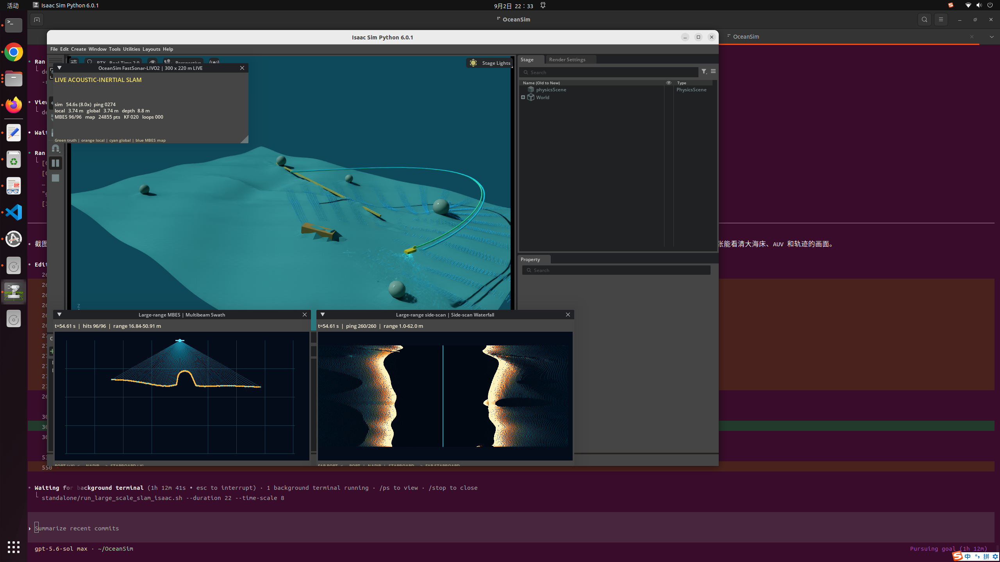

# FastSonar-LIVO2 underwater SLAM

OceanSim now includes a runnable acoustic-inertial SLAM stack for an AUV with
only an IMU, bottom-track DVL, pressure depth, multibeam echosounder (MBES),
and co-registered side-scan backscatter from one integrated sonar. Its
high-rate error-state filter and sequential geometry/appearance structure are
inspired by FAST-LIVO2, but the implementation is original OceanSim acoustic
SLAM code: it is neither the FAST-LIVO2 source code nor its camera photometric
model. It is also not FAST-LIO2 and does not require a camera, LiDAR,
compass, AHRS heading, GNSS, or simulated ground-truth pose measurements.

The implementation is original BSD-3-Clause OceanSim code.  Public GPL
projects were studied as architectural references; their source code was not
copied into this repository.

## Architecture

The local front end in `isaacsim/oceansim/slam/` contains:

1. A 15-state error-state iterated Kalman filter with rotation, position,
   velocity, gyroscope bias, and accelerometer bias.
2. High-rate IMU propagation plus robust bottom-track DVL velocity and
   positive-down pressure-depth updates.
3. A sensor-only startup window: gravity aligns roll/pitch, DVL initializes
   velocity, and pressure initializes depth. Absolute yaw and horizontal
   translation are explicitly fixed as local-frame gauge freedoms, not
   treated as measurements.
4. Each 5 Hz integrated V2 ping retains its eight simultaneous along-track
   rows and the exact MBES XYZ return that generated every backscatter pixel.
   These rows are one physical acquisition, not eight temporal pings. Four
   distinct consecutive pings form one causal feature-odometry subframe.
5. IMU/DVL propagation supplies the complete SE(3) prediction for pyramid KLT
   tracking between canonical side-scan images. Forward/backward-consistent
   GFTT tracks are lifted through the co-registered MBES XYZ grid. CUDA evaluates
   256 prediction-centred geometric hypotheses in one batch; the winning
   consensus is refined in float64. Because the short aperture does not
   independently observe smooth-terrain cross-track translation or yaw, only
   the observable along-track scalar is fused. A state projector prevents this
   measurement from directly changing cross-track position, attitude, depth,
   velocity, or IMU biases. The retired direct point-to-self-map MBES state
   update is not present.
6. MBES still supplies the causal 30 s surfel map, descriptors, graph geometry,
   feature lifting, and Global terrain likelihood. Expired ping batches are
   subtracted exactly from voxel-local sufficient statistics, avoiding
   cancellation at UTM coordinates. Co-registered side-scan intensity may
   align against an anchored appearance surface and export a conservatively
   weighted GTSAM factor, but this same-echo alignment is non-committing and
   never contracts Local a second time. Gain/offset nuisance terms are
   projected out; surface disagreement continuously inflates variance; causal
   separation, coverage, correlation, inlier, rank, view and two-sided-support
   checks protect factor export. This is acoustic map matching, not a camera
   photometric residual.
7. Fixed IMU-to-sonar and IMU-to-DVL calibration interfaces. DVL prediction
   includes the rotational lever-arm velocity at the DVL phase centre. Each
   co-registered echo can also carry a pose-sampling time offset and is
   deskewed with the current angular rate, translation velocity, and sonar
   lever arm. The current ray-cast simulator is a synchronous snapshot and
   therefore supplies zero offsets. Two-way acoustic travel time is not
   silently reinterpreted as a pose timestamp; a real driver must provide the
   instrument's actual transmit/receive timing convention.
8. Conservative innovation/correction limits and recoverable DVL weighting so
   an acoustic correction cannot permanently lock out velocity observations.

The global back end adds:

1. Fixed-interval acoustic keyframes.
2. Combined MBES bathymetry/backscatter and robust rolling side-scan
   waterfall descriptors for repeat-place candidates. A strict descriptor
   search over all historical keyframes can propose a place even outside the
   drifting odometric search radius.
3. Ordered-beam registration followed by trimmed ICP geometric verification.
4. Consecutive-match confirmation, uncertainty-weighted loop edges, global
   relocalization branch seeding, robust x/y/yaw pose-graph optimization, and
   a separately corrected global map and trajectory. An accepted direct
   intensity match that also passes graph-export validation adds a separate
   anchor-to-current pose factor
   from its measurement-only normal equation; it is not folded into or counted
   again as an odometry edge. Factor uncertainty is floored at 1 m and 2 deg
   for the 5 m source raster/3 m online voxels, partly covering correlation
   with the self-built reference submap, and a rank-aware 99% pre-fit
   normalized-residual gate rejects a graph-inconsistent factor before it can
   create or modify any node. This is a compatibility test, not a claim that
   the compact graph computes full endpoint-marginal NIS. Roll, pitch, and
   depth remain owned by the ESIKF.
   After a geometrically verified loop has corrected the global branch, that
   graph pose may seed a non-committing intensity re-alignment in an old anchor
   frame. A passing match refines the global graph only; it never jumps the
   live local inertial state and still has to pass every radiometric gate.

This split is intentional: loop corrections do not jump the live inertial
state or invalidate its local map.

## Deterministic large-area validation

Run the estimator regression suite in the Isaac Sim environment:

```bash
PYTHONPATH=isaacsim \
  /home/cgz/.conda/envs/isaacsim-6.0/bin/python -m pytest -q
```

The deterministic whole-map retrieval, cohort confirmation, native 3-D BBS,
GTSAM factor insertion and output correction check is:

```bash
standalone/build_bbs3d_bridge.sh
PYTHONPATH=isaacsim \
  /home/cgz/.conda/envs/isaacsim-6.0/bin/python \
  standalone/validate_global_relocalization_chain.py
```

Run the measured-map route headlessly with
`standalone/run_v2_full_map_slam_isaac.sh --headless`.

## Live Isaac Sim UI

Isaac Sim 6.0.1 is installed in
`/home/cgz/.conda/envs/isaacsim-6.0`.  Start the live scene with:

```bash
standalone/run_v2_full_map_slam_isaac.sh
```

The default live UI loads the **complete, geographically un-cropped** USGS
Monterey Canyon 5 m raster mosaic. Its 5,842 x 3,534 grid spans 29.205 x
17.665 km between sample centres. It contains 11,296,546 measured bathymetry
cells; source NoData remains `NaN`, so preprocessing does not bridge or invent
seafloor in unmapped areas. The display mesh uses the complete footprint at
stride 8 by default, while the static Warp acoustic mesh uses stride 2. These
are level-of-detail choices, not geographic crops. Strict mesh construction
also preserves native NoData holes instead of spanning them with coarse
triangles.

The paired texture is a mosaic of the public USGS backscatter products A, B,
C, and D. It provides 11,145,229 measured cells, or 98.6605% of the valid
bathymetry; the remaining 151,317 bathymetry cells have `NaN` backscatter.
Because the four products use heterogeneous native encodings, instruments,
and frequencies, each layer is independently clipped and linearly normalized
between its 1st and 99th percentiles before equal-weight averaging in overlap
cells. The result retains measured spatial texture and per-cell A/B/C/D source
lineage, but it is **not absolute-calibrated target strength**. Complete bounds,
source URLs, archive and array checksums, normalization details, and masks are
recorded in `data/monterey_canyon_full_5m/metadata.json`.

The vehicle is the full-scale 1.08 m Light Autonomous Underwater Vehicle
(LAUV) developed by LSTS at the University of Porto and OceanScan-MST.  Its
upstream Apache-2.0 Collada body, control fins, propeller, texture, and license
are stored under `assets/vehicles/lauv/`. The live trajectory maintains a
28 m terrain clearance over a low-pass navigation copy of the DEM. By default,
one integrated V2 ping casts one common grid of eight simultaneous rows per
side and 256 quadrature returns per row: 4,096 raw returns in one backend call.
Each raw return contains measured range/XYZ and backscatter. The 96-sample
published bathymetry cloud is selected from this grid rather than cast as an
independent fan, while the identically decimated raw `XYZ + intensity` array
feeds both local geometry and direct acoustic matching. The port/starboard range-bin
waterfall is retained for display and place descriptors only; it is not
back-projected into invented 3-D points. `--sonar-backend physx` retains the
general collision-scene fallback.

The generic matcher can optionally update the ESIKF, but the formal full-map
preset runs it non-committing because intensity and geometry come from the
same echo. Only when its freshly re-associated measurement-only optimum also
passes the graph-export checks does it produce an explicitly anchored x/y/yaw
pose-graph factor with its own conservative information matrix. The exported
factor is derived after projecting out gain/offset, rather than from the
filter's posterior covariance, and remains separate from the same interval's
pre-image inertial/DVL/depth edge. A non-committing graph-seeded match is counted as
accepted only after that graph factor also passes the transactional
compatibility gate. This architecture is implemented and its component gates
are unit-tested, but
it is not evidence by itself that measured backscatter improves localization.
Use `--disable-intensity-updates` and identical seeds for a controlled A/B run;
rolling descriptors and geometrically verified loop closure remain active in
that mode.

### Archived pre-correction direct-intensity ablation (2026-09-04)

The following results predate the one-raw-grid/per-ping correction and must not
be used as validation of the current acquisition model. A fresh matched-seed
ablation is required before making a localization-accuracy claim.

The current dense, anchored implementation was run for the complete 360 s
two-lap numerical survey with three fixed random seeds. `ON` enables the
direct intensity ESIKF update and anchored graph factors; `OFF` disables those
updates but deliberately retains rolling side-scan descriptors, so this table
isolates direct fusion rather than the total value of side-scan for proposing
loop candidates.

| Seed | Local RMSE ON/OFF (m) | Global RMSE ON/OFF (m) | Accepted updates | Intensity factors |
| --- | ---: | ---: | ---: | ---: |
| 21 | 0.260258 / 0.276660 | 0.223512 / 0.236169 | 107 | 25 |
| 31 | 0.386127 / 0.386298 | 0.287776 / 0.272710 | 106 | 33 |
| 41 | 0.353901 / 0.341703 | 0.292648 / 0.287315 | 106 | 29 |
| Mean | 0.333429 / 0.334887 | 0.267979 / 0.265398 | 106.3 | 29.0 |

Across these three seeds, direct intensity improves mean local RMSE by only
0.44% and worsens mean optimized global RMSE by 0.97%. The signs also vary by
seed. With only three deterministic trials this is not a confidence interval,
but it is sufficient to reject a claim of a large or robust gain. The result
is expected when geometry and loop closure are already strong, adjacent dense
rays share the same low-resolution texture, and most accepted image updates
apply only centimetre-scale corrections to a self-built map.

The measured mosaic itself is not featureless: over 11,145,229 valid cells its
normalized standard deviation is 0.1925 and the median 5 m neighbour
difference is 0.0512. The limitation is independence and scale. Valid-cell
correlation remains approximately 0.76--0.77 at a 10 m lag, while the default
stride-2 acoustic mesh samples the native 5 m raster at 10 m vertices. Thus a
512-ray-per-side fan heavily oversamples interpolated, correlated texture; it
does not create hundreds of independent sub-metre localization features.

The complete-map 1.1-lap run provides a second, harder paired ablation. Both
runs use the same seed, 8,561 pings, complete 29.205 x 17.665 km scene, and 54
MBES-verified loop edges; `OFF` again retains side-scan descriptors.

| Complete-map metric | Direct intensity ON | Direct intensity OFF | ON change |
| --- | ---: | ---: | ---: |
| Dead-reckoning RMSE (m) | 28.223693 | 28.223693 | identical |
| Local acoustic ESIKF RMSE (m) | 7.552456 | 7.637383 | -1.11% |
| Local final error (m) | 2.098617 | 3.823041 | -45.11% |
| Final optimized global RMSE (m) | 3.994212 | 3.969828 | +0.61% |
| Final optimized global final error (m) | 5.449938 | 4.530961 | +20.28% |

The ON run attempted 1,060 strips, accepted 77 (74 local and 3 graph-seeded),
and exported only 6 explicit graph factors; 962 attempts lacked enough old-map
correspondences. Of the 74 local acceptances, only 3 passed the stricter fresh
association needed for graph export, while 71 entered the odometry chain as a
local posterior. This supports a narrow conclusion: direct intensity helps the
revisited local tail in this run, but it does not yet improve the optimized
global trajectory. High mean accepted correlation (0.994) is internal
photometric consistency, not proof of geographic accuracy.

The live navigation model keeps simulated gyro bias within the
LSTS-published 1 degree/hour INS maximum. That data-sheet envelope is used as
a configurable bias bound; no AHRS/compass heading is generated or fused.

The UI shows a chase-camera 3-D scene, live MBES beams/returns, a live
MBES swath, a side-scan waterfall, truth/local/global tracks, optimized MBES
points, and a status panel.  The 360-second route repeats for loop closure.
Close Isaac Sim to stop it.  Use `--camera-mode overview` for a fixed view of
the complete survey instead of the default vehicle-following view.

The complete V2 full-map launcher uses a 20x render time scale and limits only
the operator sonar-window upload to 2 simulated Hz. Every 5 Hz integrated
sonar ping still updates the raw waterfall and enters the unchanged sensor and
SLAM event clocks. At 1.5 m/s, adjacent acquisitions advance 0.30 m and their
1.2 m footprints overlap by 0.90 m. Two distinguishable coded/interleaved
pings in water are an explicit scheduling assumption for the 250 m range and
0.333 s two-way travel time; waveform separation itself is not synthesized.
Four distinct physical pings form one feature-odometry subframe. Side-scan
alignment uses a four-ping causal reference separation (0.8 s / about 1.2 m),
32 independent-equivalent samples, and a 120 s stable intensity-map anchor,
but never writes Local a second time. The 150-ping ordinary and 600-ping
whole-map terrain windows preserve their 30 s / 120 s durations. No estimator
measurement is decimated to accelerate the UI:

```bash
standalone/run_v2_full_map_slam_isaac.sh
```

The status panel and shutdown metrics report the acoustic ray backend and
feature frontend independently. The formal launcher requests CUDA for the
batched feature consensus and fails explicitly if it is unavailable. Image
tracking, float64 final refinement, the 15-state filter update, map statistics,
terrain likelihood, and GTSAM remain their validated implementations; the
retired point-to-surfel Local state write and its association-backend selector
are not initialized.

Useful finite checks are:

```bash
standalone/run_v2_full_map_slam_isaac.sh \
  --headless --sonar-backend warp-cuda --verify-sonar-backend \
  --max-frames 40 --time-scale 4

standalone/run_v2_full_map_slam_isaac.sh \
  --duration 30 --time-scale 8
```

To recreate the complete bathymetry/backscatter mosaic from the official USGS
archives (the default paths are under `downloads/`):

```bash
PYTHONPATH=. python standalone/prepare_real_bathymetry.py --download
```

The source catalog and direct data download are published by the USGS at
<https://doi.org/10.5066/F7XD0ZQ4>.  The LAUV model is sourced from
<https://github.com/uuvsimulator/lauv_gazebo> at the revision recorded in
`assets/vehicles/lauv/SOURCE.md`.

Live metrics are written to
`demo/large_scale_slam/isaac_live_metrics.json` during shutdown.



## Whole-map relocalization after a navigation outage

The normal terrain matcher is deliberately local. When repeated bounded
matches fail, the optional recovery path searches the complete measured map
and all yaw angles, but it does not turn the largest correlation peak directly
into a pose-graph factor. The recovery chain is:

1. Joint coarse bathymetry/backscatter retrieval returns several spatially
   separated basins. This is an OceanSim implementation inspired by the
   cohort-filtering architecture of Global UTAN, not that paper's reference
   code.
2. Every basin must pass the pinned official
   [3D-BBS](https://github.com/KOKIAOKI/3d_bbs) branch-and-bound occupancy
   verifier. IMU roll/pitch and pressure depth remain fixed, so only residual
   horizontal translation and yaw are searched. The coarse 3D-BBS argmax and
   the original appearance proposal are both retained as metric-refinement
   seeds; diagnostics, never truth, choose the better converged basin.
3. A 5 m MBES terrain fit and multi-scale side-scan cell correlation check the
   candidate. The side-scan context treatment follows the reliability idea of
   SC-Match, but is not an exact SC-Match implementation because OceanSim
   matches geocoded samples to a prior raster rather than matching two raw
   waterfalls.
4. Refined duplicates from the same acquisition are merged. Genuinely
   separated aliases become separate particle cohorts alongside an explicit
   `no valid fix` state. Each cohort contains 256 weighted SE(2) particles;
   the FAST-LIVO2-style acoustic/IMU/DVL/depth front end propagates every
   particle. All particles from all cohorts are evaluated in one raw-sonar
   point-mass update, so the best residual is common to the complete posterior
   instead of being renormalized separately inside each alias. Low effective
   sample size triggers systematic resampling followed by covariance-preserving
   regularization. A Bayesian change-point branch reserves proposal mass from
   the complete prior, allowing a newly retrieved candidate to replace an old
   but formerly confident false mode. Overlapping windows receive discounted
   weight, and three non-overlapping ping/time windows must support the same
   cohort before confirmation.
5. The production estimator publishes a particle pose only after the leading
   whole-map or ordinary terrain cohort passes the independent-evidence,
   posterior-probability, odds, covariance, and current-observation checks.
   Every unconfirmed mode remains a shadow tracker state, even when it is the
   particle MAP and currently outranks the explicit null hypothesis. GTSAM
   supplies the online output during that ambiguity. This prevents repetitive
   or weak terrain from moving `map -> odom` before the estimator has enough
   independent evidence, while preserving every cohort for continued tracking
   and later confirmation. This is the only published-output policy.

The same particle policy also sits in front of ordinary bounded terrain
factors. Persistent proposals retain
their originating cohort ID, so a broad whole-map alias cannot steal or
overwrite an established mode through covariance-normalized association. A
single accepted bathymetry/side-scan match only initializes/tracks a cohort;
three non-overlapping observations must support the same propagated mode
before GTSAM authorization.

The graph never receives the recursive particle posterior as if it were a new
sensor measurement. The formal hybrid output can publish the current MAP mode
during ambiguity/recovery, but this provisional output cannot authorize a
graph factor.
For every independent 300-ping window, the confirmed
cohort selects only a local basin. A deterministic search and finite-
difference Laplace approximation then derive the pose and information matrix
from that current raw MBES/side-scan likelihood alone. This also supplies
ordinary factors when the compact matcher has no usable Gaussian proposal.
The curvature is projected onto its positive-semidefinite observable subspace,
and chart/model covariance floors are applied only inside that subspace; flat,
textureless directions therefore contribute zero information rather than a
false precise constraint. A separate finite reporting covariance assigns broad
variance to null-space directions; its inverse is never substituted for the
exact rank-aware graph information.

This posterior follows operational terrain-relative-navigation practice used
by MB-System/MBARI. Its public `libtrnav` tree includes both
`TNavPointMassFilter` and `TNavParticleFilter`: odometry supplies the motion
update, raw multibeam soundings are compared directly with a prior bathymetric
map, and the posterior is monitored for convergence. In OceanSim, the
Fast-LIVO2-style acoustic/IMU/DVL/depth front end supplies that odometry and
co-registered side-scan adds a conservative appearance likelihood. The
implementation is independent OceanSim code. MB-System is GPL-3.0, so no
MB-System source was copied into this BSD-3-Clause project.

Build the native verifier and run the deterministic, UI-free integration
check with:

```bash
standalone/build_bbs3d_bridge.sh
PYTHONPATH=isaacsim \
  /home/cgz/.conda/envs/isaacsim-6.0/bin/python \
  standalone/validate_global_relocalization_chain.py
```

That check samples a sequence of disjoint strips from the complete Monterey
product and stops only after the configured posterior/odds criteria confirm a
cohort. It injects a kilometre-class rigid local-frame error and validates
whole-map retrieval, native 3D-BBS, both metric refinements, persistent
confirmation, the robust graph factor, and continuous output correction. The
validator uses 0.95 posterior and 20:1 odds; the production launcher retains
the stricter 0.97 posterior and 20:1 odds. Truth synthesizes
the sonar window and ideal roll/pitch/depth inputs; map-frame horizontal
position and yaw remain hidden from the matchers, filter, and graph, and are
inspected only afterward to calculate error. Bathymetry is matched against a
separately low-pass navigation surface, but side-scan observations and the
prior still come from the same public backscatter survey. It is therefore a
deterministic integration and wiring upper bound, not an independent
chart-to-field or sea-trial accuracy result.

Run the complete route without a UI through the sole production launcher:

```bash
standalone/run_v2_full_map_slam_isaac.sh --headless
```

It preserves the archived seed-31 sensor, route, local front end, and fixed-lag
GTSAM settings while enabling complete-yaw search, persistent cohorts, the
native verifier, robust relocalization factors, and output-only soft
correction. The 72 km run is intentionally separate from the short check
because it takes hours and is the evidence required for a full-route accuracy
claim.

The controlled 2 km same-seed A/B result and its scientific limitations
are recorded in
[`demo/large_scale_slam/global_utan_cohort_pf_ab_20260911.md`](../../demo/large_scale_slam/global_utan_cohort_pf_ab_20260911.md).
The joint-likelihood, rank-safe 3.3 km critical regression is recorded in
[`demo/large_scale_slam/mature_trn_fastlivo2_regression_20260913.md`](../../demo/large_scale_slam/mature_trn_fastlivo2_regression_20260913.md).
The matched-seed 5 Hz causal acoustic front-end regression is recorded in
[`demo/large_scale_slam/fast_sonar_frontend_5hz_regression_20260913.md`](../../demo/large_scale_slam/fast_sonar_frontend_5hz_regression_20260913.md).

## Production MBES–SSS feature Local frontend

The co-registered MBES–SSS feature observation is the only Local acoustic
frontend. It does not treat one
eight-row ping as a terrestrial camera frame. GFTT corners are followed between
consecutive physical pings by pyramid KLT initialized from the complete
IMU/DVL SE(3) motion. Forward/backward-consistent tracks are lifted to the exact
MBES XYZ returns that generated their pixels, and deterministic consensus
estimates an error about the propagated pose while preserving roll, pitch,
pressure depth, and the sonar lever arm.

The V2 aperture robustly observes row displacement but does not independently
observe cross-track translation or yaw on a smooth seabed. Consequently the
accepted side-scan factor enters the ESIKF as one scalar projection along the
anchor sensor x axis. A state-space projector prevents incidental covariance
from directly changing cross-track position, attitude, or depth. MBES remains
active in the feature lift, local map, graph, and Global matcher, but there is
no direct local-map ESIKF state write: the kilometre ablation showed that this
self-map correction eventually outweighed its short-term benefit. DVL, IMU,
and the pressure sensor retain their normal responsibilities. A continuous
Cauchy consistency response reduces periodic-
texture aliases without a hard state-innovation gate. Four distinct physical
pings form one factor; no echo is counted as two simultaneous pings.

`--feature-compute-backend cuda` evaluates all 256 prediction-centred RANSAC
hypotheses as one float64 PyTorch CUDA batch. The final all-inlier refinement,
information-eigenvalue observability check, covariance, and ESIKF write remain
unchanged on CPU. GFTT and bidirectional KLT intentionally remain in OpenCV:
on the 32 x 1024 canonical image they take about 0.4 and 4 ms per ping, so a
host/device round trip would cost more than it saves. Explicit `cuda` fails
loudly when unavailable, while `auto` records and permits a CPU fallback.
Diagnostics and output metrics include the requested/active backend, device,
GPU/CPU call counts, fallback count, and per-stage timing.

The USGS backscatter supplied with the complete map is registered at 5 m,
whereas the documented standard-mode row interval is 0.15 m. The optional
`--subgrid-reflectivity-amplitude` therefore adds a deterministic world-fixed,
band-limited unresolved-scattering field for sensor-resolution experiments.
Zero preserves the measured mosaic exactly. A nonzero value retains the USGS
data as its low-frequency envelope but is explicitly synthetic below the map
cell size; metrics record that provenance. This option changes intensity only,
never terrain, ray geometry, range, or the MBES/side-scan shared-return
lineage.

Run the estimator with `standalone/run_v2_full_map_slam_isaac.sh`.
The cross-region tests, negative control, exact numbers, and limitations are
recorded in
[`feature_hybrid_frontend_validation_20260915.md`](../../demo/large_scale_slam/feature_hybrid_frontend_validation_20260915.md).
The archived 1 km replay records the selection experiment; its removed A/B
runner is not a production entry. These simulation improvements are not
presented as a full-route or sea-trial accuracy claim.

## Python sensor interface

The estimator has no Isaac Sim dependency, so the same object can consume a
ROS bag, hardware driver, or simulated sensors:

```python
from oceansim.slam import (
    FastSonarSLAM,
    gauge_anchored_initial_covariance,
    initialize_from_imu_dvl_depth,
)

slam = FastSonarSLAM()
initial = initialize_from_imu_dvl_depth(
    startup_specific_force,
    startup_dvl_velocity,
    startup_depth,
)
slam.initialize(
    t0,
    rotation=initial.rotation,
    position=initial.position,
    velocity=initial.velocity,
    covariance=gauge_anchored_initial_covariance(),
)

slam.process_imu(t, gyro_rad_s, specific_force_mps2)
slam.process_dvl(velocity_body_mps)
slam.process_depth(depth_positive_down_m)
# `ping` is the driver's BathymetricSideScanPing built from one acquisition.
slam.process_integrated_ping(ping, sample_stride=8)

R_local, p_local = slam.state.rotation, slam.state.position
R_global, p_global = slam.global_pose()
times, global_track = slam.global_trajectory()
points_global = slam.optimized_map_points()
```

Inputs must be synchronized and use metres, seconds, radians, a local
`+X forward, +Y port, +Z up` vehicle/sensor convention, and a Z-up navigation
frame. Fixed IMU-to-sonar and IMU-to-DVL rotation/translation calibrations can
be passed to the `FastSonarSLAM` constructor. The estimator state remains the
15 components `rotation, position, velocity, gyro bias, accelerometer bias`;
gravity is a fixed navigation-frame constant, and DVL scale is a fixed
externally calibrated quantity rather than an online state. Calibrate those
extrinsics, echo pose epochs, DVL scale, pressure offset, and sound speed before
real-data use. Since the
allowed sensors provide no absolute heading or horizontal position, compare
real trajectories only after fixing or aligning that gauge.

## Public references and scope

The design was checked against these public projects, specifications, and papers:

- [LSTS LAUV specification](https://lsts.fe.up.pt/index.php/vehicles/lauv):
  standard navigation/INS capabilities and the published 1 degree/hour
  maximum gyroscope bias.

- [FAST-LIVO2 repository](https://github.com/hku-mars/FAST-LIVO2) and
  [paper](https://arxiv.org/abs/2408.14035): sequential iterated Kalman
  updates for heterogeneous geometric and direct photometric observations.
- [Warp kernel guide](https://nvidia.github.io/warp/latest/user_guide/basics.html)
  and [mesh-query API](https://nvidia.github.io/warp/latest/api_reference/_generated/warp.MeshQueryRay.html):
  typed SIMT kernels and closest-hit mesh outputs used by the two GPU paths.
- [RA-SIDO](https://doi.org/10.3390/jmse14161520): tightly coupled
  sonar/inertial/depth odometry with anisotropic sonar uncertainty and
  degeneracy handling; this is the closest published underwater analogue.
- [DISO](https://github.com/jiahao-Ma/DISO): direct acoustic intensity,
  DVL/IMU/depth fusion, and acoustic odometry design choices.
- [MINS](https://www.sciencedirect.com/science/article/pii/S2468013325000579): multibeam/inertial
  navigation and bathymetric matching.
- [Dense side-scan acoustic SLAM](https://github.com/halajun/acoustic_slam):
  side-scan place constraints and mapping.
- [3D-BBS repository](https://github.com/KOKIAOKI/3d_bbs) and
  [paper](https://arxiv.org/abs/2310.10023): the exact pinned native
  branch-and-bound implementation used only for candidate verification.
- [Global UTAN](https://doi.org/10.1109/TIM.2026.3716492): appearance
  retrieval, geometric verification, and persistent cohort reasoning used as
  an architectural reference for whole-map recovery.
- [MBARI Terrain Relative Navigation](https://www.mbari.org/project/terrain-relative-navigation/)
  and [MB-System libtrnav](https://github.com/dwcaress/MB-System/tree/master/src/mbtrnav): operational
  multibeam-to-prior-map navigation and the PMF/PF architecture used as the
  mature terrain-navigation reference. OceanSim does not copy the GPL-3.0
  implementation.
- [SC-Match](https://arxiv.org/abs/2607.25937): multi-scale side-scan context
  consistency used as a design reference, not copied reference code.

This is a research and simulation implementation, not a claim of
hydrographic-grade navigation.  The current global graph assumes a
roll/pitch-stabilised survey AUV and optimizes x/y/yaw.  A platform performing
large 6-DoF maneuvers needs a full SE(3) graph. The timestamp/deskew interface
does not itself simulate propagation physics. Sound-speed refraction,
multipath, magnetic disturbances, time-varying DVL scale, pressure bias,
clock offset, and online extrinsic calibration are not yet modeled.  Validate
all noise, latency, calibration, and observability settings on the target
vehicle before field deployment.

## Jetson 处理器在环部署：阶段性证据（2026-10-21）

以下是仿真传感器驱动实际 Jetson AGX Orin 的导航处理器在环验证，
不是实船湖试/海试，也不是带执行机构的控制器闭环。完整两航程尚未完成。
本节不以短程精度、CUDA 单测或同机回放代替全程验证。

### 冻结算法与数据边界

- 湖底基线：`lake-sim-baseline-20261021` / `204d3e2`，Chelan 地形。
- 海底基线：`sea-sim-baseline-20261021` / `8b5df53`，Monterey 地形。
- PC 独立保留仿真真值；板端仅收到受控初值及原始 IMU、DVL、深度和
  同源测深/侧扫数据。原始传感器记录无跳帧，声呐 5 Hz。
- 板端使用完整原前端、粒子地形跟踪、原生 3D-BBS、GTSAM 固定滞后及
  `map→odom` 链路。不是 NumPy 后端，也不是只回放地形粒子滤波。
- 两份冻结源和地图都校验哈希；部署实验位于独立 `hil/jetson-lake-sea-20261021` 分支。

### 已完成的 600 m 锁步输入验证

两场景各有 28,003 个输入事件和 2,001 个在线输出；实际 CUDA 前端无
CPU 回退，实际 GTSAM 后端运行。锁步保证每个输入消费完再发送下一个，
**不能用其墙钟速度宣称 1 倍速实时运行**。

| 场景 | PC Global RMSE / P95（m） | Jetson Global RMSE / P95（m） | 状态 |
| --- | --- | --- | --- |
| 湖底 600 m | 1.36554 / 1.73788 | 1.36098 / 1.73319 | 短程跨架构资格通过 |
| 海底 600 m，从原路线 30 km 新初始化 | 0.83121 / 1.35714 | 0.86543 / 1.50537 | P95 增加 10.922%，待审查 |

事前提出的 RMSE/P95 相对退化 10% 审查线没有放宽。流水线因此停在
`after_build_qualification_v2/pipeline_status.json` 的 `needs_review`，
没有自动重复运行或推进全航程。海底最大板端与 PC 输出位置差为 0.15810 m，
Local 最大差为 0.00345 m；相对百分比超线与绝对数值均应如实报告。

证据目录：`demo/hil/jetson_20261021/after_build_qualification_v2/`。
真值评分和图形仅在 PC 上进行，二维/三维图工具为
`standalone/plot_hil_results.py`；`--require-full-route` 拒绝以短程冒充全程。

### 数值与性能审查

`sea_portability_audit/` 中保留以下独立对照，不覆盖原测量：

1. 相同保存因子流在两端原 GTSAM 中重算，最终 XY 差约 `3.5e-12 m`，
   不能把原来的海底差异归咎于后端求解器。
2. PC 独立 Python 3.12 环境使用与板端相同的 NumPy 1.26.4，完整
   2,001 帧 DR/Local/Global 与原 PC NumPy 2.3.1 结果逐帧差为零。
   没有降级原电脑环境，也未借此更换评分基线。
3. 选取相同协方差和种子的原高斯采样差约 `7.1e-15 m`；该对照不能
   支持本批差异由采样基底符号翻转引起的猜测。
4. 板端 30 s 原始前缀性能剖析耗时 44.34 s，其中侧扫强度处理约
   21.4 s，固定锚邻域查询约 14.3 s，CUDA 共识约 2.76 s。剖析有额外
   开销，且故意截断，不是完整 HIL 接受结果。

具体前端/匹配数值分支的首次差异仍在排查；不能把上述排除性检查写成
“跨架构精度问题已解决”。另行启动的海底 600 m 1 倍速原始输入实验
标记为**性能诊断**，不撤销 `needs_review`。该实验已完整消费 28,003 个
事件、返回 2,001 帧，输出与锁步板端结果一致；但 400 s 传感器数据实际
耗时 583.22 s，最大结果到达滞后 183.15 s，故**没有达到实时运行要求**。
不能把模式名 `realtime` 或零丢帧写成实时性能通过。

独立候选 `standalone/hil_intensity_packing.py` 只批量装填重复邻域，
保持原邻域顺序、半径、锚、因果截止、平面方程和所有门限不变；未知
源方法哈希拒绝转换。它不会在导入时自动安装，也未接入正式 ROS 接收器。
湖底与海底同输入各完整 2,001 帧候选回放的位置和姿态差全部为零；仍需
板端完整一致性、性能和实时链路验证，不能据此宣称板端提速已验收。

第一候选的板端完整 600 m 离线对照现已结束：2,001 帧 DR/Local/Global
位置和姿态与原锁步板端输出的最大差全部为零，CUDA 回退为零，仍为
原生 GTSAM。400 s 输入耗时 466.96 s（0.8566 倍），**仍不足实时**。
该离线速度不能直接与原 ROS 测试相除，冒充同条件的算法提速百分比。

第二候选另将描述子均值/标准差按行归约，但保留原 OpenCV 重采样、
逐行范数、特征归属顺序和判定。海底 PC 完整回放 2,001 帧的位置/姿态
差为零；ARM 合成逐字段一致性测试通过。同一 30 s ARM 剖析前缀为
32.12 s（原 44.34 s），声呐处理中位 0.188 s。但剖析包含启动期特殊
开销，中位声呐时间也不含全部传感器/通信预算，故仍需完整实时测试。

ROS 接口新增显式 `--deployment-layout`，默认 `original`，另外可选
`packed` 或 `packed-and-feature-batch`。选择值写入启动和提取审计，
两份适配源码也进入 PC/板端一致性哈希检查。该参数仅用于部署候选
验证，不会自动启用“最快”模式或更改两份冻结算法/评分参考。

进一步的第 91 s 单对特征隔离实验找到一个可复现的跨平台来源：完全
相同输入产生相同 147 组 KLT 对应集合，但按光流误差排序的次序不同。
这使固定种子的均匀 RANSAC 具体抽样不同，PC/ARM 分别留下 61/60 个
内点，相对变换最大元素差 `0.008213 m`。仅在隔离实验中让 ARM 复用
同一对应顺序后，变换差降为零，协方差差约 `4.4e-23`。
这证明该帧的差异由对应排列影响有限随机抽样引起，不是 GTSAM 或
同输入 CUDA 几何求解器误差；尚不能据单帧证明全程尾部差异均已解释。
生产对应排序尚未修改，原 10% 审查失败仍保留。证据为
`sea_portability_audit/pair_order_causal_audit_91s.json`。

进一步加速的第二轮 ROS 600 m 已结束：仍为 28,003 个事件/2,001 个
输出、0 跳过，6 组位置/姿态相对原 ARM 输出逐帧零差异。耗时从同条件
原 ROS 的 583.22 s 降到 449.49 s，但最大结果滞后仍为 49.44 s，
**仍未达到实时容量要求**。不能以剖析中位数替代这项实测结论。

后续等价候选 `hil_intensity_linearization.py` 批量计算强度观测的两个
矩阵乘积，保留原逐行 yaw 点积和表面一致性方差算式，避免改变归约
次序。PC 原始 600 m 完整回放的 6 组位置/姿态差为零；两端合成输入
逐字段测试通过。强度邻域打包还只在单次调用内复用共享单元统计，不
跨地图更新保留缓存。这些候选仍需完整板端和网络性能检查。

`hil_stable_correspondences.py` 则是另行标记的数值移植变体：保留 KLT
选出的对应集合和质量判定，只在进入均匀 RANSAC 前按匹配像素位置
排序。它不改变门限或抽样分布，但改变固定种子的具体样本，故**不是
原轨迹的逐帧零差异加速**。PC 600 m 对照的 Global RMSE/P95 为
0.83785/1.45313 m，原 PC 为 0.83121/1.35714 m，分别增加约 0.8%/7.1%。
原参考和原失败记录保留，不将此新变体当作旧版参考来隐藏退化；完整
ARM 同变体、5 km/转弯与全程效果仍需验证。

组合候选的海底 ARM 600 m 离线回放随后完整结束：400 s 输入耗时
371.30 s，平均 1.077 倍；CUDA 无回退，仍为原生 GTSAM。Global RMSE/P95
为 0.80270/1.27746 m，相对**原 PC**分别降低 3.43%/5.87%，此次短程
原 10% 退化检查通过（并不撤销旧变体原来的失败记录）。
但该变体与同变体 PC 的最大 Local/Global 位置差仍为 0.00616/0.34979 m，
**跨架构并未逐帧完全一致**；单帧排序根因不是全部差异的证明。
完整网络实时、湖底、关键转弯及两全航程仍须分别验证。

`score_hil_variants.py` 在同一份主机真值上并列保留原 PC、原 ARM 和
各新变体，禁止以新结果替换 `original_PC`，不做轨迹对齐，且明确不
单凭位置误差统计声称生命周期、实时或全程验收完成。

组合海底 600 m 的网络输入试验现已结束：全部 28,003 个事件和
2,001 个在线输出完整，网络版与该 ARM 离线版的六通道位置/姿态逐帧
零差异，Global RMSE/P95 仍为 0.80270/1.27746 m。400 s 输入实际耗时
401.31 s，平均吞吐约 1 倍；输出延迟最大 4.12 s、P95 3.28 s，属于
仍有突发延迟的近实时处理，**不是硬实时或控制器闭环通过**。
此项使用已记录输入，不能冒充真实运行的 Isaac 源链路；后续须实际
接通 `--live-bundle` 的传感器生成、IPC、ROS 和板端处理全过程。

首个湖底 600 m 实际 Isaac 源链路随后完整完成：原生源、IPC/ROS、
板端均正常结束，28,003 个事件/2,001 个输出一致，明确记录
`live_Isaac_sensor_stream` / `live_ROS2_to_Jetson`。排除仅输出路径不同的
boot 元数据后，28,002 个事件与原生录入对照逐包相同；不是用录入文件
假装实时生成。ARM Global RMSE/P95 为 1.35751/1.71522 m，短程完整性
和相对原 PC 的精度检查通过。400 s 输入耗时 402.19 s，最大/P95 输出
延迟 4.45/3.12 s，仍是近实时处理，不是硬实时通过。

该次主机观测最低可用内存约 15.08 GiB，没有 OOM kill；源进程的内核
累计峰值触及 7 GiB 硬上限，并发生文件缓存回收，不能宣称资源完全
没有压力。部分 GPU 时间线在观测启动前，没有补造早期样本。
`observe_hil_host_resources.py` 只读取主机及任务 cgroup，不停止或调整
任何任务；后续启动器自动从启动期记录主机资源，板端仍记录独立的
tegrastats。首个 live 短程并不等于两个完整航程已通过。

### 海底实际链路 5 km 阶段结果（2026-10-21 20:34）

从原路径 30 km 位置重新初始化的海底 5 km 处理器在环已完整结束，
不是原 73 km 误差图中累计 30～35 km 的历史状态续跑。输入包含
166,666 个 IMU、16,666 个 DVL、33,333 个深度、16,667 个声呐事件，
以及各一个 boot/finish；三个参与者的计数相同，网络没有跳过事件。
实际板端日志与 PC 网络返回的 16,667 帧、六组位置/姿态逐帧完全相同；
这项网络一致性**不是**跨架构与 PC 算法逐帧完全相同的声明。
CUDA 无 CPU 回退，原生 GTSAM 固定滞后仍启用。

| 输出 | Jetson 三维位置 RMSE / P95（m） | 同输入原 PC RMSE / P95（m） |
| --- | --- | --- |
| DR | 45.63577 / 83.17716 | 45.64588 / 83.33905 |
| Local | 39.07183 / 71.75510 | 39.11421 / 72.00023 |
| 在线 Global | 3.90987 / 9.98787 | 4.63283 / 11.07987 |

板端 Global 最大/最终误差为 19.62095/3.89680 m，不能只报末端值。
三个输出均通过原 10% RMSE/P95 退化审查；Global 此单种子短程指标
低于原 PC，**不能推断新变体在所有地形或所有航程都更优**。
10/30/60 s 窗口的 Local 平移 RPE RMSE 为 0.88770/1.59157/2.34080 m，
DR 为 0.90541/1.64115/2.45344 m，说明仍有不可忽略的短时增量误差。

3333.32 s 传感器数据实际耗时 3336.14 s；输出到达滞后最大/P95/均值为
3.77008/2.61785/0.82606 s。上述定位误差按同一传感器时刻计算，不包含
将旧位姿直接用于当前控制时刻造成的额外滞后误差；这是近实时导航
处理器在环，不是硬实时或控制器闭环资格通过。源进程触及 7 GiB
缓存回收上限，但观测到的 OOM kill 为零；不能宣称内存没有压力。

完整阶段证据及二维/三维图位于
`demo/hil/jetson_20261021/full_missions_20261021_canonical_v3/pilot_review/`。
湖底自己的 5 km 已随后启动；两份完整航程在本阶段尚未完成，不能
拿这次 5 km 或已经排队的状态代替全航程验收。

### 湖底实际链路 5 km：完整运行，但 P95 审查未通过（2026-10-21 21:31）

湖底实际 Isaac 源、板端处理及收尾均完整完成，距离 4999.796 m，
16,667 个输出、233,334 个输入事件，独立计数一致且没有跳过。
实际 board 日志与网络返回的六通道位姿逐帧完全一致，CUDA 未回退，
原生 GTSAM 保持。它不是导航服务崩溃或丢帧造成的失败。

| 输出 | Jetson RMSE / P95（m） | 原 PC RMSE / P95（m） |
| --- | --- | --- |
| DR | 17.68888 / 39.04567 | 17.69030 / 39.04878 |
| Local | 15.55318 / 35.16203 | 15.56019 / 35.37256 |
| 在线 Global | 4.41648 / 9.25613 | 4.19934 / 7.24484 |

Global RMSE 增加 5.17%，P95 增加 **27.76%**，因此未通过此前提出的
10% 退化审查线。最大误差 10.79834 m、最终误差 1.14730 m；不能以
较小的末端误差掩盖较差的尾部分布。全部样本和未通过的证据均保留。
两者最大 Local 位置差为 0.59690 m、Global 为 5.35849 m，不能宣称
跨架构轨迹已完全一致。原始输入和源码配置已对照冻结湖底生产入口，
种子 31、起点 0、cohort 合并、raw-recovery 和 5 Hz 均保持。

3333.32 s 输入实际耗时 3337.08 s；最大/P95/均值结果滞后分别为
5.72841/3.36959/1.06642 s。主机 OOM kill 为零；源峰值触及 7 GiB
上限，发生缓存回收，不能据此称内存没有压力。近实时吞吐、无损传输
和有限内存并不能替代定位精度资格。

协调器因此按既定规则进入 `needs_review_existing_tasks_untouched`，
停止**后续排队**，没有重启或中途停止已完整结束的导航试验，也没有
放宽规则。湖底 47 km 和海底 73 km 尚未启动。阶段证据及图件位于
`full_missions_20261021_canonical_v3/lake_5km_live_pilot_review/`。
下一步在相同 5 km 原始输入上做 PC 同数值变体对照，区分排序变体
本身和剩余 ARM 数值影响；根因当前仍未证明，不把排查计划写成修复。

#### 相同湖底 5 km 的 PC 同变体对照

PC 使用相同 packed/descriptor/Jacobian 加速及空间规范排序，完整离线
处理了同一原始输入的 16,667 帧。CUDA 共识调用 16,513 次、回退零，
原生 GTSAM 保持；原 PC 参考没有被替换，评分仍使用同一传感器时刻
的主机真值。以下都是同输入对照，不是新的实时链路或完整航程资格：

| 角色 | Global RMSE（m） | Global P95（m） | P95 相对原 PC |
| --- | --- | --- | --- |
| 原 PC | 4.19934 | 7.24484 | 0 |
| PC 同部署变体 | 4.53028 | 8.16482 | +12.70% |
| 原 ARM 同部署变体 | 4.41648 | 9.25613 | +27.76% |

因此不能将全部退化归因于 ARM：同一套部署变体在 PC 上也没有通过
原 10% P95 审查。此时还不能单独归咎空间排序，因为原始排序的完整
PC 等价加速/抽取一致性对照尚在进行。相同变体 PC/ARM 的最大 Local
位置差为 0.06539 m，而 Global 为 3.88284 m，这也是待解释的观测。

图日志显示两者均接受 103 项地形先验，发布来源的聚合计数相同；
但侧扫强度因子为 10/9 项，弱信息拒绝为 2/7 项，并形成不同的非回环
辅助位姿节点。辅助节点不是常规关键帧调度变化的直接证据；这些差别
也**尚未证明**是 P95 退化的原因，不能据此修改弱信息判断或放宽门限。
共同真值、输入文件 SHA256 和图观测记录位于
`demo/hil/jetson_20261021/lake_5km_portability_audit_20261021/`。

进一步将两份完整 5 km 因子流分别在 PC 的同一冻结原生 GTSAM 中重算：
ARM 因子流的最终平面位姿最大差约 `7.28e-12 m`、yaw 最大差
`2.40e-14 rad`；PC 同变体因子流自身重算约 `2.03e-12 m`。
这项检查没有真值输入、没有重新匹配，也没有调整优化目标；它支持
相同因子流最终解的可复现性，而不是全部在线中间解已逐项相同的证明。
因此目前没有依据把米级 Global 差异直接归咎于 GTSAM 的最终求解，
还需检查实际输入因子、接受时序及原始排序对照。

PC 原始排序、仅启用等价加速的完整 5 km 对照随后结束：16,667 帧的
DR/Local/Global 位置与姿态六通道最大差**全部为零**，CUDA 回退零、
原生 GTSAM 保持。这不是依靠默认比较容差宣布零差，也不代表两份包含
不同元数据的文件逐字节相同。结合仅切换空间排序的 PC 对照，可隔离出
该排序改变有限 RANSAC 抽样轨迹，是此单次 PC 输入 P95 退化的来源；
不能再把这一部分归咎于等价加速、录入抽取或 ARM。
板端原始排序离线对照随后也完整完成：Global RMSE/P95 为
4.03939/7.69971 m，相对原 PC 分别变化 -3.81%/+6.28%；DR 和 Local 的
RMSE/P95 也均未超出原 10% 审查线。原 PC 参考未被替换，16667 帧完整，
CUDA 回退零、原生 GTSAM 保持，输入文件双方 SHA256 一致且无持续真值。
当前这个**离线**对照通过精度审查；3333.32 s 输入耗时 2815.91 s，
不能将其当作 ROS/live Isaac 实时资格。

该结果支持在湖底部署中撤掉造成退化的空间排序变体，恢复原成熟算法的
KLT 次序，保留已验证的等价加速，而不是调整导航阈值或换评分参考。
仍有跨架构差异：原始排序下最大 Local/Global 位置差为 0.08634/2.15266 m，
不宣称逐帧完全一致。下一步必须重新通过原始排序的实际 live 600 m 和
5 km，再进入湖底 47 km；海底保留此前已通过的空间排序部署模式。
失败记录和原两份算法基线不覆盖，此决定也不是所有地形的泛化结论。

### 湖底原始排序 5 km 实时验证通过（2026-10-21 23:41）

本次为新的实际 Isaac 原始传感器流，经 ROS 2 送到 Orin 完整估计器，
不是用已完成的离线结果代替实时实验。湖底恢复原始 KLT 对应顺序，
只保留经过等价性验证的邻域打包、描述子批处理和强度雅可比批计算；
冻结算法、地图、5 Hz 声呐及导航门限没有修改。先前空间排序变体的
5 km P95 失败记录继续保留，不通过更换参考或放宽 10% 审查线隐藏失败。

本次完整距离 4,999.796 m，16,667 个同时间戳在线输出。板端三维误差：

| 通道 | RMSE（m） | P95（m） | 最大误差（m） | 终点误差（m） |
| --- | --- | --- | --- | --- |
| DR | 17.68888 | 39.04567 | 45.29444 | 45.29444 |
| Local | 15.55143 | 35.35218 | 42.66935 | 42.63403 |
| 在线 Global | 4.03939 | 7.69971 | 10.02109 | 1.30539 |

原 PC 独立参考 Global RMSE/P95 为 4.19934/7.24484 m；本次分别变化
−3.81%/+6.28%，均通过原审查规则。板端与原 PC 的最大位置差仍为
DR 0.00758 m、Local 0.08634 m、Global 2.15266 m，**不是跨架构逐帧零差**。
Local 的 10/30/60 s 平移 RPE RMSE 为 0.70515/1.20681/1.64383 m，
DR 为 0.71898/1.23906/1.71324 m；这是单次重叠窗口诊断，不是独立重复试验。

所有 233,334 个事件完整消费：IMU 166,666、DVL 16,666、深度 33,333、
声呐 16,667，以及 boot/finish 各一个；跳过为零。实际板端输出与网络
返回的六个位姿通道逐帧完全一致。另对本次完整 16,667 帧与此前 ARM
原始排序离线对照 C 比较，六个位姿通道最大分量差全部为零；这只证明
所比较输出的复现性，不声明两个压缩文件或全部原始传感器字节相同。
实际前端有 16,513 次 CUDA RANSAC、CPU 调用/回退均零，后端仍为原生
`gtsam_isam2_incremental_fixed_lag`，持续真值仅留在 PC。

3,333.32 s 传感器时钟耗时 3,337.06 s；结果到达滞后最大/P95/均值为
6.304/3.357/1.092 s。平均接近实时，但仍有突发滞后，不能宣称硬实时或
控制器闭环通过。源进程历史内存峰值触及 7 GiB 硬上限，缓存发生回收；
668 次资源观测未发现 OOM kill，整机最低观测可用内存约 6.39 GiB，
不能写成完全没有内存压力，也未停止其它用户应用。

证据与二维/三维图位于
`demo/hil/jetson_20261021/full_missions_lake_original_20261021_v2/lake_5km_live_pilot_review/`。
其中 `completion_evidence.json`、`common_truth_metrics.json`、
`relative_motion_audit.json` 与 `live_vs_offline_pose_reproducibility.json`
分别对应完整性/审核、共同真值误差、短时运动和完整输出复现性。
图中不拟合或偏移轨迹，湖底算法输入 6 m 网格，绘图仅用 12 m LOD，
垂向显示夸张 3.5 倍；NoData 留空，不能将显示网格当成算法分辨率。

上述审核通过后，串行执行器于 23:42 实际启动湖底全航程，板端 unit 为
`oceansim-hil-lake-realtime-20261021-234206-210294.service`，
输出目录为同一流水线下的 `lake_full_route_live/`。这是全航程启动证据，
不是完成证据；湖底约 47.116 km、海底约 73.070 km 及最终整体验收仍待完成。

#### 长程进行中的跨平台差异（2026-10-22）

湖底全程超过短程覆盖范围后，不能再将 5 km 的通过结果外推为长程通过。
在传感器时刻 6109.8 s、累计约 9.165 km，实际板端 Global 瞬时误差为
26.296 m，同一时刻原 PC 独立参考为 4.712 m；这是需要调查的部署差异。
此前另一些高点在两端同时存在，例如 5919.8 s 时板端/PC 为
19.502/23.336 m，不能因此认定所有后续高点都不是板端新增偏差。
板端在 6369.8 s 的瞬时误差又回落至 6.726 m，亦不能据此删去前述高误差样本。

只读对齐前 30,550 个网络返回输出与原 PC 参考、截止 6109.8 s 的诊断
显示：DR 两端位置差首次达到 0.1 m 在 4019.6 s（约 6.029 km），达到
1 m 在 4350.6 s（约 6.526 km）。约 6.56 km 附近，DR 差分向量相邻
0.2 s 样本的变化最大约 0.970 m；Local 差异也同时扩大。该前缀的
DR/Local/Global 两端最大位置差为 9.606/9.452/22.409 m。
这只是诊断用差分统计，不是新增导航门限或全程 RMSE/P95 接受结果。

由此需要进一步分离惯性/DVL/深度链路的数值复现与声呐/全局匹配差异，
不能仅凭 KLT 单帧排序实验、相同因子最终 GTSAM 解一致，便宣布所有
长程问题已排除。目前没有改动估计器、状态向量或门限，完整试验继续
记录；前缀日志仍在增长，亦尚未完成最终板端原始日志与网络返回的
全程一致性审计，不将这些部分证据标成最终通过。
原始前缀诊断及同时间戳对照位于
`demo/hil/jetson_20261021/full_route_portability_audit_20261022/`。

进一步按同时间戳核对前 33,334 个输出，截止 6666.6 s、真实累计
9,999.894 m：板端/原 PC Global RMSE 为 7.06992/6.39594 m，增加
10.54%；P95 为 14.34395/13.22423 m，增加 8.47%。同期 DR RMSE
49.03222/46.85787 m、Local RMSE 45.09554/42.78712 m，分别增加
4.64%/5.40%。该前缀板端 Global 最大误差 33.46421 m，原 PC 为
26.77189 m；不能用低频进度快照代替全样本峰值。
上述是 `partial_metrics_10km.json` 的**部分航程统计**，不是全程门限
决定，也未完成最终实际板端文件回收审计。原 10% 全程 RMSE/P95 审查
规则保持不变，既不能宣称长程通过，也不能用前缀结果冒充完整失败结论。

同一正式任务继续后，另按前 66,667 个均匀 5 Hz 同步输出计算约
20 km 前缀（0–13333.2 s，真值弧长 19999.79510 m）。板端/原 PC
Global RMSE 为 6.36276/5.98939 m，相对增加 6.23%；P95 为
12.31516/11.25266 m，相对增加 9.44%；最大误差仍分别为
33.46421/26.77189 m。同期板端/原 PC 的 DR RMSE 为
122.25020/127.87937 m、Local RMSE 为 117.35317/124.84069 m。
后约 10 km 的 Global RMSE 为 5.56645/5.55314 m、P95 为
10.83767/10.61433 m。两个不重叠区段仅为描述性分段，不是独立重复试验。
该结果表明部分统计差异随前缀增长而变化，既不能只用前 10 km 的
RMSE 超 10% 宣告完整失败，也不能用前 20 km 的变化小于 10% 宣告
全程通过。两端 Global 位置差的前缀最大值仍达 26.78979 m，故误差
统计接近也不构成轨迹复现。完整阶段数据见 `partial_metrics_20km.json`；
正式任务未停止或改参，实际板端全量日志核对和原全程审核仍待完成。

前 30 km 的进一步只读统计采用 100,001 个 5 Hz 同步输出，截止
20000.0 s，真值弧长 29999.99909 m。板端/原 PC Global RMSE 为
6.04209/5.79163 m（相对增加 4.32%），P95 为 10.88803/10.67118 m
（增加 2.03%）；最大误差仍为 33.46421/26.77189 m。同期板端/原 PC
DR RMSE 为 255.95498/277.89812 m，Local 为 259.77391/283.11139 m。
当前板端前缀的 Local RMSE 略高于 DR，不能宣称前端一直优于纯航位推算。
两端前缀 DR/Local 位置差最大已分别达 68.35361/68.06545 m；Global
统计接近仍不是跨架构轨迹逐帧复现。该分析精确重现了既存前 20 km 的
全部精度指标/真值弧长，以及前 77,100 帧的时序指标，未替换原 PC 参考。

此时累计到达滞后最大已达 518.02128 s、P95 379.59490 s、末值
516.27860 s；逐包传输加处理往返 P95 则为 3.31261 s，不能将累计
滞后当成纯网络延迟。最近 600 传感器秒内，整个声呐事件处理平均
0.20969 s、P95 0.21030 s，已超过 5 Hz 的 0.2 s 周期，且尚未计入
其它 IMU/DVL/深度事件成本。因此当前片段不能宣称可持续 5 Hz 实时处理，
即使同历元位置误差统计较接近原 PC。整前缀声呐处理最大值仍为
109.09936 s；未对当前正式任务降频、改算法或增加板端剖析负载。
证据为 `partial_metrics_and_timing_30km.json`，该结果仍是阶段性审查，
不是完整湖试通过或海试完成，原全程 10% 审查范围和规则均不变。

性能也必须独立于同历元定位精度审查。截止 15419.8 s 的前 77,100
个回传输出中，相对名义 1× 传感器时钟的累计到达滞后最大
218.01971 s、P95 178.50005 s，末值 178.47544 s。源时钟在 boot
确认之后启动，因此该统计已排除 boot 预热；它包括源端进度及背压，
**不是单纯的网线传输延迟**。逐包传输加处理往返 P95 为 3.05510 s，
最大 110.52441 s。板端整个声呐事件处理的平均耗时 0.16615 s、
P95 0.18348 s，但最大达 109.09936 s，出现在传感器时间 8190.0 s。
最后 600 s 传感器区段的平均声呐处理耗时为 0.19542 s，且还不包括
其它 IMU/DVL/深度事件的处理成本，不能由平均声呐耗时认定 5 Hz 实时达标。

选出的 8 个最长处理事件均位于 30 s 地形尝试边界，提示优先在板端
安全空闲后对地形/后端分阶段剖析；现有整事件计时不能唯一归因于
3D-BBS、GTSAM 或特征提取。当前正式航程未修改、未降频、未丢弃
高耗时样本。上述是部分回传记录审查，完整板端文件和全程时序审核仍待。
证据为 `partial_latency_to_15419p8s.json` 与
`selected_processing_tail_to_15419p8s.json`。同历元位置误差较小并不
代表当前时刻可及时用于控制/导航，不能把“任务持续运行”写成实时性通过。

另一项只读同历元核对进一步区分了误差幅值与轨迹一致性：在累计
18.2247 km（12149.8 s），原 PC/网络返回板端 Global 三维误差分别为
10.94835/10.90422 m，数值相近，但两者位置相差 **17.37481 m**，
不能据此宣称复现或等价。18.5097 km（12339.8 s）时对应误差为
6.81593/1.17552 m，两者位置仍相差 5.64532 m。DR/Local 在这两点
的位置差均为数十米；单点误差减小不是修复或全程通过。该比较仅在
两个选定时刻评分，证据为上述审计目录的 `two_selected_epochs_near_18km.json`；
未更改正式导航或原 10% 全程审核规则，实际板端完整日志回收仍待完成。

`standalone/audit_hil_inertial_channel.py` 是另外的主机侧 CPU 诊断工具，
不是正式导航修复或另一个完整估计器。它从冻结源抽取原 DR 初始化，
保留原测量数值、序号和声呐时钟；声呐数组替换为专用诊断时钟标记。
专用缓存不能作为普通 HIL 记录使用，摘要明确不构成全程验收。
必须先验证原 PC 上的完整指定前缀 DR 输出复现，再解释同缓存、不同
NumPy 环境的结果；特别是其零阶保持传播假设不能仅凭单元测试视为已验证。
8 项合成 CPU 测试和真实冻结初始化检查通过后，实际提取了截止
6666.6 s 的完整导航前缀：333,330 IMU、33,333 DVL、66,666 深度及
33,334 声呐时钟，专用缓存 39,352,982 字节。原 PC NumPy 2.3.1 的
DR 单独回放与原生参考位置/旋转逐项零差，随后同一缓存的 NumPy
1.26.4 对照同样逐项零差，两个过程均为 Python 3.12.14/x86_64。
NumPy 1.26.4 对照与 Jetson 网络回传 DR 的最大位置分量差仍为
13.61811 m、旋转矩阵分量差 0.00927172。两个 PC 对照的全部 DVL/
深度更新均被接受。因此，PC 上单独改变 NumPy 版本没有重现板端差异，
不能将其简单归因于版本号；尚未执行 ARM 独立 DR 对照，ARM 数值库、
初始微差及实际运行链路之间的原因仍待隔离，不宣称已修复。
完整测量及边界见
`demo/hil/jetson_20261021/inertial_channel_control_20261022/control_completion_review.json`。
执行时 GPU 对诊断进程不可见，不在 Jetson 上另开任务，不修改当前
全航程的源码或运行配置。资源核查发现：两端用户 cgroup 目前仅有
`memory pids` 控制器，没有 `cpu.max`，因此诊断的 `CPUQuota=50%`
及正式任务的 CPUQuota 值均只是配置请求，**不能声称内核硬配额已生效**。
实际 CPU 诊断采用单线程 BLAS/OMP/MKL 配置及 Nice=19；1 GiB 的
`memory.max` 则已直接核实。没有为此启用控制器或修改系统配置，诊断
与正式航程重叠的负载需在性能解释中保留，证据见 `resource_capability_audit.json`。

另设明确标记的初始旋转微差反事实：先用原 PC 的 t=0 旋转做置换
安慰剂，要求完整前缀逐项零差，再只置换为网络回传的 ARM t=0 旋转。
两矩阵当前最大分量差约 `3.047e-19`，使用 float64 原始字节和 SHA
保存，避免文本舍入；其它初始名义状态、协方差及滤波配置保持不变。
这是独立 CPU 敏感性实验，不改变正式真值初始条件，也不是部署修复。
相关工具 10 项 CPU 检查通过。2026-10-22 的两个实际独立回放均已
完整结束：PC 安慰剂首先通过全部 33,334 帧与原生参考的位置/旋转
逐项零差验证，之后才启动 ARM 初始旋转反事实。仅该极小置换即可使
相对合格 PC 安慰剂的最大位置分量差达到 19.95260 m，旋转矩阵分量
差达到 0.01372905。这里是两个估计轨迹间的**最大单分量差**，不是
三维绝对定位误差或 RMSE。两次对照的全部 33,333 次 DVL 和
66,666 次深度更新仍全部接受，其它初始状态和协方差未变。

该反事实与实际网络返回 ARM DR 的最大位置分量差仍为 26.69683 m，
并未复现实际 ARM 轨迹。因此，证据支持冻结 DR 链路对数值微扰敏感，
不能据此断言初始 SVD、协方差谱处理或某个传感器是唯一根因，更不是
已完成的修复。尚需在板端安全空闲后进行 ARM DR 独立对照，随后逐项
定位最早放大的运算；当前正式全航程的初始化、代码、门限、配置均未改变。
两个主机 CPU 回放分别约在 02:37:31–02:38:31、02:42:36–02:43:35
与正式任务重叠，性能解释需保留该负载。计划、逐项比较、实际启动信息
和完整诊断审查 `control_completion_review.json` 位于
`demo/hil/jetson_20261021/initial_rotation_sensitivity_20261022/`。

### 后续验证次序与限制

#### 独立的短时相对运动诊断

`standalone/analyze_hil_relative_motion.py` 对**已经完整结束并通过输入完整性
核验的** HIL 记录计算 10、30、60 s 固定时间窗 SE(3) 相对位姿误差。
位置和姿态都使用各窗起始时刻的机体系，而不是直接相减两个绝对误差。
常量世界坐标系平移/旋转会抵消，随时间变化的漂移、尺度和航向误差不会。
不插值、不拟合、不将真值送回估计器，也不删除高误差窗口。

```bash
/home/cgz/.conda/envs/isaacsim-6.0/bin/python -m standalone.analyze_hil_relative_motion \
  --run demo/hil/jetson_20261021/lake_live_600m_canonical_v3 \
  --output /tmp/oceansim-lake-600m-rpe-new-report.json
```

输出文件必须尚不存在；该工具不接受用未结束记录代替完整试验。
湖底实际链路 600 m 记录中，Local 的 10/30/60 s 平移 RPE RMSE 为
0.157/0.377/0.636 m，DR 为 0.174/0.457/0.861 m。这说明**该短程输入**
中 Local 的短时平移增量优于 DR，并不能据此保证长程不漂移。
Global 也单独报告，但其短时变化包含地图校正，不能作为前端增量使用。
滑动窗口彼此重叠，不是独立重复试验，亦不单凭 RPE 宣布全程验收。

#### 尚待完成的长程证据

`standalone/run_hil_full_missions.py` 是主机侧有限串行执行器，不改变导航
计算。它先观察**已经运行的**海底 5 km pilot，完整结束后回收真实板端
日志，逐帧核对网络返回的六组位姿与板端日志完全相同，再做原 PC
参考的 RMSE/P95 审查、10/30/60 s RPE 和二维/三维图。沿用先前提出的
10% 相对退化审查规则，不改变估计器门限，也不以新变体替换原 PC。
真实 live 标记、所有输入计数、CUDA 无回退、原 GTSAM、无持续真值输入和
资源记录均要核验。单凭 systemd 已回收临时 unit 后显示的默认 success，
不能声称独立观察到了 exit 0；完成数据和失败记录也必须分别检查。

显式开启 `--run-full-missions` 后，它复核已完成的湖底 600 m，另外
先做湖底自己的 5 km live 验证，以检查较大底图的资源行为，再依次
运行湖底约 47.116 km 和海底约 73.070 km 的完整航程。每次启动仍经过
原启动器的代码/地图哈希、工作树、唯一任务、内存、磁盘和显存检查。
资格验证后若部署源码发生变化，会拒绝沿用旧验证启动新航程。

执行器现在也支持显式的 `--lake-correspondence-order` 和
`--sea-correspondence-order`，取值为 `original` 或 `spatial-canonical`。
为兼容已有启动记录，两者默认仍为 `spatial-canonical`；不会根据当前
误差偷偷自动选择模式。每个阶段的 manifest、接收器声明和实际提取审计
必须与所选模式一致。选择原始排序后，不能用旧的规范排序湖底 600 m
记录代替资格证据；必须提供匹配模式的 live 短程，并重新通过 5 km
完整审查后才能进入全航程。精度审查线、传感器频率和导航状态不变。

```bash
/home/cgz/.conda/envs/isaacsim-6.0/bin/python -m standalone.run_hil_full_missions \
  --pilot demo/hil/jetson_20261021/sea_live_5km_canonical_v3 \
  --output demo/hil/jetson_20261021/full_missions_pipeline_new_run \
  --run-full-missions
```

这是执行入口示例，不要在已有执行器运行时再次执行；输出目录必须是新的。
适合通过有内存限制的独立用户服务及单实例锁运行，不能依赖终端窗口。
任何检查失败只终止后续队列并写明原因，**不停止、重启、重试当前试验，
不放宽审查线，不删除失败数据**。SSH 暂时失败会重查相同任务；观察
期限耗尽也不会自动认定原任务已结束。图和阶段报告不代表最终整体验收，
更不代表物理传感器、实船试验或硬实时资格通过。

保留现有失败证据，完成数值审查及板端实时容量检查后，再验证实时
Isaac 原始传感器链路、5 km/关键转弯，最后串行执行湖底 47.116 km 和
海底约 73.070 km。全程数据应包含无损输入、实际在线返回位姿、时间戳、
延迟和资源监测；不得事后对齐轨迹或用 PC 位姿替换板端输出。
当前真实地形和已有传感器模型的科学边界仍沿用前文，部署并不使其
自动成为真实声学传播或实船硬件试验。
