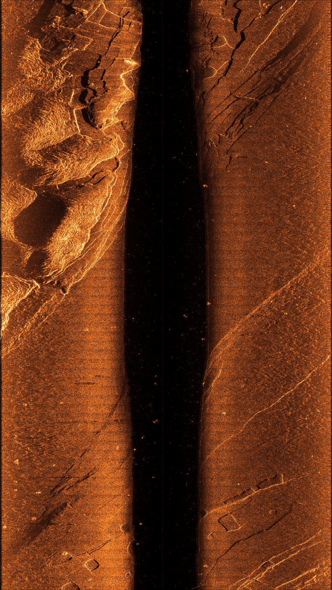

# 实测侧扫声呐去噪与高清增强管线

这套管线以声学所提供的含条纹噪声原始 MATLAB v7.3 数据为输入，输出本次确认的琥珀色侧扫图：**固定的融合宽带前级模型，随后执行增益连续与相干条纹边缘修复，最后使用 Shotwell 0.30.14 原始自动增强代码提亮暗场**。它不是对已经拼好的 PNG 运行生成式修图，也不需要历史服务器目录或联网调用大模型。

原始 MAT 和完整原生大图不放入普通 Git；模型权重、执行代码、Shotwell 对应源码、依赖、测试、校验信息及结果预览均在本仓库。运行者需自行取得原始 MAT 的使用权限并在本地提供输入文件。

## 一、输入和输出

### 1. 原始输入

```text
原始数据目录/
  Data01/
    SysPara.mat
    PortNormalModeBeamformingTotal.mat
    StbdNormalModeBeamformingTotal.mat
    PortNormalModeDepthTotal.mat
    StbdNormalModeDepthTotal.mat
  Data02/
    同上五个文件
```

支持上述分段目录，也支持直接传入含五个文件的单段目录。输入是设备输出的波束形成复数数据，不是阵元级 ADC 原始射频信号。原数据以只读方式打开，左右舷回波和检测文件的 `PingNum/PingS/PingUs` 必须一致，不静默跳过异常记录。

本次实测批次：Data01 为 1033 条物理记录，Data02 为 987 条，合计 2020 条；双舷每侧 8 个同步波束，每束每条记录 12189 个距离采样点。两侧共 16 束，不能理解为 8 次连续发射。采样率为 37650 Hz，输入声速参数为 1480 m/s。

测深文件在此处**只提供底跟踪和首回波位置，保护水柱与近底过渡区域**；不运行测深重建、SLAM 或 GPS 配准。不支持把这些文件直接省略后仍声称与当前版本相同。

### 2. 最终输出

- 完整原生增强 PNG，本批次为 **24378×8084**，约 147 MiB。
- 内嵌全部原生像素的高清竖版 PDF，便于放大查看。
- 全幅竖版预览、增强前后对比、原生像素 1:1 局部对比。
- 原生复数派生缓存、逐束浮点对数增益、边缘增益补丁，以及各阶段的参数和 SHA256 校验记录。

下面是本次确认的增强结果预览，不是原生分辨率文件。竖版延续既有显示纵横比，**不是地理正射校正，也不是超分辨率**。



完整图的像素排列不被缩放；PDF 使用展示矩阵排成竖版。原生 PNG 保持原来的像素宽高排列，所以它与竖版 PDF 的页面纵横比不同。

## 二、算法处理过程

### 1. 复数回波读取

沿用原 MATLAB 程序的 ULA 选择：先对 ULA 1 和 ULA 2 的复数波束输出求和，再求幅度；不能先取两个幅度再相加。保留 complex128 原生派生缓存，网络输入按既定协议转换为 complex64。

### 2. 固定去噪模型

唯一正式选择为 `fusion_wide_front`，即融合、宽带噪声条件、前级子带处理版本。权重是已完成选择的第 400 步检查点，不在运行时继续训练，也不切换为其它候选。

前级沿用 37650 Hz 下的负频率参考子带 −15000 至 −3000 Hz，257 taps FIR。该子带是现有处理链使用的经验假设，**不是声学所设备上下游链路已经完整标定的证明**。特征包含原生对数幅度局部对比及相对于固定参考频带的相邻复数相位增量；网络使用两级 Haar 小波表示和学习的局部与方向共识融合，输出实数对数幅度增益。

完整原生特征先计算，再用 256×2048 核心窗口和规定上下文推理；分块是执行方式，不把全幅缩成 4K。与原验证版本一致，完整拼接的物理记录进入模型；后续边缘慢变统计按原采集文件分段计算。

### 3. 水柱保护和边缘修复

先按照原始底跟踪与首回波位置给增益加平滑支持，再运行 `gain_and_commonmode`：使用末端 1024 列上下文，保存末端 512 列补丁，实际修正末端 384 个有效采样列，过渡宽度 256 列，按每段物理记录做 sigma=8 的慢变背景估计。

该方法延续内部慢变增益，并抑制边缘相对于内部参考区的额外时间共模分量。它是统计幅度修正，不是新的神经网络、已恢复的射频标定或噪声真值估计。共同有效端点和零填充必须满足协议；不以涂黑、裁边、补造回波来隐藏边缘。真正的强目标也可能影响统计量，因此不能保证无损去噪。

### 4. 原始拼接与琥珀色成像

保留 8 波束与相邻记录 4 行重叠的原 MATLAB 拼接规则，左舷距离轴反转、右舷保持正向；0–1 幅度映射使用既定的 256 色 CARIS orangecopper 琥珀色。拼接图不是带绝对坐标的地形海图。

### 5. Shotwell 自动增强

编译并运行 [Shotwell 0.30.14 原始色彩引擎](../../third_party/shotwell_0_30_14/UPSTREAM.txt)，按其 GUI 路径在最长边 360 像素的分析图上计算参数，再将同一变换用于整幅图。不是用 gamma 或 CLAHE 仿制一个近似效果。

本次实际参数是黑点 0、白点 161、阴影参数 4.5913043。增强阶段只修改索引 PNG 的 256 项 RGB 调色板，完整压缩索引流 IDAT 逐字节保持一致。原本纯黑的区域仍为纯黑。亮部存在自动拉伸带来的显示截断，暗部残余噪声也可能一起变亮；增强 PNG 不等于定量声学强度，应使用另存的浮点幅度与增益开展定量研究。

## 三、安装和运行

### 1. Linux 环境

建议 Ubuntu 22.04 或具有相同开发依赖的 Linux。本管线不依赖 Isaac Sim，不使用服务器或网络推理。

```bash
git clone https://github.com/Guanzhen-C/DeepSea-Matching-navigation.git
cd DeepSea-Matching-navigation

sudo apt-get update
sudo apt-get install -y python3-venv python3-gi python3-numpy python3-pil \
  gir1.2-gdkpixbuf-2.0 libgdk-pixbuf-2.0-dev libglib2.0-dev \
  libgee-0.8-dev valac gcc pkg-config fonts-noto-cjk

python3 -m venv --system-site-packages .venv-sonar-release
.venv-sonar-release/bin/python -m pip install -r \
  releases/sonar_denoise_enhanced_20261107/requirements.txt
```

PyTorch 的安装版本需与实际 CPU/CUDA 环境兼容；CPU 可执行同一模型但会更慢。Shotwell GUI 不必安装，增强算法使用仓库固定版本源码；本机原始版本为 0.30.14-1ubuntu6，其发行版补丁不修改增强计算。

### 2. 从原始 MAT 一次运行到高清图

```bash
.venv-sonar-release/bin/python standalone/RunFrozenSonarDenoising.py \
  --source "/实际路径/20260924_下午返航测试参数及数据(含有噪声条纹)/数据" \
  --out output/sonar_release_full_run \
  --device auto
```

输出目录必须不存在，且不得位于原始数据目录内。默认自动使用可用 CUDA，否则用 CPU；没有内存限额设置。一次只做一束完整推理，16 束依次执行；本批次派生数据需要约 10 GiB 量级的空闲磁盘，原始 MAT 另外保留。原始记录不抽样，生成预览不影响完整原生图。

如同一批原始数据需要**严格检查与本次确认图相同**，添加 `--reference-batch`。该选项逐像素索引哈希核对边缘候选，发生不同就报错并保留输出，不把跨设备浮点差异或错误输入强称为完全复现。不应将该选项用于其它航次。

### 3. 在当前项目电脑上运行

本机沿用分开的 MAT、神经网络、显示环境：

```bash
.venv-real-sonar/bin/python standalone/RunFrozenSonarDenoising.py \
  --source "data/自动化所/20260924_下午返航测试参数及数据(含有噪声条纹)/数据" \
  --out output/sonar_release_full_run \
  --mat-python .venv-real-sonar/bin/python \
  --ml-python .venv-sonar-denoise/bin/python \
  --display-python /usr/bin/python3 \
  --device auto
```

### 4. 分阶段继续

入口提供 `--stage extract|infer|render|enhance`。例如，提取已成功后可以用新环境执行推理：

```bash
.venv-sonar-release/bin/python standalone/RunFrozenSonarDenoising.py \
  --stage infer --out output/sonar_release_full_run --device auto
/usr/bin/python3 standalone/RunFrozenSonarDenoising.py \
  --stage enhance --out output/sonar_release_full_run
```

`render` 必须在 `enhance` 之前成功。各阶段拒绝覆盖已存在的自身产物；中断结果保留供检查，不自动重试或偷偷跳过记录。增强运行环境需能导入系统 GI、numpy、Pillow；标准安装中的默认 `/usr/bin/python3` 即此用途。

## 四、代码与固定版本

| 环节 | 代码或资源 |
| --- | --- |
| 原始 MAT 到最终图入口 | [RunFrozenSonarDenoising.py](../../standalone/RunFrozenSonarDenoising.py) |
| MAT 原始轴顺序和复数 ULA 求和 | [BathymetrySideScanDrawing.py](../../standalone/BathymetrySideScanDrawing.py) |
| 前级子带处理 | [MatchedSonarSignal.py](../../standalone/MatchedSonarSignal.py) |
| 固定参考相位与幅度特征 | [BandAnchoredNativeSonarFeatures.py](../../standalone/BandAnchoredNativeSonarFeatures.py) |
| 小波网络与学习融合 | [MatchedSonarWavelet.py](../../standalone/MatchedSonarWavelet.py) |
| 支持区和原始重叠拼接 | [FullMeasuredSonarProtocol.py](../../standalone/FullMeasuredSonarProtocol.py) |
| 边缘修复 | [RangeGainContinuityRepair.py](../../standalone/RangeGainContinuityRepair.py) |
| 原生无损索引编码 | [NativeSonarPaletteStream.py](../../standalone/NativeSonarPaletteStream.py) |
| Shotwell 增强和高清导出 | [EnhanceEdgeSonarShotwell.py](../../standalone/EnhanceEdgeSonarShotwell.py) |
| Shotwell 批处理适配器 | [EnhancePalette.vala](../../standalone/shotwell_reference/EnhancePalette.vala) |
| 固定模型权重 | [fusion_wide_front.pt](../sonar_denoise_20261106/weights/fusion_wide_front.pt) |
| 原始冻结源码和权重清单 | [release_manifest.json](../sonar_denoise_20261106/release_manifest.json) |

选定权重 SHA256：`faece15dfd9c9a4b028a409b6d8ee583c93287e1b6ec81afd0c274c4686073e0`。旧冻结版本和比较用 `fusion_limited_front` 继续保留用于溯源；正式入口只加载这里指定的一个模型，不混用其它算法。

## 五、测试与复现边界

```bash
PYTEST_DISABLE_PLUGIN_AUTOLOAD=1 .venv-sonar-release/bin/python -m pytest -q \
  tests/test_frozen_sonar_denoising_pipeline.py \
  tests/test_edge_sonar_shotwell_enhance.py
.venv-sonar-release/bin/python standalone/FreezeSonarDenoisingRelease.py \
  --release releases/sonar_denoise_20261106 --verify
```

本次交付检查包含真实权重和 Shotwell 原始引擎的小样本 MAT 端到端运行、整批实测输入结构核对、既有全 2020 条推理增益的完整原生渲染重放，以及固定源码和权重哈希检查。**新独立入口未在本次交付中从头重跑全部 2020 条神经推理**，不能把小样本测试称为该项完成。此前完整实测推理与审计记录仍保留，分享清单区分新旧证据。

声学所两次采集不是逐样点配对的干净真值。输出外观改善不等于真实 PSNR、无损恢复或导航精度已经提高。本版本只用于当前去噪图展示，**没有自动替换已完成导航实验的底图**。后续若使用增强强度参与匹配，需要重新开展相同输入下的对照实验。

## 六、许可证与分享范围

原项目署名与许可证继续保留。Shotwell 的三份原始源码及对应许可独立放在 [third_party/shotwell_0_30_14](../../third_party/shotwell_0_30_14)，遵循 LGPL 2.1 或更新版本。公开目录不包含声学所原始 MAT、GPS 文件、SSH 信息或任何账号密码。分享的示例仅为本次处理结果预览，不代表可以公开下载或转发原始采集数据。
