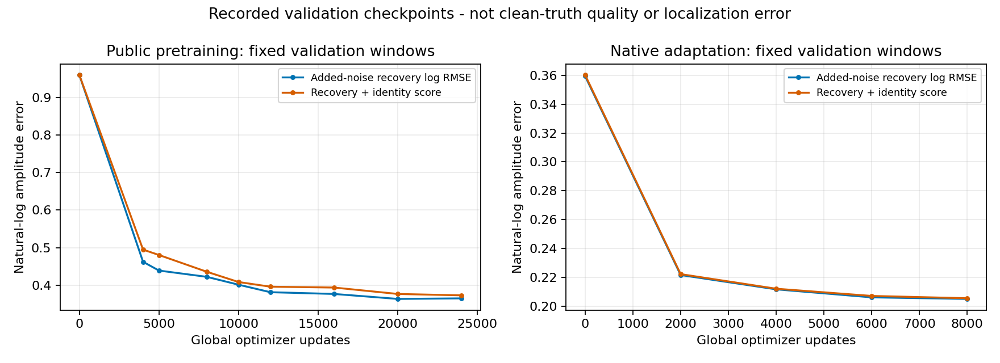

# 随机弧形条纹侧扫去噪模型的架构与训练代码

本目录发布当前random_adapted_56M声呐去噪模型的网络、训练、人工噪声构造、验证代码和已完成训练的记录。模型为56,083,513参数、宽度96的三层Haar小波卷积网络，先用公开声呐观测预训练，再用声学所观测与公开数据混合适配。它不是官方预训练MWCNN，也不是已经证明对任意声呐或真实噪声均有效的通用模型。

本次只发布代码、参数配置和脱敏训练记录，不包含原始MAT、声呐像素/复数数组、训练缓存、模型权重或TensorRT引擎。不重新训练，不修改正在运行的硬件在环算法。

## 一、阅读入口

| 内容 | 文件 |
|---|---|
| 当前实际模型与原生特征 | [NoFIRSonarWavelet.py](standalone/NoFIRSonarWavelet.py) |
| 当前使用的卷积骨干 | [LargeSonarMWCNN.py中的SonarMWCNNBackbone](standalone/LargeSonarMWCNN.py) |
| Haar正逆变换 | [PublicSonarWavelet.py中的haar和inverse_haar](standalone/PublicSonarWavelet.py) |
| 四进程训练、优化器与检查点选择 | [TrainNoFIRSonarDistributed.py](standalone/TrainNoFIRSonarDistributed.py) |
| 实际随机弧形噪声训练样本 | [RandomRippleSonarData.py](standalone/RandomRippleSonarData.py) |
| 多触发源弧形噪声与随机化 | [RandomTriggeredSonarNoise.py](standalone/RandomTriggeredSonarNoise.py) |
| 多域数据读取与预训练/适配采样 | [NoFIRSonarData.py](standalone/NoFIRSonarData.py) |
| 实际损失函数 | [TrainNativeLocalSonarWavelet.py中的fidelity_loss](standalone/TrainNativeLocalSonarWavelet.py) |
| 原训练流程入口 | [RunRandomRippleSonarTrial.py](standalone/RunRandomRippleSonarTrial.py) |
| 架构、数学量与FIR边界 | [ARCHITECTURE.md](ARCHITECTURE.md) |
| 训练过程、参数、验证和复训条件 | [TRAINING.md](TRAINING.md) |
| 输入域和数据准备约定 | [DATA_CONTRACT.md](DATA_CONTRACT.md) |
| 已完成训练记录 | [records](records) |
| 代码来源与脱敏清单 | [SOURCE_PROVENANCE.json](SOURCE_PROVENANCE.json) |

这些文件保留原函数和类，依赖闭包中包含若干早期模块。当前实例化的是NoFIRSonarMWCNN，它只使用SonarMWCNNBackbone和24参数的域仿射嵌入；并不实例化LargeSonarMWCNN类中的早期融合网络。训练器从早期模块复用fidelity_loss，不因此启用早期FIR预处理或旧网络。

## 二、这版模型与FIR的准确关系

接收观测不经过本项目FIR_only的负频带滤波；FIR_only输出也不是这版的监督标签。训练对为“已有观测加人工噪声 → 加噪前的已有观测”，推理输出是学习到的对数幅度修正。

但“NoFIR”不是“任何步骤都没有有限卷积”：原生特征使用5×65支持归一化局部均值；随机噪声载波使用33抽头色化核塑造频谱；网络也使用小波和卷积。这些运算不能与对接收信号运行FIR_only去噪混为一谈。声学所及公开数据还可能已经有上游处理，已有观测不能当作严格无噪声真值。

## 三、已经执行的训练

| 项目 | 公开数据预训练 | 混合适配 |
|---|---:|---:|
| 优化器更新步数 | 24000 | 8000 |
| DDP进程数 | 4 | 4 |
| 每进程每步样本 | 1 | 1 |
| 实际全局样本暴露次数 | 96000 | 32000 |
| 初始学习率 | 0.0001 | 0.00003 |
| 最终选中步数 | 24000 | 8000 |

预训练覆盖691个公开训练条目；适配覆盖这691个条目及48个本地侧/波束训练条目。条目不是独立航次；同一条目会抽取不同窗口、多次增强。训练源和验证源按原采集组隔离，已有审查记录未发现验证条目进入优化器。



图中是固定验证窗口上的自然对数幅度误差，不是米制定位误差，也不是完整训练逐步loss曲线；两个阶段使用的验证数据不同，不能直接比较两图纵坐标来宣称跨域精度提高。

## 四、不读取真实数据的检查

在本目录中，用已有兼容Python环境执行：

```bash
python tools/inspect_model.py
python tools/verify_release.py
PYTEST_DISABLE_PLUGIN_AUTOLOAD=1 OMP_NUM_THREADS=2 OPENBLAS_NUM_THREADS=1 python -m pytest -q tests
```

inspect_model用meta设备核对正式宽度96的参数量，用小宽度CPU网络检查零输出头和形状，不下载权重或占用GPU。测试仅使用合成数组和临时文件，不访问声学所数据，不训练56M模型。相应依赖列于requirements.txt；代码发布不要求当前机器安装或升级这些依赖。

本次公开副本的42项合成/CPU测试全部通过，正式参数量已在meta设备复核为56,083,513。测试记录见records/public_code_cpu_tests.xml及records/model_architecture_check.json。这些是代码发布检查，不是重新执行完整训练或重新验收真实去噪质量。

完整复训还需要具备合法访问权的数据、准备好的原生数组、来源清单和支持掩码，具体见TRAINING.md。脱敏后的本地路径是占位符，不是可以直接执行的现有磁盘位置；这不是附带私有数据的一键复训发行包。

## 五、来源与科学边界

架构思路参考Liu等的[Multi-level Wavelet-CNN for Image Restoration](https://arxiv.org/abs/1805.07071)及[作者代码](https://github.com/lpj-github-io/MWCNNv2)。本项目使用声呐特征、显式数据域、支持掩码和单通道对数幅度残差，不能称为论文官方声呐模型或官方预训练权重。

发布前已核对训练完成记录中的15份关键源码指纹。其余依赖记录当前发布文件的指纹，不冒称它们全部都有独立保存的原训练时指纹。机器专属路径和私网地址仅在公开副本中脱敏，模型与训练逻辑未改；源文件和导出文件的哈希分别保留。

已有训练完成、数值一致性和人工噪声验证，不等于真实去噪质量已全面验收。人工弧形条纹是增强假设，不是已标定的设备干扰物理模型；适配中已经看过的航次不能作为独立外场泛化证据。
